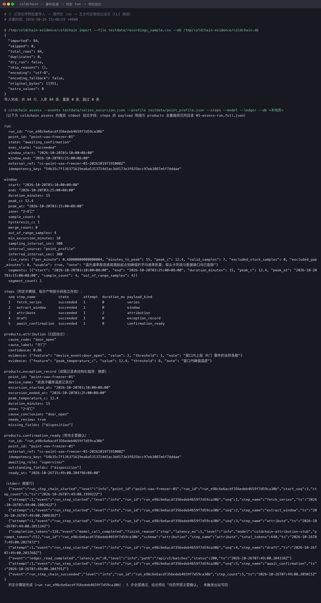
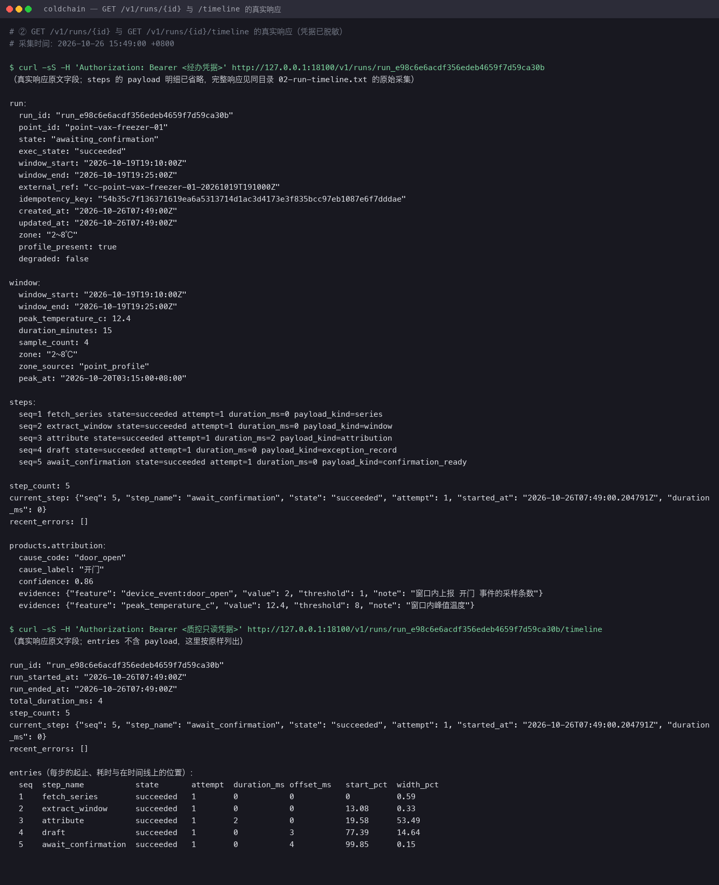
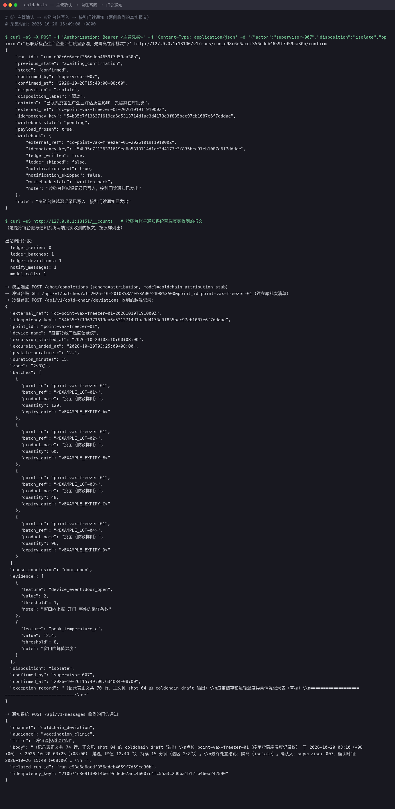
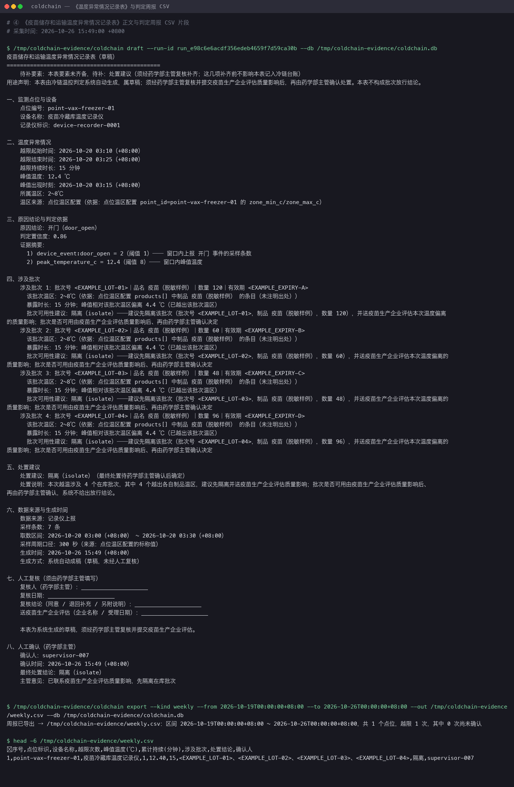

# 药品与疫苗冷链温控判定系统

> 记录仪把温度事件推进来，药学部冷链管理员几分钟内拿到**越温窗口 + 当时在库批次 + 原因判断 + 一份能直接报药事与疫苗生产企业的《温度异常情况记录表》草稿**；主管确认后，冷链台账与接种门诊通知一起落库。

疫苗冷库、接种门诊冷藏柜与药学部冷藏药品冰箱按 5 分钟粒度记录温度。本系统接管的是「越温发生后那段查证与出结论的活」：谁在什么时候被卡住、手写情况说明再二次录入台账、纸质温度表与记录仪导出对不上账、临时去找在库批次清单——这些重复步骤被收成一条可留痕的判定流程。

**批次到底能不能用，仍由疫苗生产企业评估质量影响、再由药学部主管确认决定，系统不自己下结论。**

## 适用场景 / 目标岗位

| 岗位 | 什么时候用 | 得到什么 |
|------|------------|----------|
| 药学部冷链管理员（经办） | 越温告警弹出来那一刻，要查清哪台设备、从什么时候开始、最高到多少度 | 一条越温结论：起止时间、峰值、持续分钟、所属温区、原因判断与证据、涉及批次清单 |
| 药学部主管（审核） | 拿到结论要决定这批疫苗怎么处置时 | 一份《疫苗储存和运输温度异常情况记录表》草稿，可直接送药事会与疫苗生产企业评估；确认后系统才写回台账并通知门诊 |
| 预防接种门诊护士 | 收到越温通知，要知道自己管的那台冰箱里这批疫苗暂时怎么放 | 一条通知：隔离、待企业评估等处置说明与对应批次，不含任何患者信息 |
| 质控 / 院感（调阅） | 月度质控会或内审要复盘「这批药当时为什么判成这样」 | 一次判定的完整步骤时间线：每一步起止、耗时、重试次数、模型调用与确认动作记录 |
| 药学部（周度台账） | 每周做冷链台账汇总与越温次数统计 | 一份周报 CSV：点位、越限次数、峰值、持续分钟、涉及批次、处置结论、确认人 |
| 药学部冷链管理员（经办） | 台账侧一时写不进去，越温还挂在「待补偿」上时 | 一份待补偿清单：哪条判定、哪个点位、台账还是通知没写进去、已经敲了多少次门；补发一次即补上，且不会在台账里多出一条重复记录 |

## 能力要点

- **越温窗口自动成形，脏数据形态不会被算成越温**：连续超限采样点按点位温区抽成一段窗口；缺口、时钟回拨、探头卡死三种脏数据形态各自被认出来并标在窗口上；温区从哪儿来写在结论里。
  - **越温窗口自动成形**：连续超限采样点按点位温区抽成一段窗口（起止、峰值、持续分钟、采样点数），并按「连续超限要够最短时长 + 回落要跌出迟滞带」两把尺消除空调启停造成的贴边抖动；窗口起止落在真实越限那条读数上，复核时能对着记录仪导出的表一条条核。
  - **一次异常只记一条，短时波动单独列**：没够最短越限时长的越限不生成窗口，单独归进「短时波动」列表交药师自己看（不是当成没发生过）；两段越限中间只回落了不到门槛时长、说明设备没真正恢复的，合成一条窗口并保留分段明细——台账上不会把一次断电拆成三条记录，也不会把每天开门的波动当成事故。
  - **脏数据不被算成越温**：记录仪掉线留下的数据缺口、换电池导致的时钟回拨、探头接触不良造成的读数卡死，三种形态各自被认出来并标在窗口上（缺口标断点、回拨标异常、卡死标特征）——缺口那段时间不计入越温时长，回拨区间按采样点数折算，卡死读数不进温升速率；不会凭空造出一段看着正常的越温让你去追。
  - **温区从哪儿来写在结论里**：每条结论都带温区出处（点位配置还是制品说明书条目、依据哪一条），同一台冷柜里既有疫苗又有冷藏药品时逐制品各判各的；温区没配、点位对不上、设备对不上时结论落「需人工处理」，不产出窗口——系统不猜温区，也不拿一个看着正常的假结论糊弄过去。
- **原因判断带证据，模型给的每个数字都要能在现场读数里找得到**：开门、断电、除霜、探头脱落、探头卡死、制冷异常、超量存放等候选原因逐条附特征名、数值与阈值；模型说的峰值、起止与批次号都要对得上现场读数与台账清单。
  - **原因判断带证据**：开门、断电、除霜、探头脱落、探头卡死、制冷异常、超量存放等候选原因逐条附特征名、数值与阈值；证据不足时给「原因待查」并列出缺哪项判别特征，不硬套一个原因。
  - **模型说的每个数字都要在现场读数里找得到**：模型给的峰值温度必须能在记录仪读数里找到（±0.05℃），窗口起止必须落在规则抽出的窗口内，批次号必须出现在台账在库批次清单里；对不上就把「哪个字段错在哪、依据是什么」退回给模型改一次，仍对不上就退回规则基线，并把被拦下的字段与原值留档——不会把一个现场从没发生过的温度写进异常记录表。
- **在库批次一次带出，逐批给可用性建议**：按点位与时刻从冷链台账取当时在库的批次，批次号只认台账给的；同一台冷柜里既有疫苗又有冷藏药品时，每一批按自己的温区单独给建议。
  - **在库批次一次带出**：按点位与时刻从冷链台账取当时在库的批次（`coldchain batches --point <point_id> --at <时间>` 手动查，或 `coldchain assess --steps --ledger` 在成稿那一步自动取），批次号只认台账给的；台账没查成时写「批次信息缺失，待人工核对」，台账确实没货时照实写「无在库批次」，系统不造新批次号。
  - **逐批次给可用性建议，不是一柜一锅端**：同一台冷柜里既有 2~8℃ 的疫苗又有 0~10℃ 的冷藏药品时，峰值 9℃ 对前者越限、对后者不算——每一批按自己的温区、暴露时长与偏离度数单独给建议（建议先隔离并送疫苗生产企业评估 / 按待企业评估处理），并把该批次的温区出处、暴露分钟数、偏离度数挂在建议下面；批次能不能用仍由疫苗生产企业评估质量影响、再由药学部主管确认，系统不下放行结论。
  - **越权措辞当场挡下**：建议与处置说明里出现「可放心使用」「质量不受影响」「建议放行」这类替企业或主管下结论的话，会被替换成显式标记并把命中内容留痕（成稿里写明「越权措辞过滤」），不让一份递出去的表看着干净、实际没人判过。
- **异常记录表直接成稿，缺项与降级写在稿子最上面**：稿子每个栏目都指得回一个来源字段，此刻拿不到的写「待补」而不是编一个像样的值；精度不足与规则基线降级写在稿子第一行。
  - **异常记录表直接成稿**：把点位与设备、越限起止、峰值、持续时长、温区、原因与证据、涉及批次、处置建议、数据来源与生成时间写成一份可递出去的表，稿头写明「属草稿、须经药学部主管复核并提交疫苗生产企业评估」，稿尾留主管复核签字位；稿子里每个栏目都指得回一个来源字段，此刻拿不到的一律写「待补」而不是编一个像样的值；`coldchain draft --run-id <run_id>` 直接把稿子打印出来，可重定向成附件。
  - **稿子自己会报缺项**：十个必备栏目逐项核对，缺哪几项写在稿子顶部（「待补要素」一行，用中文栏目名）；点位、温区、原因结论这类**必备要素**缺了，这份稿子就不许进台账写回载荷；涉及批次、最终处置这类**等人补**的项缺了只标 needs_review、不挡写回——台账照实收下一条「这一栏还没定」的记录，比这条记录压根不落库要好。
  - **精度不足与降级写在稿子最上面**：设备自报精度超限时，稿子第一行就写「【精度不足，仅供参考】」并给出声明值与上限值；模型不可达、结论退回规则基线时，稿子第一行写「本次原因判断来自规则基线，请重点核对」并写明降级原因——收件人打开第一眼看到的是 caveats，不是藏在末尾的附注。
- **未确认绝不写回；确认之后一次落库，写不进去可补偿**：模型与规则的产出一律停在「待主管确认」；主管确认后台账与门诊通知各落一条；台账写不进去时挂「待补偿」等人补，补发不会多记一条。
  - **未确认绝不写回**：模型与规则的产出一律停在「待主管确认」，只有主管身份的确认动作才会触发台账写入与门诊通知；未确认前出站写回调用次数为 0。这道闸写进代码——写回在**发请求之前**先问一次状态，不到「已确认」就一次出站调用都不发，不靠「记得先确认」这种约定。
  - **主管一签字，写什么就此定下**：确认那一刻，成稿与批次建议按台账字段规范组装成写回载荷并原样存下（写回侧发出去的就是这份，不在写回时重算）；成稿正文末尾补上「人工确认」小节（确认人 / 确认时间 / 最终处置结论 / 主管意见），原稿一字不动；处置结论与主管意见在审计链上各自成列，飞检问「这条为什么这么定、谁定的」，答案就在那一行里。
  - **台账写不进去不会「就当没事发生」**：写回失败先按指数退避重试（默认额外 2 次），仍失败就把这条越温挂到「待补偿」，同时留一条看得见的告警（累计敲了多少次门、最后错在哪），并进待补偿清单——台账里少一条越温这件事有人管，不会悄悄过去。
  - **补发不是重新确认，账上也不会多出一条**：补发走的是同一份固化载荷、同一把幂等键与同一个外部引用，台账侧认得出是同一次越温；已经写进去的那一处（台账或通知）连请求都不发，只补没写成的那个。
- **每个岗位只看该看的，每一步可回看，问了几次花了多少账上都有**：一把令牌一个身份，越权一律挡下并点名该找谁签；一次判定还原成步骤时间线；模型调用与人工确认落在同一条审计链上。
  - **每个岗位只看该看的**：一把令牌一个身份——记录仪只管投递温度、经办能看结论与在库批次、主管独占确认权、质控只读调阅。身份缺失、声明与凭据对不上、或者端点没声明权限要求，一律按最保守处理挡下（`403`），并在错误里点名「这事该找谁签」；不会出现「一把凭据什么都能干」，也不会出现「记录仪那把凭据能翻整个台账」。
  - **每一步可回看**：一次判定还原成步骤时间线，哪一步慢、哪一步重试过几次、哪一步降级退回规则基线，事后查得清。
  - **一张摘要看全服务在忙什么**：`GET /v1/summary` 一次给出近 24 小时的采样数、判定段数、失败段数、模型调用次数与降级率，外加此刻欠着的待确认 / 待写回 / 告警数与在跑在排队的判定数，逐小时分解直接读小时级聚合表（不回头扫原始采样）；取数失败时报错而不返回一份全 0 的摘要——全 0 会被读成「今天什么事都没发生」，而真相是「没查出来」。
  - **问了几次、花了多少，账上都有**：每次模型调用都留一条审计记录——用的哪个模型、耗时多久、输入输出多少 token、估算成本多少、这次调用成没成（答歪了、被事实校验拦下了也算失败）；人工确认动作落在同一条链上，内审一眼看得出「机器判了什么、人认了什么」。凭据与提示词原文不进这条链，只留提示词指纹。
  - **当初的结论能重跑一遍**：飞检内审前把某段历史读数离线重跑，用当初那一份温区配置重建越温窗口，与在线判定的结论逐字段比对——对得上说明当初判得没错，对不上时差异落到具体字段上。回放只读不写，不动在线判定记录、不写回台账。

## 快速开始

### 依赖

| 项 | 要求 | 说明 |
|----|------|------|
| Go | ≥ 1.22 | 编译与运行，服务端只用标准库 `net/http` |
| SQLite 驱动 | `modernc.org/sqlite` | 纯 Go 实现，无需 cgo，院内小主机可直接部署 |
| 外部系统 | 冷链台账、通知系统、模型网关 | 由院内提供，本服务通过 HTTP 访问，凭据走环境变量 |

### 安装

```bash
git clone <本仓库地址> coldchain-temp-assessment
cd coldchain-temp-assessment
go mod download          # 拉取依赖
go build -o bin/coldchain ./cmd/coldchain
```

### 配置

所有基址与凭据只从环境变量读取，仓库内提供 `.env.example` 作为填写模板：

```bash
cp .env.example .env
# 按院内真实取值填写 .env（.env 已在 .gitignore 中排除，禁止入库）
set -a && . ./.env && set +a
```

| 配置项 | 默认值 | 说明 |
|--------|--------|------|
| `COLDCHAIN_INGEST_TOKEN` | 无（必填） | 记录仪 / 边缘网关投递事件时携带的 Bearer 凭据；这个身份**只可投递**，看不到在库批次与判定结论 |
| `COLDCHAIN_OPERATOR_TOKEN` | 无（必填） | 药学部冷链管理员（经办）的凭据：触发判定、查看结论与台账、导出台账、维护温区配置；**不能确认**处置结论 |
| `COLDCHAIN_SUPERVISOR_TOKEN` | 无（必填） | 药学部主管（审核）的凭据：唯一能确认或否决处置结论的身份 |
| `COLDCHAIN_AUDITOR_TOKEN` | 无（可选） | 质控 / 院感（只读调阅）的凭据：查判定依据、步骤时间线与审计链；不配就没有调阅通道 |
| `COLDCHAIN_LEDGER_BASE_URL` | 无（必填） | 冷链台账服务基址，如 `https://ledger.internal.example-hospital.cn` |
| `COLDCHAIN_LEDGER_TOKEN` | 无（必填） | 访问冷链台账的 Bearer 凭据 |
| `COLDCHAIN_LEDGER_TIMEOUT_SECONDS` | `15` | 台账单次调用超时（秒，读写两侧共用），必须为正整数；超时按「台账不可达」处置 |
| `COLDCHAIN_LEDGER_CACHE_TTL_SECONDS` | `30` | 台账读侧缓存有效期（秒）；配成负值关闭缓存。读失败从不入缓存，过期缓存不再当作现状使用 |
| `COLDCHAIN_NOTIFY_BASE_URL` | 无（必填） | 通知系统基址，用于接种门诊 / 药事通知 |
| `COLDCHAIN_NOTIFY_TOKEN` | 无（必填） | 访问通知系统的 Bearer 凭据 |
| `COLDCHAIN_NOTIFY_TIMEOUT_SECONDS` | `10` | 通知单次调用超时（秒），必须为正整数；超时按「通知系统不可达」处置 |
| `COLDCHAIN_NOTIFY_CHANNEL` | `coldchain_deviation` | 通知渠道；院内通知系统的渠道名各家不同，按本院约定覆盖即可 |
| `COLDCHAIN_NOTIFY_AUDIENCE` | `vaccination_clinic` | 通知对象（默认预防接种门诊）；多个点位分属不同门诊时按点位覆盖更合适，本轮先给全局默认 |
| `COLDCHAIN_WRITEBACK_MAX_RETRIES` | `2` | 出站写回失败时的额外重试次数（连首次共 1+N 次调用）；`0` 表示不重试。台账短时抖动值得再敲一次门，但主管点完确认要的是当场回执，不能把一次确认拖成几分钟的等待 |
| `COLDCHAIN_WRITEBACK_BACKOFF_SECONDS` | `1` | 首次退避等待秒数，之后按指数增长并封顶在 8 秒；重试用尽仍未落成的越温挂到「待补偿」，等补发，不会静默丢弃 |
| `MODEL_BASE_URL` | 无（必填） | OpenAI-compatible 模型端点，指向 `{base}/chat/completions` |
| `MODEL_API_KEY` | 无（必填） | 模型端点凭据；缺失时服务启动即失败，不发匿名请求 |
| `MODEL_NAME` | 无（必填） | 部署的模型名，写入调用审计元数据 |
| `MODEL_TIMEOUT_SECONDS` | `30` | 模型调用超时（秒），必须为正整数 |
| `MODEL_PRICE_TABLE` | 无（可选） | 每 token 单价的 JSON 文件路径，用来估算模型调用成本；不配就把成本记成 `unknown`（「本服务不知道单价」），而不是记 `0`（「这次调用不花钱」） |
| `DATABASE_PATH` | `./data/coldchain.db` | 本地 SQLite 数据文件路径 |
| `ARCHIVE_DIR` | `./data/archive` | 冷数据归档目录 |

> 缺少任一必填项时，`coldchain serve` **启动即报错退出（退出码 78）**，不会回落到本地替身，也不提供 localhost 默认基址。

### 构建与验证

```bash
go build ./...                 # 编译全部包
go vet ./...                   # 静态检查
go test ./... -v               # 单元测试
go run ./cmd/coldchain version # 打印版本号，确认二进制可执行
```

想一次看到可核对的结果，用随附的一条命令验证脚本（自带协议替身，运行时数据落在临时目录）：

```bash
bash scripts/verify.sh
```

它按「查环境 → 编译 → 跑测试 → 起服务 → 灌一条事件 → 打印判定结论与步骤时间线」走一遍，
最后打印一条真实的越温判定（起止、峰值、持续分钟、原因判断、结论停在「待药学部主管确认」），
并核对项目目录里没有留下数据库、日志或构建产物。详见 [验收与自检](#验收与自检)。

### 取数：公开冷链数据集（离线对照基准用）

跑 `coldchain bench` 的对照基准与性能压测需要公开冷链数据集，用随附脚本取数：

```bash
bash scripts/fetch_datasets.sh          # 取数 + 完整性校验（已缓存且 SHA256 匹配则跳过下载）
bash scripts/fetch_datasets.sh --check  # 只校验本地缓存，不联网
```

取的是 **VCC-CPLD**（Zenodo，CC BY 4.0，445,603 条 1 分钟粒度冷链时序，带 `safe_to_use_flag_t_plus_H` 标签）
与 **LogTag Nepal**（Mendeley Data，CC BY 4.0，526 份真实记录仪 CSV）两个公开数据集，
来源、许可证、字段口径与校验阈值见 `docs/datasets.md`。**断网时脚本降级退出并提示改用 `testdata/` 样例，
不会产出空数据集冒充成功。**

取完数就能跑离线对照基准：

```bash
bash scripts/bench_window.sh            # 真实规模跑一遍，打印窗口误差 / 归因一致率 / 耗时三项指标
bash scripts/bench_window.sh --check    # 只校验已落盘的报告，不重跑
```

指标口径与实测结果见 `docs/bench.md`；报告落在 `data/bench_baseline.json`（运行时目录，不入库）。

### 主命令速查

```bash
coldchain serve      # 启动常驻 HTTP API 服务（常态运行形态）
coldchain assess     # 对一条温度事件做判定并打印结论
coldchain import     # 批量导入记录仪导出的温度时序
coldchain replay     # 离线回放历史事件，重建判定结论
coldchain draft      # 打印一条判定的《温度异常情况记录表》正文
coldchain batches    # 查冷链台账的在库批次清单（按点位与时刻）
coldchain archive    # 归档过期原始事件（gzip JSONL，从热表清理）
coldchain export     # 导出判定周报 CSV（--kind hourly 出小时级聚合 CSV）
coldchain bench      # 跑离线对照基准
coldchain version    # 打印版本号
```

周报与归档这两条是每周 / 每月固定跑一次的批处理通道：

```bash
# 每周一导一次上周的周报（贴进台账用）
coldchain export --from 2026-10-19T00:00:00+08:00 --to 2026-10-25T23:59:59+08:00 --out 周报.csv

# 每月把一个月前的原始采样搬出热表（先干跑看一眼要搬多少）
coldchain archive --before 2026-10-01T00:00:00+08:00 --dir ./data/archive --dry-run
coldchain archive --before 2026-10-01T00:00:00+08:00 --dir ./data/archive
```

## 命令 / API / 配置说明

### 关键配置项

凭据位一律来自环境变量，进程内不落盘、日志中按 `[REDACTED]` 脱敏；出站基址必须带 `http://` 或 `https://` 协议与主机名。**完整配置项清单（含全部可选项）见「快速开始 → 配置」的表**，下面是缺一项就起不来的必填项：

| 配置项 | 默认值 | 说明 |
|--------|--------|------|
| `COLDCHAIN_INGEST_TOKEN` | 无（必填） | 记录仪 / 边缘网关投递事件用的 Bearer 凭据；这个身份只能投递，看不到判定结论与在库批次 |
| `COLDCHAIN_OPERATOR_TOKEN` | 无（必填） | 药学部冷链管理员（经办）的凭据：触发判定、查结论与时间线、导台账、维护温区配置；**不能确认**处置结论 |
| `COLDCHAIN_SUPERVISOR_TOKEN` | 无（必填） | 药学部主管（审核）的凭据：唯一能确认或否决处置结论的身份 |
| `COLDCHAIN_LEDGER_BASE_URL` | 无（必填） | 冷链台账服务基址（如 `https://ledger.internal.example-hospital.cn`）；读侧与写侧都走它 |
| `COLDCHAIN_LEDGER_TOKEN` | 无（必填） | 访问冷链台账的 Bearer 凭据 |
| `COLDCHAIN_NOTIFY_BASE_URL` | 无（必填） | 通知系统基址，用于接种门诊 / 药事通知 |
| `COLDCHAIN_NOTIFY_TOKEN` | 无（必填） | 访问通知系统的 Bearer 凭据 |
| `MODEL_BASE_URL` | 无（必填） | OpenAI-compatible 模型端点基址，实际请求打到 `{base}/chat/completions` |
| `MODEL_API_KEY` | 无（必填） | 模型端点凭据；缺失时服务启动即失败，不发匿名请求 |
| `MODEL_NAME` | 无（必填） | 部署的模型名，写入每次调用的审计元数据 |
| `COLDCHAIN_AUDITOR_TOKEN` | 无（可选） | 质控 / 院感（只读调阅）的凭据；不配就没有调阅通道，服务照常起 |

> 缺任一必填项时 `coldchain serve` **启动即报错退出（退出码 78）**，不回落本地替身，也没有 localhost 默认基址。

判定门槛不在环境变量里，在点位温区配置（`--profile` 指向的 JSON）里——它决定「这一段算不算越温」，按点位逐个配：

| 配置项 | 含义 | 配错的后果 |
|--------|------|-----------|
| `zone_min_c` / `zone_max_c` | 该点位温区上下限（℃，闭区间） | 配错整柜的判定结论全错；系统不猜、不用默认值顶替，配置缺失一律转人工 |
| `sample_interval_sec` | 标称采样周期（秒），如 300 | 决定「连续越限多少分钟」怎么折算；不配则按墙钟折算（偏宽松） |
| `min_excursion_minutes` | 成立越温窗口的最短连续时长（分钟），0 表示不设门槛 | 配得过大会漏掉真实短时越温，过小则把开关门抖动算成越温 |
| `hysteresis_c` | 迟滞带（℃）：越限后要回落到 `zone_max_c - hysteresis_c` 以内才算结束 | 必须小于温区宽度（否则越限窗口永远关不掉）；一般 0.5～1℃ 足够吃掉空调启停抖动 |
| `accuracy_limit_c` | 该点位的测温精度上限（℃） | 收紧后精度不足的读数会被标「精度不足，仅供参考」 |
| `products[]` | 在库制品各自的温区与出处 | 同一台冷柜里既有疫苗又有冷藏药品时，逐制品各判各的；没登记的制品会被点名转人工 |

### CLI 子命令 / 接口端点

| 命令或路径 | 用途 | 关键参数 |
|------------|------|----------|
| `coldchain serve` | 启动 HTTP API 服务 | `-addr`（默认 `:8080`） |
| `coldchain assess` | 判定单条事件或一段时序 | `--events`（温度事件 JSON 文件，单个事件对象或事件数组）、`--profile`（点位温区配置 JSON；给出后打印 `{run, window}` 判定结论；温区缺失或点位不匹配时结论落「需人工处理」并以非 0 退出码收尾）、`--db`（给定时：事件文件是多点位采样序列时，温区配置改从该库的点位温区配置登记簿里按点位取——配置登记一次，各台机器跑批按同一份口径判；登记簿里没有该点位则明确报错并以非 0 退出码收尾，系统不猜温区、不用默认值顶替） |
| `coldchain assess --steps` | 跑完整判定步骤链并打印步骤时间线 | 需配合 `--profile`；`--db`（给出后每步产物落进 `run_steps` 表，run 状态落进 `runs` 表）；按「取数 → 抽越限窗口 → 归因 → 成稿记录表 → 停在待主管确认」五步执行，输出 `steps` 时间线与按分码取回的 `products`；任一步失败时 run 落失败态并保留此前产物与失败原因，以非 0 退出码收尾 |
| `coldchain assess --steps --model` | 同上，但归因走模型端点（端点 / 凭据 / 模型名取自 `MODEL_BASE_URL` / `MODEL_API_KEY` / `MODEL_NAME`） | 模型端点超时、不可达、响应不合协议、输出未过结构化校验或与现场读数对不上时，自动退回规则基线归因：`run.degraded=true`、`run.degrade_reason` 记错误码、归因置信度封顶 0.60、成稿注明「归因来自规则基线、须人工重点核对」；结论仍停在待主管确认，不写台账、不发通知 |
| `coldchain assess --steps --ledger` | 同上，但在库批次清单走冷链台账读侧（基址 / 凭据取自 `COLDCHAIN_LEDGER_BASE_URL` / `COLDCHAIN_LEDGER_TOKEN`） | 成稿那一步按越温窗口起点去台账查在库批次：查到了就逐批次给可用性建议（批次号原样引用台账给的，不生成新号）；台账没查成时成稿写「批次信息缺失，待人工核对」、`batch_lookup.status=unavailable`、`missing_fields` 含 `batches`，判定本身不失败（结论仍停在待主管确认）；批次归属与点位对不上时整份清单落歧义、同样转人工；与 `--batches` 同时给出时以本地清单为准 |
| `coldchain batches` | 查冷链台账的在库批次清单（操作员入口：处置越温前先看这个点位当时库里有什么货） | `--point`（点位标识，必填）、`--at`（查询时刻，RFC3339 含偏移，缺省取当前时间）；基址 / 凭据取自 `COLDCHAIN_LEDGER_BASE_URL` / `COLDCHAIN_LEDGER_TOKEN`；stdout 出查询结果 JSON（含 `status`：`ok` / `empty` / `unavailable` / `ambiguous`）、stderr 出人话摘要；台账没查成或批次归属有歧义时以非 0 退出码收尾 |
| `coldchain import` | 批量导入记录仪 CSV | `--file`（记录仪导出 CSV 路径）、`--dry-run`（只校验不落库，跳过统计与实跑一致）、`--db`（覆盖 `DATABASE_PATH`）；有行被跳过时逐条原因写 stderr 并以非 0 退出码收尾 |
| `coldchain replay` | 离线回放历史事件，重建越温窗口并与当初在线判定的结论逐字段比对 | `--point`（回放覆盖的点位，必填）、`--from` / `--to`（回放区间，RFC3339 带偏移，必填）、`--profile`（点位温区配置 JSON；不给时用当初在线判定随 run 落库的那一份「当初的口径」）、`--archive`（从归档文件读采样；不给时从本地库读）、`--db`（覆盖 `DATABASE_PATH`）；输出含逐段窗口、字段级差异与「在线有、回放重建不出」的清单；存在字段级差异时以非 0 退出码收尾；回放不落库、不写回台账 |
| `coldchain draft` | 打印一条判定已经生成的《疫苗储存和运输温度异常情况记录表》正文（可直接重定向成附件） | `--run-id`（判定 run 标识，必填）、`--db`（覆盖 `DATABASE_PATH`）；正文从库里按成稿分码取回，打印的是当初判定那一刻渲染出来的稿子，不重新渲染、不重新判定；该判定尚未成稿时以非 0 退出码收尾 |
| `coldchain export` | 导出周报 CSV（一行一个点位）或小时级聚合 CSV（一行一个点位一个小时桶） | `--from` / `--to`（统计区间，RFC3339 带偏移，必填）、`--kind`（`weekly` 周报 / `hourly` 小时级聚合，默认 `weekly`）、`--point`（只导某个点位，不给则全部）、`--out`（导出文件路径，不给则写 stdout）、`--db`（覆盖 `DATABASE_PATH`）、`--tz-offset`（院内本地时区偏移分钟数，默认 480）、`--refresh-aggregates`（导聚合前先重算小时桶，默认开）；CSV 带 UTF-8 BOM、中文固定表头，Excel 双击直接看；未确认的判定在处置结论一栏写「待确认」，不拿系统建议冒充人的结论；区间倒置或 `--kind` 取值非法时以非 0 退出码收尾 |
| `coldchain archive` | 把过期原始事件归档成 gzip JSONL 并从热表清理 | `--before`（归档截止时刻，该时刻及之前的原始采样被归档，RFC3339 带偏移，必填）、`--dir`（归档目录，默认取 `ARCHIVE_DIR`）、`--point`（只归档某个点位，不给则全部）、`--dry-run`（只统计将被归档的条数，不写文件也不清热表）、`--db`（覆盖 `DATABASE_PATH`）、`--tz-offset`（默认 480）；**先落盘、后删表**：归档文件写不成功就绝不删热表里的行；归档文件一行一个采样对象，「文件行数 == 移出热表条数」可逐行核对；文件名带点位与时间区间；没有过期数据时按成功收尾（不是失败） |
| `coldchain bench` | 在公开冷链数据集上跑离线对照基准：越限窗口误差、规则基线归因 Top-1 一致率、真实规模耗时 | `--dataset`（数据集 CSV 路径，默认 `data/datasets/vcc-cpld/vaccine_coldchain.csv`）、`--out`（报告落盘路径，默认 `data/bench_baseline.json`）、`--tolerance-c`（温区相对设定点的容差，默认 3）、`--context`（归因上下文采样条数，默认 5）、`--hysteresis-c`（迟滞带，默认 0.5）、`--repeat`（重复运行次数，默认 1；≥2 时核对确定性指标是否逐字一致）、`--max-error-samples`（窗口误差上限，默认 1）、`--max-seconds`（耗时上限，默认 30）；数据集不存在或行数不足 40 万条时报错退出；窗口误差或耗时越线时以非 0 退出码收尾 |
| `POST /v1/events/coldchain-temperature` | 记录仪投递温度事件 | Bearer 鉴权（投递通道身份）；请求体为单个温度事件 JSON，字段含 `point_id`、`device_id`、`device_name`、`measured_at`（RFC3339 带偏移）、`temperature_c`（量程 -80～120）、`unit`（`C` / `F`）、`humidity_pct`、`battery_pct`、`accuracy_c`、`source`（`recorder` / `edge-gateway` / `manual-upload`）、`alarm_flag`、`events[]`（`door_open` / `power_loss` / `defrost`）；完整字段规范见「对接现有系统」与 `api/openapi.yaml`；返回 202 与 `event_id`、`duplicate`、`point_id`、`measured_at`、`run_id`、`note`（同一采样重复投递时 `duplicate=true`，不新增事件） |
| `POST /v1/imports/temperature-series` | 批量导入记录仪导出的 CSV | Bearer 鉴权；请求体为 CSV 原文（表头驱动，按列名取值）；查询参数 `dry_run=true` 只校验不落库；回执给出 `imported` / `skipped` / `total_rows` / `duplicates` 与逐条 `skip_reasons`，并报告文件编码 `encoding` / `encoding_fallback`、被忽略的多余列 `extra_columns` 与整列缺失的 `missing_columns` |
| `GET /v1/runs/{id}` | 查看一次判定的总体状态、窗口摘要与步骤时间线 | Bearer 鉴权；路径参数 `id`（判定 run 标识）；响应含 `run`（业务状态、执行态、窗口起止、外部引用、写回状态、温区）、`window`（越温窗口摘要：起止、峰值、持续分钟、采样数、温区来源）、`steps`（每步序号、名称、状态、尝试次数、起止、耗时与位置坐标）、`current_step`（当前停在哪一步）、`recent_errors`（最近失败，含错误码）与 `products`（按分码取回的越限窗口、归因结论、成稿草稿）；run 不存在返回 `404 E_NOT_FOUND` |
| `GET /v1/runs/{id}/timeline` | 查看一次判定的运行时间线（哪一步慢、哪一步重试过、现在停在哪） | Bearer 鉴权；路径参数 `id`；响应含 `run_started_at` / `run_ended_at` / `total_duration_ms`、`entries`（每步的名称、状态、尝试次数、起止、`duration_ms` 与 `duration_us`、相对起点的 `offset_ms` / `offset_us` 与轨道上的 `start_pct` / `width_pct`）、`current_step` 与 `recent_errors`；位置坐标按链上次序单调推进，两步不重叠；不返回产物正文（正文在 `/v1/runs/{id}` 按分码取回） |
| `GET /v1/runs/{id}/audit` | 调阅一次判定的模型调用与确认动作审计链（内审 / 飞检用） | Bearer 鉴权；路径参数 `id`；响应含 `entry_count` / `model_call_count` / `confirmation_count`、`total_prompt_tokens` / `total_completion_tokens` / `total_tokens`、`known_cost_amount` / `cost_currency` / `cost_status`（`known` 全算得出 / `partial` 部分算得出 / `unknown` 全算不出）与 `entries`（每条的序号、类型、步骤名、模型名、结果状态、是否降级、错误码、耗时、token 数、成本、提示词指纹与长度、发生时刻）；审计链里没有凭据与提示词原文；run 不存在返回 `404 E_NOT_FOUND` |
| `POST /v1/runs/{id}/confirm` | 药学部主管确认处置结论（**唯一由人推进业务状态的入口**），确认成立后触发出站写回 | Bearer 鉴权 + 需 `supervisor` 身份（经办 / 只读 / 投递通道一律 `403 E_ROLE_REQUIRED`，并在错误里点名「这事该找谁签」）；路径参数 `id`；请求体 `{"actor":"<主管工号>","disposition":"isolate","opinion":"<处置说明，可选>"}`——`actor` 是确认人（必填，处置结论要能落到具体的人身上）、`disposition` 取值为 `isolate`（隔离）/ `release`（放行）/ `scrap`（报损）/ `pending_manufacturer_evaluation`（待疫苗生产企业评估，默认），域外取值报 `400 E_VALIDATION`；确认时把成稿与批次建议按台账字段规范组装成写回载荷并**固化**（此后写回侧原样发出，不重新算），成稿正文末尾补上「人工确认」小节（确认人 / 确认时间 / 最终处置结论 / 主管意见）；确认成立之后触发出站写回：**先写冷链台账的越温记录，再发接种门诊通知**，两处各发一次；响应含 `previous_state` / `state` / `confirmed_by` / `confirmed_at` / `disposition` / `external_ref` / `idempotency_key` / `writeback_state` / `payload_frozen` 与 `writeback`（`ledger_written` 台账写没写进去、`notification_sent` 通知到没到、`ledger_error` / `notification_error` 各自的错误码、`ledger_skipped` / `notification_skipped` 重放时是否跳过、`writeback_state`）；写回失败**不推翻这次确认**——结论已经定了，缺的是台账里那一条，它会挂到「待补偿」等人补 |
| `POST /v1/runs/{id}/reject` | 药学部主管否决这条判定 | Bearer 鉴权 + 需 `supervisor` 身份；请求体 `{"actor":"<主管工号>","opinion":"<否决理由，可选>"}`；状态落到 `rejected`，**不产生任何写回载荷、不触发出站调用**——被否决的判定不写冷链台账，台账里多一条没发生过的越温比少记一条更麻烦；`assessed` 与 `awaiting_confirmation` 两种状态都可否决 |
| `GET /v1/runs` | 查判定台账清单：一段时间内判过哪些越温 | Bearer 鉴权 + 需 `run_read` 权限（经办 / 主管 / 只读岗持有，投递通道不持有）；查询参数 `point_id`（限点位，缺省不限）、`from` / `to`（限窗口起点区间，闭区间，只接受 RFC3339 带偏移的时刻——只给日期会被明确拒掉而不是替现场猜一个时区）；响应含 `count` 与 `runs`（每条给 `run_id`、`point_id`、业务状态 `state`、执行态 `exec_state`、窗口起止、`external_ref`、`idempotency_key`、`writeback_state`、温区 `zone`、是否降级 `degraded`），按窗口起点升序；未设窗口的采样不计入 |
| `GET /v1/points` | 查点位温区配置清单：这些冷柜现在按什么温区判 | Bearer 鉴权 + 需 `run_read` 权限；响应含 `count` 与 `profiles`（每份给 `point_id`、`zone_min_c` / `zone_max_c`、`sample_interval_sec`、`min_excursion_minutes`、`hysteresis_c`、`accuracy_limit_c` 与逐制品温区 `products`），按 `point_id` 升序；这是**当前口径**，已判定的历史结论仍按判定当时的配置快照复算 |
| `PUT /v1/points/{point_id}/profile` | 登记或更新一个点位的温区配置（改的是判定口径） | Bearer 鉴权 + 需 `profile_write` 权限（经办与主管持有；只读岗 `403 E_ROLE_REQUIRED`，投递通道不持有）；请求体是**整份**配置：`zone_min_c` / `zone_max_c`、`sample_interval_sec`（采样周期，秒）、`min_excursion_minutes`（成立越温窗口的最短持续分钟数）、`hysteresis_c`（迟滞带）、`accuracy_limit_c`、逐制品温区 `products`；校验口径与判定时完全一致：`zone_min_c` 不得大于 `zone_max_c`、温区不得超出记录仪量程、`min_excursion_minutes` 与 `sample_interval_sec` 必须为正数（**留空等于「不知道」，系统不替现场填默认值**）、迟滞带不得盖住整个温区；**校验不过就不落库**，库里那份配置原样留着继续可用；路径里的 `point_id` 与请求体里的 `point_id` 不一致直接拒绝；响应含登记生效的整份配置与写入时刻 |
| `GET /v1/writebacks/pending` | 查看待补偿清单：哪些越温还没写进台账 / 没通知到门诊 | Bearer 鉴权 + 需 `run_read` 权限（经办 / 主管 / 只读岗持有，投递通道不持有）；响应含 `pending_count`（还没写成的写回记录条数）、`open_alert_count`（还挂着的告警条数）、`items`（每条的 `run_id`、`target`、`state`、`external_ref`、`idempotency_key`、`error_code` / `error_detail`、`attempts`（累计出站调用次数）、`failures`（累计失败轮次）、`run_state`、`point_id` 与 `updated_at`）与 `alerts`（每条告警的定位、错误码、累计次数、首次与最近失败时刻）；待写回数量按最早失败的排在最前 |
| `POST /v1/runs/{id}/writeback/retry` | 对一条待补偿的判定触发补偿重放（把上次没送到的那一份再送一遍） | Bearer 鉴权 + 需 `writeback_retry` 权限（经办与主管持有；只读岗 `403 E_ROLE_REQUIRED`）；路径参数 `id`；请求体为空对象；**补发不重新判定、不重新确认**：载荷、幂等键与外部引用都是主管确认那一刻定下的那份，台账侧认得出是同一次越温，不会多出一条记录；已写成的那一处连请求都不发；响应含 `ledger_written` / `ledger_skipped`、`notification_sent` / `notification_skipped`、各自的 `ledger_attempts` / `notification_attempts`（本次实际发起的出站调用次数）、`writeback_state`（`pending` 仍待补偿 / `written_back` 已补上）与 `note`；该 run 没有待补偿目标时返回 `409 E_ILLEGAL_TRANSITION` |
| `GET /v1/summary` | 运行摘要：服务自己在跑的这 24 小时里发生了什么（只读看板） | Bearer 鉴权 + 需 `run_read` 权限（经办 / 主管 / 只读岗持有，投递通道不持有）；响应分四组——**窗口内发生的**（`events` 采样条数、`runs` 判定段数、`failed_runs` 最终失败段数、`degraded_runs` 结论降级段数、`model_calls` 模型调用次数、`degraded_model_calls` 降级次数、`failed_model_calls` 失败次数、`degrade_rate` 降级率 = 降级次数 ÷ 模型调用次数）、**此刻还欠着的**（`awaiting_confirmation` 停在待主管确认的判定数、`pending_writebacks` 还没写进台账的写回数、`open_writeback_alerts` 还挂着的告警数）、**此刻在动的**（`running_runs` / `queued_runs` / `retrying_runs`）、以及**逐小时分解**（`hourly` 每桶给 `hour_start` / `event_count` / `excursion_count` / `peak_temperature_c` / `points`，来自小时级聚合表）；同时给出统计窗口 `window_start` / `window_end` / `window_hours` 与覆盖情况 `hourly_covered_hours`；`notes` 里有需要人看的事（欠账 / 失败 / 聚合缺口），一切正常时为空；**只读**——不推进任何业务状态，也不发任何出站请求 |
| `GET /healthz` | 服务存活检查（无鉴权） | 无 |
| `GET /v1/version` | 服务名称与版本（无鉴权） | 无 |

### 错误与降级

| 场景 | 表现 | 处理方式 |
|------|------|----------|
| 缺少必填配置项 | 启动即退出，退出码 78，打印缺失项清单 | 按 `.env.example` 补齐后重启；服务不静默降级到本地替身 |
| 判定结果形状重复登记（同一个结果类型名挂了两种形状） | 启动即退出，退出码 78，打印冲突的结果类型名 | 核对结果形状登记：一个结果类型名只允许一种形状；冲突时服务起不来，避免带着形状对不上的结论写台账 |
| 某一步的产物形状未登记、或与登记的形状对不上 | 该步落 `failed` 并记错误码，产物不落库 | 检查该步的结果分码是否已在结果形状注册表登记，处理器返回的载荷类型是否就是登记的那一种 |
| 请求缺少或携带错误凭据 | `401`，响应体含 `E_UNAUTHORIZED` | 核对 `COLDCHAIN_INGEST_TOKEN` 与调用方配置 |
| 温度超出量程（-80～120℃） | `422`，响应体含 `E_RANGE` | 该条事件拒收并说明原因，其余事件照常处理 |
| 事件字段缺失或取值非法 | `400`，响应体含 `E_VALIDATION` | 按接口规范补齐字段后重投；脏行在批量导入时逐行给出跳过原因 |
| 导入文件既不是合法 UTF-8 也不是合法 GBK | `400`，响应体含 `E_VALIDATION` | 用 Excel「CSV UTF-8」另存一次后重导；不硬解成乱码入库 |
| 导入文件是 GBK 编码 | 导入成功，回执 `encoding_fallback=true` | 回执已注明回退解析；事件上带同样标注，事后核对时可见 |
| 点位温区配置缺失 | 判定结论落「需人工处理」，不产出窗口结论 | 由信息科补录点位温区配置后重跑；系统不猜温区、不用默认值顶替 |
| 点位温区配置写坏了（温区颠倒 / 门槛非正数 / 超出量程 / 迟滞带盖住温区） | `PUT /v1/points/{point_id}/profile` 返回 `400 E_VALIDATION`，错误细节点名是哪一项不合法 | 改对后再登记；**库里原来那份配置没被动过**，继续可用——写坏的配置进了登记簿，下一次判定就会拿一份错温区算出「一切正常」的结论 |
| 温区配置的路径点位与请求体点位不一致 | `400 E_VALIDATION`，错误细节写明两处分别是什么 | 核对这份配置到底属于哪台冷柜；悄悄挑一个会让配置挂到错误的冷柜上 |
| 判定台账查询的区间参数格式不对（只给日期 / 不是时刻 / 终点早于起点） | `400 E_VALIDATION`，错误细节给出要求的格式 | 补成 RFC3339 带偏移的时刻再查；日期被悄悄解释成某个时区的零点，清单就会少算或多算一整段越温，而清单看起来「正常」，没人会去核 |
| 读数点位与温区配置对不上 | 判定结论落「需人工处理」，窗口为 `null`，绑定状态 `ambiguous` 并写明两个点位 | 核对这条读数是不是发到了别的冷柜；系统不取其中一方凑合 |
| 读数设备不在点位登记的设备清单内，或同一设备登记了两条 | 判定结论落「需人工处理」，错误信息点名设备编号 | 由信息科核对该冷柜实际挂的是哪台记录仪并更正设备清单 |
| 在库批次所属的制品没有登记温区 | 判定结论落「需人工处理」，未映射制品名单列出制品名与批次号 | 补登记该制品的温区与出处；「在库有货、温区没登记」不能默认成「这批没事」 |
| 设备自报测温精度超出点位上限（或超出该类设备规范） | 判定照出，精度栏标「精度不足，仅供参考」并写明自报值与采用的上限 | 换一台精度合规的记录仪，或把该点位的 `accuracy_limit_c` 调到实际设备水平；该标注会一路带到归因结论与成稿 |
| 读数越限但连续时长没到 `min_excursion_minutes` | 不成立越温窗口；结论里的 `excursions` 段写明越限了几条、几段、最长确认时长多少，`transient_excursions` 段逐条列出这段波动的起止、峰值与时长 | 这是波动不是越温：确认时长够门槛才成窗口；复核时先看 `excursions` 与 `transient_excursions` 两段，别把「没窗口」当成「没越限」 |
| 两段越限中间只回落了不到门槛时长 | 合成一条越温窗口，窗口上标 `segment_count` 与分段明细 `segments`，并记 `recovery_minutes` | 说明设备没有真正恢复，属同一次异常；分段明细留着，复核时能看出这次是「冲出去又回来一次」还是连续一段——后者往往意味着设备在反复启停，该查设备而不是先查那批疫苗 |
| 两段越限中间回落时间够了一个门槛时长 | 不合成，各自成一条窗口 | 冰箱确实在温区内待够了时长，那是两次独立异常，台账上分开记才对得起账 |
| 两段越限分处温区两侧（一段偏热、一段偏冷） | 不合成，各自成一条窗口 | 偏热与偏冷是两回事，合成一条会让「峰值取哪一侧」说不清 |
| 点位配置的迟滞带 `hysteresis_c` 不小于温区宽度 | 判定落「需人工处理」，错误信息点名迟滞带与温区宽度 | 迟滞带盖住整个温区会让越温窗口永远关不掉；把迟滞带改到温区宽度以内（一般 0.5～1℃ 足够） |
| 采样周期 `sample_interval_sec` 或最短越限时长 `min_excursion_minutes` 配成负数 | 判定落「需人工处理」，错误信息点名配置项与取值 | 门槛配错会让「这一段算不算越温」没法回答；改成非负整数后重跑 |
| 点位没配 `sample_interval_sec` | 按相邻采样间隔的中位数推断周期，结论里标 `interval_source=inferred`，并把推断值写进 `inferred_interval_sec` | 由信息科补录点位标称周期；推断值与配置值不一致时，两者在结论里都写明，供复核时判断是不是配置过期了 |
| 采样中断（相邻读数间隔超过 3 个采样周期） | 判定照出，窗口上标 `breakpoint_count` 与 `data_gaps`（缺口起止、缺了多少分钟、约缺几条采样） | 缺口那段时间不计入越温时长（按墙钟折算会把断线算成越温）；温升速率也不跨缺口连线。补齐记录仪供电或网络后再跑一次 |
| 记录仪时钟回拨（换电池、断电重启、网关重发历史数据） | 判定照出，窗口上标 `clock_regressions`（回拨了多少分钟、前后两条读数的原始时刻），窗口起止改用修正后的单调时间轴 | 回拨区间的持续分钟按采样点数折算，不按墙钟（按墙钟会算出负数时长）；原始时刻仍保留在读数序列里，必要时向厂家核对记录仪时钟 |
| 探头卡死（连续 3 条读数数值完全相同，且不在温区中值上） | 判定照出，窗口上标 `probe_stuck_spans`；该段读数不计入温升速率 | 更换或校准探头后重跑；卡死段的读数仍计入窗口采样条数（那是记录仪当时报的值），但不用它定义「温升多快」 |
| 读数数值恒定在温区中值上 | 不标探头卡死 | 冰箱稳在温区中值属正常工况，与「探头不动」分不开，标了会误伤 |
| 模型服务不可达 / 超时 | `E_MODEL_UNAVAILABLE` / `E_MODEL_TIMEOUT` | 退回规则基线归因：run 标 `degraded=true`、记 `degrade_reason`，归因置信度封顶 0.60，成稿**顶部**注明「本次原因判断来自规则基线，请重点核对」并写明降级原因；判定停在待主管确认，状态不被推进、不写台账 |
| 模型端点回了非兼容响应（连不上 JSON、没有 `choices`、输出被长度上限截断） | `E_MODEL_PROTOCOL` | 同上走降级路径；先核 `MODEL_BASE_URL` 是否指向真正的兼容端点、模型是否支持结构化输出，重试无用就别再重发 |
| 模型端点限流（HTTP 429） | `E_MODEL_UNAVAILABLE` | 退避后重试；连着限流就先降级，不占判定流程 |
| 模型输出未通过结构化校验（必填缺失、类型错、枚举越界、不是 JSON） | `E_MODEL_SCHEMA_INVALID` | 把不合规的字段与原因退回给模型重问一次；仍不合规则走降级路径，判定步骤层不再重试 |
| 模型输出与现场事实不符（峰值温度在读数里找不到、窗口起止越界、批次号不在台账清单里） | `E_MODEL_FACT_MISMATCH` | 带校验反馈重问一次（把被拦下的字段、原值与依据一并告诉模型）；仍不符则走降级路径、判定步骤层不再重试，被拦下的字段与依据留档在事实校验记录里 |
| 降级结论被当成「已查实」的结论往下用 | 归因产物带 `degraded=true` 与逐条候选标注「降级结论（规则基线）」，置信度封顶 0.60（精度不足时更严，封顶 0.50） | 复核时先看 `degraded` 标记再谈原因；降级结论只到草稿，须主管重点核对后才能决定批次处置 |
| 模型调用成本算不出来（没配 `MODEL_PRICE_TABLE`，或表里没有这个模型） | 审计记录 `cost_status=unknown`，`cost_amount` 为空 | 补上单价表文件并重启服务；`unknown` 说的是「本服务不知道单价」，不是「这次调用不花钱」——别把空金额读成零成本 |
| 单价表里某个条目输入输出两项成本都是 0 | 该条目被当作未填的占位行剔除，不进成本核算 | 按院内与厂商的实际单价重填；占位行当成免费模型会让真实调用的成本悄悄记成 0 |
| 单价表里出现负单价 / 文件读不到 / 格式非法 | 服务照常启动，该次调用成本记 `unknown`，启动日志记 `model_price_table_unreadable` | 核对单价表文件；成本只是一个审计字段，不该阻断判定服务启动 |
| 判定步骤链某一步失败 | 该步落 `failed` 并记错误码，run 执行态落 `failed`，此前各步产物原样保留 | 按失败步骤的错误码处理（模型类错误走规则基线降级，存储类错误查库与磁盘）；失败的步骤不会被标成成功 |
| 导出周报时区间倒置（终点早于起点）或 `--kind` 取值非法 | 命令以退出码 2 收尾，stderr 点名是哪个参数不合法 | 补成合法区间再导；区间被悄悄解释成别的意思，周报上的越限次数就会少算或多算一整段，而表看起来「正常」，没人会去核 |
| 导出时库里没有这段时间的判定 | 出的是只有表头的空表（这不是失败） | 「这周没出事」是常态；空表照样能贴进台账，说明本周无越限 |
| 归档目录不可写 / 磁盘满 | 归档文件写不成功，**热表里的行一条都不删** | 换目录或清盘后重跑；先落盘后删表是硬顺序——反过来做，删完表才发现文件没写成，这段原始读数就没了 |
| 归档后热表里查不到那段时间的采样了 | 正常：采样搬进了 gzip JSONL 归档文件 | 用 `coldchain replay --archive <文件>` 从归档读回采样重跑判定；需要明细时直接解压归档文件看 JSONL |
| 归档文件与热表条数对不上（行数不等） | 归档命令会明确报出「归档文件写入 N 条、热表只清掉 M 条」，并保留归档文件 | 以归档文件为准（它保有全部数据），核对磁盘与库后重跑归档；系统不会在条数对不上时假装成功 |
| 服务重启时库里有没跑完的判定 | 启动时自动扫描并续跑：按已成功的步骤产物算出续跑点，从那一步接着跑 | 续跑日志见 stderr 的 `resume_scan_completed`（含扫描 / 续跑 / 跳过 / 失败条数）；已完成的步骤不重跑，时间线上不出现重复记录 |
| 库里那条判定没有温区配置 | 不续跑，run 落「需人工处理」并写明原因 | 由信息科补录点位温区配置后重跑；系统不猜温区、不用默认值顶替 |
| 库里那条判定的台账已经写过 | 不再续跑、不再写一次台账 | 写回状态随 run 一起落库，重启后据此认出「这条已入账」，避免同一段越温在台账里出现两条记录 |
| 判定步骤瞬时失败（模型超时、台账不可达等） | 同一步自动重试，最多 3 次；退避 1 秒起、每次翻倍、30 秒封顶 | 时间线上看得见每一次尝试（序号、错误码、退避时长）；第 2 次成功即照常出结论 |
| 重试 3 次仍失败 | 该步落 `failed`，run 执行态落 `failed`，保留最后一次错误 | 按错误码处理；该步的三次尝试各留一行记录，不静默改数据 |
| 步骤失败属「重试也没用」类（字段校验不过、状态迁移非法） | 直接判失败，只尝试 1 次，不占退避时间 | 修数据或修流程后重跑，不做无谓等待 |
| 业务状态迁移非法 | `409`，响应体含 `E_ILLEGAL_TRANSITION` | 按状态机允许的后继状态操作 |
| 状态推进没带原因码 | `400`，响应体含 `E_VALIDATION` | 每次状态推进都要带原因码（如 `excursion_window_extracted`、`supervisor_confirmed`）；没有原因码的迁移无法归因，不予放行 |
| 自动推进试图把判定推到「已确认 / 已否决 / 已写回」 | `409`，响应体含 `E_ILLEGAL_TRANSITION`，错误信息点名被拒的触发来源 | 这三类状态只认人的确认动作与台账写回；模型产出最多到「待药学部主管确认」为止 |
| 身份无权执行（经办想确认、记录仪想看结论、只读岗想投递事件） | `403`，响应体含 `E_ROLE_REQUIRED`，错误详情点名当前身份、缺哪项权限、持该权限的是谁 | 按错误详情里的岗位去找对应的人签；确认 / 否决必须由药学部主管身份发起 |
| 请求头里的角色声明与凭据身份对不上 | `403`，响应体含 `E_ROLE_REQUIRED`，错误详情说明两者不一致 | 一把令牌只能对应一个身份；核对调用方拿的是谁的凭据，别靠改声明绕过权限 |
| 请求头里的角色声明是个没登记过的身份 | `403`，响应体含 `E_ROLE_REQUIRED` | 声明不能自证身份；只能用服务登记过的四类身份（`ingest` / `operator` / `supervisor` / `auditor`） |
| 凭据能匹配但没登记角色（身份缺失） | `403`，响应体含 `E_ROLE_REQUIRED`，错误详情写明「按最保守处理」 | 认不准就拒：核对这台机器的凭据表是不是配全了角色 |
| 端点没声明权限要求 | `403`，响应体含 `E_ROLE_REQUIRED` | 缺失声明的端点一律不开放；核对端点的权限声明 |
| 冷链台账不可达 | `E_LEDGER_UNAVAILABLE` | 出站失败退避重试后置「待写回」并产生可见告警，支持补偿重放且不重复入账 |
| 台账读侧调用超时 / 连接失败 / 台账 5xx / 台账限流（429） | 读侧报 `E_LEDGER_UNAVAILABLE`；成稿的「涉及批次」一栏写「批次信息缺失，待人工核对」并附失败原因 | 读侧失败可退避重试；判定本身不因此失败（窗口与归因结论照样成立，结论仍停在待主管确认）。人工须到冷链台账核对该点位在库批次后补齐这一栏再报药事 |
| 台账拒绝了本服务的凭据（401 / 403） | 读侧报 `E_UNAUTHORIZED`（与「台账不可达」分开：重试无用，要人去改凭据） | 核对 `COLDCHAIN_LEDGER_TOKEN` 与台账侧授权；批次清单同样按「缺失、待人工核对」处置，不拿空清单顶替 |
| 台账回了非台账内容（连不上 JSON、缺 `temperature_c`、`measured_at` 不是 RFC3339） | 读侧报 `E_LEDGER_PROTOCOL` | 核对台账侧的响应结构与本系统的字段规范；重发一次多半还是这样 |
| 台账按点位查出的批次里混着别的点位的批次 | 整份清单落 `batch_lookup.status=ambiguous`、`needs_manual=true`；别点位批次不并入本次清单 | 核对台账侧批次的点位归属字段；归属不可信时把哪批算作「本次越温涉及」是在猜，转人工核对 |
| 台账查到了但该点位该时刻确实没有在库批次 | `batch_lookup.status=empty`；成稿照实写「该点位该时刻无在库批次」，**不**写「待人工核对」 | 库房里确实没货，不该让人白跑一趟台账；按成稿上的说法确认即可 |
| 台账返回了没有批次号的条目 | 该条目被当作占位剔除并计数（结构化日志记 `ledger_batches_placeholder_skipped`） | 台账侧补齐批次号；本系统不生成新批次号顶替——编出来的批次号在药事与疫苗生产企业面前查无此物 |
| 回放区间内没有该点位的读数 | `E_NOT_FOUND` | 核对区间与点位；库里的读数来自事件接入与记录仪 CSV 导入，先确认那段读数确实进过库 |
| 回放时取不到温区配置 | `E_NOT_FOUND` | 用 `--profile` 显式指定点位温区配置；系统不猜温区、不用默认值顶替 |
| 回放重建的窗口与在线结论对不上 | 逐字段差异打印在 stderr，退出码 1 | 差异落在 `peak_c` / `sample_count` 等具体字段上：先看是温区口径变了还是原始读数缺了；回放不改写在线判定记录，差异只作复盘材料 |
| 回放路径挂上了台账写回口 | 拒绝执行，`E_VALIDATION` | 回放结论只用于核对，不写回台账；台账写回只发生在主管确认后的在线路径上 |
| 成稿的必备要素缺了（点位、设备、越限起止、峰值、持续分钟、温区、原因结论、生成时间任一缺失） | 组装台账写回载荷时报 `E_VALIDATION` 并点名缺项（如「缺少 zone」）；这份稿子标 `needs_review` 且 `quality.qualified=false` | 先补齐缺的那几项再确认。这份稿子在陈述一件说不清的事，写进台账等于把说不清的记录留成「已入账」 |
| 成稿只缺「涉及批次」或「最终处置」 | 稿子标 `needs_review` 并列出缺项（`quality.pending_fields`），但**不挡**台账写回 | 这两栏本来就等着人补：批次号只能由冷链台账给、最终处置由药学部主管确认。台账如实收下一条「这一栏还没定」的越温记录，比这条记录压根不落库要好 |
| 成稿被当成「要素齐全」递出去 | 稿子顶部「待补要素」一行写明还差哪几项（中文栏目名，不是字段名） | 复核时先看稿子顶部三条提示（精度 / 归因来源 / 待补要素），再看栏目；缺项清单与产物里的 `quality.missing_fields` 一致 |
| 确认动作没带确认人（`actor` 为空） | `400`，响应体含 `E_VALIDATION`，错误信息写明「处置结论必须能落到具体的人身上」 | 补上主管工号再确认；「药学部」三个字不算确认人 |
| 处置结论取值不在域内 | `400`，响应体含 `E_VALIDATION`，错误信息点名越界取值并列出四个合法取值 | 只能用 `isolate` / `release` / `scrap` / `pending_manufacturer_evaluation`；取值域之外一律拒绝，不自己编一个 |
| 确认时判定还没成稿（没有成稿产物） | `400`，响应体含 `E_VALIDATION`，错误信息写明「尚未成稿」 | 先让判定链跑到成稿那一步（`coldchain assess --steps`），再来确认 |
| 确认时成稿的必备要素仍不齐 | `400`，响应体含 `E_VALIDATION`，错误信息点名缺项 | 确认不是绕过质量闸门的口子：先补齐缺项（点位 / 温区 / 起止 / 峰值 / 持续分钟 / 原因结论 / 生成时间）再确认 |
| 确认时判定不在「待确认」状态（已确认 / 已否决 / 已写回 / 还没判完） | `409`，响应体含 `E_ILLEGAL_TRANSITION`，错误信息给出该状态的合法后继 | 状态只沿白名单迁移表走；同一条判定确认两次会被挡下，不会出现两条台账记录 |
| 未经确认就想写出站写回 | `409`，响应体含 `E_ILLEGAL_TRANSITION`，错误信息写明「未经药学部主管确认，不得触发出站写回」；**出站调用数为 0** | 写回侧在调用之前就问一次状态，拦在发请求之前而不是发完再补救 |
| 写回冷链台账失败（超时 / 连接失败 / 台账 5xx / 台账限流 429） | 确认回执的 `writeback.ledger_error` 记 `E_LEDGER_UNAVAILABLE`，`writeback_state=pending`；run 挂到「待补偿重放」，台账那一处记 `failed` | 台账里这次越温还没进去，得补：核对台账服务是否可用，再用补偿重放补写（补写带同一个 `external_ref` 与幂等键，不会多出一条） |
| 台账拒绝了写回的凭据（401 / 403） | 确认回执的 `writeback.ledger_error` 记 `E_UNAUTHORIZED`（与「台账不可达」分开：重试无用，要人去改凭据） | 核对 `COLDCHAIN_LEDGER_TOKEN` 与台账侧授权 |
| 台账按 `external_ref` / 幂等键判重（409） | 按**已入账**处理，不报错、不重发 | 台账认得出这是同一次越温；台账里保持一条记录 |
| 台账写回时请求体不合法（400 / 422） | 确认回执的 `writeback.ledger_error` 记 `E_VALIDATION` | 按台账侧的字段规范核对写回体（`external_ref` / `point_id` 缺一栏台账就认不出这条越温） |
| 运行摘要取数失败（本地库打不开 / 查询出错） | `500`，响应体含 `E_STORAGE_ERROR` | 查本地库文件是否可读、磁盘是否满；**不会**返回一份全是 0 的摘要——全 0 会被读成「今天什么事都没发生」，而真相是「没查出来」 |
| 出站写回失败（超时 / 连接失败 / 台账 5xx / 通知 5xx / 429） | 先按指数退避重试（默认额外 2 次，退避 1s→2s，封顶 8s）；仍失败则 run 挂到「待补偿」，那一处记 `failed`，并留一条**可见告警**（记着累计尝试次数、失败轮次与最后的错误码），进 `GET /v1/writebacks/pending` 清单 | 台账里这次越温还没进去，得补：核对台账 / 通知服务是否可用，再用 `POST /v1/runs/{id}/writeback/retry` 补发（补发带同一个 `external_ref` 与幂等键，不会多出一条）；补上后告警解掉但留痕仍在 |
| 凭据被拒或请求本身不合法（401 / 403 / 400 / 422） | **不重试**：一次就交出错误码（`E_UNAUTHORIZED` / `E_VALIDATION`），重发一百次也是同一个结果 | 去改凭据或改写回体，不要靠重试蒙混过去 |
| 待补偿清单为空（`pending_count=0`） | 说明台账与账面是对得上的 | 平时就该是 0；不是 0 就得有人管，直到补上为止 |
| 台账没写进去，通知还发不发 | **不发**：通知的调用数为 0 | 先写台账再发通知是刻意的——台账是飞检与内审对账的那一份，少一条记录比多发一条通知严重得多 |
| 通知系统不可达（超时 / 5xx / 429） | 确认回执的 `writeback.notification_error` 记 `E_NOTIFY_UNAVAILABLE`，`writeback_state=pending`；通知那一处记 `failed`，**台账那一条保持已写入** | 台账里那条越温已经在了，不用重写；补发通知即可（补发用同一个幂等键，门诊不会收到两条一样的消息） |
| 通知系统拒绝了本服务的凭据（401 / 403） | 确认回执的 `writeback.notification_error` 记 `E_UNAUTHORIZED` | 核对 `COLDCHAIN_NOTIFY_TOKEN` 与通知侧授权 |
| 重放时台账那一处已经写成 | 跳过台账这一次请求（`writeback.ledger_skipped=true`），只补没写成的那一处 | 本地按目标分别记账；台账侧再按 `external_ref` / 幂等键兜一层——两道凭据都不会让同一次越温在台账里出现两条记录 |

### 对接现有系统

本系统**不接管**记录仪采集，也不替代冷链台账自身的存储；它只做判定、成稿与写回。院内既有系统按下列接口挂接：

| 对端 | 方法与路径 | 方向 | 关键字段 | 凭据位 |
|---|---|---|---|---|
| 冷链监测平台 / 边缘网关 | `POST /v1/events/coldchain-temperature` | 入站（写） | `point_id`、`device_id`、`device_name`、`measured_at`、`temperature_c`、`unit`、`humidity_pct`、`battery_pct`、`accuracy_c`、`source`、`alarm_flag`、`events[]` | `COLDCHAIN_INGEST_TOKEN` |
| 冷链台账 | `GET {base}/api/v1/points/{point_id}/series?from&to` | 出站（读） | `point_id`、`measured_at`、`temperature_c`、`humidity_pct`、`accuracy_c` | `COLDCHAIN_LEDGER_TOKEN` |
| 冷链台账 | `GET {base}/api/v1/batches?point_id=&at=` | 出站（读） | `batch_ref`、`product_name`、`quantity`、`expiry_date` | `COLDCHAIN_LEDGER_TOKEN` |
| 冷链台账 | `POST {base}/api/v1/cold-chain/deviations` | 出站（写） | `external_ref`、`point_id`、`device_name`、`excursion_started_at`、`excursion_ended_at`、`peak_temperature_c`、`duration_minutes`、`zone`、`batches[]`、`cause_conclusion`、`evidence[]`、`disposition`、`confirmed_by`、`confirmed_at`、`exception_record` | `COLDCHAIN_LEDGER_TOKEN` |
| 通知系统 | `POST {base}/api/v1/messages` | 出站（写） | `channel`、`audience`、`title`、`body`、`related_run_id`、`idempotency_key` | `COLDCHAIN_NOTIFY_TOKEN` |
| 模型网关 | `POST {MODEL_BASE_URL}/chat/completions` | 出站（读） | OpenAI-compatible 请求体 + JSON Schema 约束的结构化输出 | `MODEL_API_KEY` |

- **凭据**：全部来自环境变量，进程内不落盘，写日志前脱敏。
- **入站身份**：投递端点认 `COLDCHAIN_INGEST_TOKEN`（记录仪 / 边缘网关身份，只可投递）；查判定结论、时间线与审计链认 `COLDCHAIN_OPERATOR_TOKEN` / `COLDCHAIN_SUPERVISOR_TOKEN` / `COLDCHAIN_AUDITOR_TOKEN`，投递通道那把凭据读不到这些内容。
- **批次号**：只接受冷链台账返回的 `batch_ref`，本系统不生成任何新批次号。
- **台账读侧口径**：两个读接口都是 `GET` + `Authorization: Bearer $COLDCHAIN_LEDGER_TOKEN`；超时 / 连接失败 / 5xx / 429 → `E_LEDGER_UNAVAILABLE`（可退避重试），401 / 403 → `E_UNAUTHORIZED`（要去改凭据），404 → `E_NOT_FOUND`，响应不合法 → `E_LEDGER_PROTOCOL`；读侧只在成功时入缓存，失败与过期缓存都不当作现状使用。
- **批次缺失口径**：台账没查成、批次归属有歧义 → 成稿写「批次信息缺失，待人工核对」并标 `needs_manual`；查到了但确实没有在库批次 → 照实写「无在库批次」。两种情形不混。
- **写回顺序**：主管确认之后**先写台账、再发通知**。台账是飞检与内审对账的那一份，少一条记录比多发一条通知严重得多；反过来会出现「门诊已经知道要隔离，台账里却查不到这次越温」。
- **写回内容**：写回的是主管确认那一刻**固化**下来的载荷原文，不在写回时重新算一遍——重算就等于台账里躺着的是另一份结论，与主管签的字对不上。
- **不重复入账**：台账请求体带 `external_ref` 与 `idempotency_key`，台账侧据此认出「同一次越温」；本地再按目标分别记账（台账一行、通知一行），已写成的那一处重放时连请求都不发。台账判重（409）按「已入账」处理，不报错、不重发。
- **通知失败不撤销台账写入**：台账里那一条已经是对的事实（这次越温确实发生过、处置确实这么定），撤掉等于让账目对不上；通知没发出去要补发，补发用的是同一个幂等键。
- **替身边界**：仓库内的脱敏样例与本地替身服务只出现在测试数据层，不是最终对接方式；出站客户端始终按上表的真实协议与字段规范发起调用。

### 业务状态与合法迁移

一条判定 run 有九个业务状态，状态只能沿着下表的边走；不在表里的迁移一律拒绝（`409 E_ILLEGAL_TRANSITION`），并且**不改**当前状态。判定链自动推进只到「待药学部主管确认」为止，再往后（已确认 / 已写回）只认人的确认动作与台账写回。

| 当前状态 | 含义 | 允许的后继状态 | 由谁推进 |
|---|---|---|---|
| `detected` | 事件已入库、判定已建，尚未给出结论 | `assessed` / `needs_manual` / `failed` | 判定链自动推进 |
| `assessed` | 已给出可核对的判定结论 | `awaiting_confirmation` / `rejected` | 判定链自动推进 / 主管否决 |
| `awaiting_confirmation` | 结论已成稿，等待药学部主管确认 | `confirmed` / `rejected` | 主管确认 / 主管否决 |
| `confirmed` | 主管已确认处置结论 | `written_back` / `pending_writeback` | 台账写回 |
| `pending_writeback` | 已确认，台账写回没落成，等补偿重放 | `written_back` | 写回补偿重放 |
| `written_back` | 台账与通知已落库 | —（终态） | — |
| `rejected` | 主管已否决这条判定 | —（终态） | — |
| `needs_manual` | 判不了，须人工接手 | —（终态） | — |
| `failed` | 判定最终失败（重试已耗尽） | —（终态） | — |

- **唯一写入口**：业务状态只经状态机推进，每次推进都必须带原因码与备注（如 `excursion_window_extracted`、`supervisor_confirmed`）；迁移留痕随 run 落库（`runs.state_trail_json`），进程重启后仍查得到「这条判定是怎么一步步走到今天这个状态的」。
- **模型产出不得推进业务状态**：自动推进只能到 `awaiting_confirmation`；`confirmed` / `rejected` / `written_back` 三类状态只认人的确认动作与台账写回，自动推进撞上去一律 `409`。
- **终态不可回退**：`written_back` / `rejected` / `needs_manual` / `failed` 进入后拒绝任何迁移——一条判定的结论一旦落定就不再改动。

### 角色与权限矩阵

一把令牌对应一个身份：身份由**凭据**决定，请求头里的 `X-Coldchain-Role` 只是自报，与凭据对不上照样拒绝。身份缺失、端点没声明权限要求，一律按最保守处理挡下。

| 身份 | 岗位 | 投递事件 | 触发判定 | 查看结论与时间线 | 读在库批次 | 确认 / 否决 | 导出 | 改温区配置 | 补发待补偿写回 |
|---|---|---|---|---|---|---|---|---|---|
| `ingest` | 记录仪 / 院内边缘网关 | ✅ | — | — | — | — | — | — | — |
| `operator` | 药学部冷链管理员（经办） | ✅ | ✅ | ✅ | ✅ | — | ✅ | ✅ | ✅ |
| `supervisor` | 药学部主管（审核） | ✅ | ✅ | ✅ | ✅ | ✅ | ✅ | ✅ | ✅ |
| `auditor` | 质控 / 院感（调阅） | — | — | ✅ | ✅ | — | ✅ | — | — |

- **确认权与经办权分开**：经办天天跑判定，但确认 / 否决处置结论只有主管能做——「谁判的」和「谁签的」不是同一个人，签字才有意义。
- **补发权不等于确认权**：补发只是把主管确认过的那一份再送一遍（载荷、幂等键、外部引用一字不改），没有产生任何新的结论，所以经办拿得到补发权，确认权仍然只在主管手上。
- **投递通道是写通道**：记录仪那把凭据能投递温度事件，看不到在库批次、也看不到判定结论；它的凭据被抄走不会连带整个库摊开。
- **只读岗真的只读**：质控 / 院感能查依据、看时间线、调审计链、导台账，但不能投递事件、不能触发判定、不能改配置、不能确认、不能替人补发台账。
- **越权信息说清楚**：403 的错误详情点名当前身份、缺哪项权限、持该权限的是谁——一线人员据此知道该找谁签，不用回去翻文档。

## 典型场景

### 场景 1：药学部冷链管理员接到越温告警，要当天给出判断

1. 越温告警弹出，记录仪或边缘网关把该时段温度事件推进来（事件里带 `power_loss` 标记）。
2. 系统按点位建一次判定，抽出越温窗口、给出原因候选与证据，并从冷链台账取当时在库批次。
3. 管理员拿到一段可核对的结论与一份《温度异常情况记录表》草稿，判定停在「待主管确认」，此时台账与门诊通知**尚未**写入。

```bash
# 投递一条温度事件（事件体见 api/openapi.yaml）
curl -sS -X POST http://127.0.0.1:8080/v1/events/coldchain-temperature \
  -H "Authorization: Bearer $COLDCHAIN_INGEST_TOKEN" \
  -H 'Content-Type: application/json' \
  -d @testdata/single_event.json

# 查看这次判定的步骤时间线（哪一步慢、哪一步重试过、现在停在哪）
curl -sS -H "Authorization: Bearer $COLDCHAIN_OPERATOR_TOKEN" \
  "http://127.0.0.1:8080/v1/runs/$RUN_ID/timeline"
```

### 场景 2：药学部主管确认处置结论，写回内容就此固化

1. 主管打开判定结论，确认处置取值（隔离 / 放行 / 报损 / 待疫苗生产企业评估，默认最后一种）与处置说明。
2. 系统按台账字段规范把成稿与批次建议组装成写回载荷，并在**确认这一刻固化**（此后写回侧原样发出，不重新算）；成稿正文末尾补上「人工确认」小节（确认人 / 确认时间 / 最终处置结论 / 主管意见）。
3. 判定状态从「待药学部主管确认」推进到「已确认」，写回状态置「待写回」；确认成立之后触发出站写回：**先写冷链台账的越温记录，再发接种门诊通知**，两处各发一次，未确认的判定一次出站调用都不会有。
4. 回执里的 `writeback` 段说明两处各自的落点：台账写进去了没有、门诊通知到了没有、哪一头没成（错误码在这里）。台账没写进去时**确认照样成立**——结论是主管定的，缺的那一条挂在「待补偿」上等人补，不会悄悄消失。

```bash
# 主管确认（处置取值默认 pending_manufacturer_evaluation）
# 只有药学部主管的凭据能确认；拿经办凭据来调会得到 403 E_ROLE_REQUIRED
curl -sS -X POST http://127.0.0.1:8080/v1/runs/$RUN_ID/confirm \
  -H "Authorization: Bearer $COLDCHAIN_SUPERVISOR_TOKEN" \
  -H 'Content-Type: application/json' \
  -d '{"actor":"<主管工号>","disposition":"pending_manufacturer_evaluation","opinion":"已联系疫苗生产企业评估，先隔离"}'

# 确认后查判定结论：状态、最终处置与写回状态都在
curl -sS -H "Authorization: Bearer $COLDCHAIN_OPERATOR_TOKEN" \
  http://127.0.0.1:8080/v1/runs/$RUN_ID

# 内审视角：确认动作与模型调用在同一条审计链上
curl -sS -H "Authorization: Bearer $COLDCHAIN_AUDITOR_TOKEN" \
  http://127.0.0.1:8080/v1/runs/$RUN_ID/audit
```

### 场景 3：质控 / 院感在月度内审时复盘「这批当时为什么判成这样」

1. 按点位与时间区间查出相关判定记录。
2. 打开某次判定的步骤时间线，看清哪一步慢、哪一步重试过、是否发生过模型降级。
3. 取回模型调用元数据（模型名、耗时、token、估算成本）与主管的确认动作记录，连同异常记录表草稿作为审阅材料。

```bash
# 按点位与时间区间查判定记录
curl -sS "http://127.0.0.1:8080/v1/runs?point_id=$POINT_ID&from=$FROM&to=$TO"

# 取一次判定的模型调用与确认动作审计记录
curl -sS http://127.0.0.1:8080/v1/runs/$RUN_ID/audit
```

### 场景 4：机房断电重启后，昨夜那次越温判定没丢

1. 服务在判定跑到一半时断电，重启后启动扫描自动找出库里没跑完的判定，按已成功的步骤产物算出续跑点，从断掉的那一步接着跑。
2. 已完成的步骤不重跑（重跑会用可能已经变了的温区口径把结论改写一遍）；台账已经写过的判定不会再写一次，避免同一段越温在台账里出现两条记录。
3. 续跑完成后照常查得到完整时间线：这次判定走到第几步、每步起止与耗时、结论停在哪，一目了然。

```bash
# 启动扫描的结果写在 stderr：扫到几条、续跑几条、跳过几条
coldchain serve 2>&1 | grep resume_scan_completed

# 查这条判定的总体状态与步骤时间线
curl -sS -H "Authorization: Bearer $COLDCHAIN_OPERATOR_TOKEN" \
  "http://127.0.0.1:8080/v1/runs/$RUN_ID"
```

### 场景 5：飞检前复盘——把当初那批读数重跑一遍，看结论还对不对得上

1. 质控从库里挑出某次越温判定的时间区间，用**当初那一份温区配置**把这段历史读数离线重跑一遍。
2. 系统重建出越温窗口，与当初在线判定的结论逐字段比对：起止、峰值、峰值时刻、持续分钟、温区、采样条数，差异落到具体字段上。
3. 回放只读不写：不改在线判定记录、不写回冷链台账，重建出的判定带独立标记（`replay_` 前缀），飞检翻库时一眼分得清哪条是当初判的、哪条是复算的。

```bash
# 重跑某点位某段时间的历史读数，与当初在线判定的结论逐字段比对
coldchain replay \
  --point "$POINT_ID" \
  --from  "2026-10-20T02:55:00+08:00" \
  --to    "2026-10-20T03:35:00+08:00" \
  --db    "$DATABASE_PATH"

# 存在字段级差异时退出码为 1，差异逐条打印在 stderr
coldchain replay --point "$POINT_ID" --from "$FROM" --to "$TO" --db "$DATABASE_PATH" 2>&1 \
  | grep -A3 '窗口不一致'
```

### 场景 6：信息科换判定引擎前，先在公开数据集上核对新旧口径

1. 取一份公开冷链数据集（脚本化下载、附完整性校验、断网降级），把规则基线的越限窗口抽取与归因跑一遍。
2. 系统给出三项可核对的数：窗口起止与数据集自带标注段差几条采样、规则基线归因 Top-1 与数据集成因标注的一致比例、40 万条记录跑完要多久。
3. 指标写进 `data/bench_baseline.json` 备查；换引擎、换规则、改口径之后重跑一遍，数字变了就是变了，报告里逐条列着是哪一段变了。

```bash
# 取数 + 跑基准（默认重复 2 次核对确定性指标是否逐字一致）
bash scripts/fetch_datasets.sh
bash scripts/bench_window.sh

# 只校验已落盘的报告，不重跑
bash scripts/bench_window.sh --check
```

### 场景 7：台账侧一时写不进去，越温挂在「待补偿」上等补发

1. 主管确认之后台账侧正好在维护，写回按指数退避重试（首次 + 2 次）仍失败——确认照旧成立（结论已经定了），这条越温挂到「待补偿」，同时留一条看得见的告警。
2. 冷链管理员打开待补偿清单，看到是哪条判定、哪个点位、台账还是通知没写进去、已经敲了多少次门；台账恢复后补发一次即补上，台账里不会多出第二条记录。
3. 补上的那一刻告警从「挂着」变成「已解决」（留痕不删），待补偿清单里的条数回到 0——账面与实物重新对得上。

```bash
# 1. 看还差什么（经办凭据即可）
curl -sS -H "Authorization: Bearer $COLDCHAIN_OPERATOR_TOKEN" \
  http://127.0.0.1:8080/v1/writebacks/pending

# 2. 台账恢复后补发这一条
curl -sS -X POST -H "Authorization: Bearer $COLDCHAIN_OPERATOR_TOKEN" \
  -H "Content-Type: application/json" -d '{}' \
  http://127.0.0.1:8080/v1/runs/<run_id>/writeback/retry

# 3. 再看一眼清单：pending_count 应当回到 0
curl -sS -H "Authorization: Bearer $COLDCHAIN_OPERATOR_TOKEN" \
  http://127.0.0.1:8080/v1/writebacks/pending
```

### 场景 8：药学部每周一导出上周周报，贴进冷链台账

1. 管理员每周固定跑一次导出：按越限窗口起点统计上周的判定，一行一个点位——越限几次、峰值多少、累计多少分钟、涉及哪些批次、结论是什么、谁确认的。
2. 没人确认的判定在处置结论一栏写「待确认」，主管否决的写「已否决」；系统不拿自己的建议顶替人的结论。表头固定、带 UTF-8 BOM，Excel 双击直接看，不用先转码。
3. 原始采样一个月比一个月多，冷库又占不了多少地方：先干跑看一眼要搬多少条，确认后把过期采样写成 gzip JSONL 移出热表，小时级聚合留住统计口径；飞检要复盘时用 `coldchain replay --archive` 把归档里的读数读回来重跑一遍。

```bash
# 1. 导出上周周报（周一跑，区间是上周一 00:00 到上周日 23:59:59）
coldchain export \
  --from "2026-10-19T00:00:00+08:00" \
  --to   "2026-10-25T23:59:59+08:00" \
  --out  "周报-2026-10-19_2026-10-25.csv"

# 2. 想知道这一周每个冷库哪个小时最热，导一份小时级聚合
coldchain export --kind hourly \
  --from "2026-10-19T00:00:00+08:00" \
  --to   "2026-10-25T23:59:59+08:00" \
  --out  "小时级聚合-2026-10-19_2026-10-25.csv"

# 3. 月底把一个月前的原始采样搬出热表（先干跑，再实跑）
coldchain archive --before "2026-10-01T00:00:00+08:00" --dir ./data/archive --dry-run
coldchain archive --before "2026-10-01T00:00:00+08:00" --dir ./data/archive

# 4. 飞检复盘时从归档文件把那段读数读回来重跑
coldchain replay --point "$POINT_ID" \
  --from "2026-09-20T00:00:00+08:00" --to "2026-10-01T00:00:00+08:00" \
  --archive ./data/archive/coldchain-events-<point>-<from>-<to>.jsonl.gz \
  --db "$DATABASE_PATH"
```

### 场景 9：信息科运维早上开机先看一眼运行摘要

1. 值班的人打开服务，先问一句「昨夜有事吗」：`GET /v1/summary` 一次给全——昨夜投了多少条采样、判了几段越温、失败了几段、模型调了几次、其中几次降级。
2. 再问一句「现在还欠着什么」：摘要里单列了此刻停在待主管确认的判定数、还没写进冷链台账的写回数、还挂着的告警数——这三项是存量，跟昨夜无关。
3. 摘要里带一个「备注」栏：有欠账、有失败、模型端点不在线时才会写上话；一切正常时它是空的。逐小时分解直接读小时级聚合表，不回头扫原始采样。

```bash
# 一次看全：近 24 小时发生了什么 + 此刻欠着什么
curl -sS -H "Authorization: Bearer $COLDCHAIN_OPERATOR_TOKEN" \
  http://127.0.0.1:8080/v1/summary

# 备注里说「有越温还没进冷链台账」时，接着看待补偿清单
curl -sS -H "Authorization: Bearer $COLDCHAIN_OPERATOR_TOKEN" \
  http://127.0.0.1:8080/v1/writebacks/pending
```

## 输出样例

### 判定结论（JSON）

一次判定产出的结论包含窗口、温区、归因与批次几段，字段与接口规范一致：

```json
{
  "run_id": "<RUN_ID>",
  "point_id": "<EXAMPLE_POINT>",
  "state": "awaiting_confirmation",
  "state_trail": [
    {
      "from": "detected",
      "to": "assessed",
      "action": "auto",
      "reason": "excursion_window_extracted",
      "note": "越温窗口已抽出，给出可核对的判定结论",
      "actor": "system",
      "at": "2026-01-16T03:41:00+08:00"
    },
    {
      "from": "assessed",
      "to": "awaiting_confirmation",
      "action": "auto",
      "reason": "draft_ready_for_confirmation",
      "note": "异常记录表已成稿，结论停在待药学部主管确认，未触发出站写回",
      "actor": "system",
      "at": "2026-01-16T03:42:00+08:00"
    }
  ],
  "window": {
    "start": "2026-01-15T22:05:00+08:00",
    "end": "2026-01-16T03:40:00+08:00",
    "duration_minutes": 335,
    "peak_c": 12.4,
    "peak_at": "2026-01-16T01:20:00+08:00",
    "zone": "2~8℃",
    "sample_count": 68,
    "hysteresis_c": 1,
    "merge_count": 2,
    "out_of_range_samples": 66,
    "min_excursion_minutes": 10
  },
  "excursions": {
    "segment_count": 3,
    "out_of_range_samples": 66,
    "longest_confirmed_minutes": 335,
    "min_excursion_minutes": 10
  },
  "zone": {
    "zone_min_c": 2,
    "zone_max_c": 8,
    "zone_label": "2~8℃",
    "zone_source": "point_profile",
    "zone_basis": "点位温区配置 point_id=<EXAMPLE_POINT> 的 zone_min_c/zone_max_c",
    "needs_manual": false,
    "sample_interval_sec": 300,
    "min_excursion_minutes": 10,
    "hysteresis_c": 1,
    "products": [
      {
        "product_name": "<EXAMPLE_PRODUCT>",
        "zone_min_c": 2,
        "zone_max_c": 8,
        "zone_label": "2~8℃",
        "zone_source": "product_manual",
        "zone_basis": "疫苗储存和运输管理规范（2017 年版）",
        "batch_refs": ["<EXAMPLE_LOT>"],
        "out_of_range": true
      }
    ],
    "precision": {
      "limited": false,
      "limit_c": 0.5,
      "limit_source": "point_profile",
      "declared_c": 0.3
    },
    "binding": {
      "status": "point_only",
      "point_id": "<EXAMPLE_POINT>",
      "device_id": "<EXAMPLE_DEVICE>",
      "reason": "点位未登记设备清单，读数设备归属未核验"
    }
  },
  "attribution": {
    "cause_code": "power_loss",
    "cause_label": "断电",
    "confidence": 0.9,
    "candidates": [
      {
        "cause_code": "power_loss",
        "label": "断电",
        "confidence": 0.9,
        "evidence": [
          {"feature": "device_event:power_loss", "value": 3, "threshold": 1, "note": "设备上报断电事件 3 次（阈值 1 次）"},
          {"feature": "rise_rate_per_hour", "value": 4.8, "threshold": 0.5, "note": "断电后制冷中断，折算温升速率 4.80 ℃/小时（阈值 0.50）"},
          {"feature": "humidity_rise_pct", "value": 0.2, "threshold": 2, "note": "箱内湿度上升 0.20 个百分点（阈值 2.00，即不超过该值视为无明显湿空气进入），与开门引入湿空气的特征相反"}
        ]
      }
    ],
    "evidence": [
      {"feature": "device_event:power_loss", "value": 3, "threshold": 1, "note": "设备上报断电事件 3 次（阈值 1 次）"}
    ],
    "missing_features": [],
    "degraded": false
  },
  "batches": [{"batch_ref": "<EXAMPLE_LOT>", "product_name": "<EXAMPLE_PRODUCT>"}]
}
```

> 上例为**字段形状示意**（点位与批次为脱敏占位值）。真实运行输出见下文「规则基线归因」「归因特征」「步骤时间线」等小节；也可按「验收与自检」里的命令原样重跑：`go run ./cmd/coldchain assess --events testdata/series_excursion.json --profile testdata/point_profile.json --steps --db $DB`。

### 规则基线归因（JSON，真实运行输出）

`coldchain assess --steps` 的 `products.attribution` 段是**规则基线归因**的产物：候选原因逐条成条，
各自带证据、置信度与中文标签，按证据强度排序，第一条就是结论。证据里每一条都写清
「用哪个特征、量到多少、判据阈值是多少」，复核的人不必猜这条结论站不站得住：

```json
{
  "cause_code": "door_open",
  "cause_label": "开门",
  "confidence": 0.9,
  "candidates": [
    {
      "cause_code": "door_open",
      "label": "开门",
      "confidence": 0.9,
      "evidence": [
        {"feature": "door_open_minutes", "value": 10, "threshold": 5, "note": "观测范围内开门累计 10 分钟（阈值 5 分钟；按观察到的开门采样条数折算，为下界）"},
        {"feature": "door_open_minutes", "value": 10, "threshold": 7.5, "note": "累计开门 10 分钟，超过本次越温时长的一半（阈值 7.50 分钟）"},
        {"feature": "door_to_rise_delay_minutes", "value": 0, "threshold": 30, "note": "最近一次开门在温升起点前 0 分钟（阈值 30 分钟），时间上对得上"},
        {"feature": "humidity_rise_pct", "value": 9.75, "threshold": 1, "note": "窗口内湿度上升 9.75 个百分点（阈值 1.00），符合开门引入室外湿空气的特征"}
      ]
    }
  ],
  "evidence": [
    {"feature": "door_open_minutes", "value": 10, "threshold": 5, "note": "观测范围内开门累计 10 分钟（阈值 5 分钟；按观察到的开门采样条数折算，为下界）"}
  ],
  "notes": ["规则基线归因：结论由观测特征按阈值推出，每条候选均附特征名、数值与阈值"]
}
```

判不出来时不会硬套原因，而是给 `cause_code: "unknown"`（标签「原因待查」），
并列出**还差哪条线索**——下一步该去查设备日志、补湿度通道还是核对装载量：

```json
{
  "cause_code": "unknown",
  "cause_label": "原因待查",
  "confidence": 0,
  "missing_clues": [
    "设备不上报设备事件（开门 / 断电 / 除霜），无法区分开门、断电与除霜；须查记录仪日志或柜体门磁",
    "湿度上升幅度未知，无法区分开门引入湿空气与制冷中断；须确认湿度通道是否启用"
  ]
}
```

设备自报测温精度超出规范上限时，**每一条**候选都带「精度不足，仅供参考」标注，
置信度一律封顶——读数本身不可信时，原因判断也不能装得很确定。

### 归因特征（JSON，真实运行输出）

判定结论里的 `features` 段是这次越温的**归因特征**：规则基线归因与模型归因看的是同一批数字。
下面这段来自 `coldchain assess` 的真实运行输出（脱敏样例）：

```json
{
  "features": {
    "rise_rate_per_hour": 28.8,
    "rise_rate_hours": 0.25,
    "rise_rate_samples": 4,
    "rise_rate_start_c": 5.2,
    "rise_rate_peak_c": 12.4,
    "peak_deviation_c": 4.4,
    "peak_deviation_side": "high",
    "humidity_baseline_pct": 58.75,
    "humidity_baseline_samples": 2,
    "humidity_peak_pct": 68.5,
    "humidity_rise_pct": 9.75,
    "door_open_minutes": 10,
    "door_open_count": 2,
    "door_open_at": "2026-10-20T03:10:00+08:00",
    "door_to_rise_delay_minutes": 0,
    "power_loss_observed": false,
    "power_loss_at": null,
    "power_loss_count": 0,
    "defrost_observed": false,
    "defrost_at": null,
    "defrost_count": 0,
    "max_sample_jump_c": 3.8,
    "sample_jump_count": 0,
    "sample_jump_threshold_c": 5,
    "accuracy_c": 0.3,
    "accuracy_limit_c": 0.5,
    "precision_limited": false,
    "device_events_reported": true,
    "missing_features": [],
    "notes": [
      "特征取自本次异常的归因观测范围；数据缺口处不连线，探头卡死段不计入温升速率",
      "温升速率 28.80℃/小时：连续观测段起点 5.20℃ → 有效峰值 12.40℃，历时 0.25 小时（按采样点数折算，共 4 条采样）",
      "峰值偏离温区 high 边界 4.40℃（温区 2~8℃，峰值 12.40℃）",
      "湿度基线 58.8%（窗口之前 2 条温区内读数的中位数），窗口内峰值 68.5%，上升 9.8 个百分点",
      "本次异常的观测范围内开门 2 次，累计 10 分钟（按观察到的开门采样条数 × 采样周期折算，为下界）",
      "最近一次开门在 2026-10-20T03:10:00+08:00，温升起点在 2026-10-20T03:10:00+08:00，滞后 0 分钟",
      "相邻采样最大跳变 3.80℃，超过 5.00℃ 阈值的跳变 0 次（比较了 6 对相邻采样，跨缺口的不计）"
    ]
  }
}
```

几条读法：

| 特征 | 怎么读 | 缺测时 |
|------|--------|--------|
| `rise_rate_per_hour` | 温升速率（℃/小时）。历时按采样点数折算，跨数据缺口不连线 | `null` 并列入 `missing_features` |
| `peak_deviation_c` | 峰值超温区边界多少度（℃） | `null` |
| `humidity_rise_pct` | 相对窗口之前的湿度基线上升了几个百分点。**跟着涨是开门，纹丝不动是断电** | `null`（设备没上报湿度时） |
| `door_open_minutes` | 本次异常的观测范围内开门累计时长（分钟），按下界算 | `null`（设备不上报事件时） |
| `door_to_rise_delay_minutes` | 最近一次开门到温升起点的滞后。滞后越短，开门越像是原因 | `null` |
| `max_sample_jump_c` / `sample_jump_count` | 相邻采样的最大跳变与超阈次数。跳变大而卡死为 0，多半是探头脱落 | `null` |
| `missing_features` | 算不出来的特征名清单。**设备没上报 ≠ 数值为 0** | 恒为数组，不会是 `null` |

### 温区判不了时的结论（JSON，真实运行输出）

温区配置缺失、点位对不上、设备归属歧义时，结论落「需人工处理」且**不产出窗口**：

```json
{
  "run": {
    "run_id": "<RUN_ID>",
    "point_id": "<EXAMPLE_POINT>",
    "state": "needs_manual"
  },
  "window": null,
  "zone": {
    "zone_label": "2~8℃",
    "zone_source": "point_profile",
    "needs_manual": true,
    "reason": "点位与温区配置不匹配",
    "binding": {
      "status": "ambiguous",
      "point_id": "<EXAMPLE_POINT>",
      "reason": "E_VALIDATION: 字段缺失或取值不合法（点位不一致：事件 point_id=<EXAMPLE_POINT>，温区配置 point_id=<EXAMPLE_OTHER_POINT>）"
    }
  },
  "needs_manual_reason": "点位与温区配置不匹配"
}
```

### 脏数据形态下的窗口结论（JSON，真实运行输出）

以下三段来自 `coldchain assess` 的真实运行输出（脱敏样例），对应三种现场最常见的脏数据形态。

**① 数据缺口**：记录仪在 03:10 之后断了 40 分钟，03:50 才补上。缺口被标成断点，
那 40 分钟不计入越温时长（否则一次断电会被算成 45 分钟越温）：

```json
{
  "start": "2026-10-20T03:05:00+08:00",
  "end": "2026-10-20T03:50:00+08:00",
  "duration_minutes": 10,
  "peak_c": 9.2,
  "sample_count": 3,
  "sampling_interval_sec": 300,
  "interval_source": "point_profile",
  "data_gaps": [{
    "from": "2026-10-20T03:10:00+08:00",
    "to": "2026-10-20T03:50:00+08:00",
    "gap_minutes": 40,
    "missing_samples": 7,
    "note": "采样中断 40 分钟（约缺 7 条采样），判定不跨缺口连线，该段时间不计入越温时长"
  }],
  "breakpoint_count": 1
}
```

**② 时钟回拨**：记录仪换电池后时钟回到 09:55。判定按记录仪序重排（不按时刻排序，
否则先发生的 12.4℃ 会被排到后发生的 8.5℃ 后面），窗口起止改用修正后的单调时间轴，
回拨区间按采样点数折算时长：

```json
{
  "start": "2026-10-20T10:05:00+08:00",
  "end": "2026-10-20T10:20:00+08:00",
  "duration_minutes": 15,
  "peak_c": 12.4,
  "peak_at": "2026-10-20T10:10:00+08:00",
  "clock_regressions": [{
    "index": 3,
    "at": "2026-10-20T09:55:00+08:00",
    "previous_at": "2026-10-20T10:10:00+08:00",
    "backward_minutes": 15,
    "note": "记录仪时钟回拨 15 分钟：前一条采样 2026-10-20T10:10:00+08:00，后一条采样 2026-10-20T09:55:00+08:00"
  }]
}
```

**③ 探头卡死**：读数连续 4 条恒为 9.4℃ 且不在温区中值 5℃ 上。卡死段被标出来，
这一段读数不进温升速率（否则算出来的是「探头在动」而不是「温度在动」）：

```json
{
  "start": "2026-10-20T04:05:00+08:00",
  "end": "2026-10-20T04:25:00+08:00",
  "duration_minutes": 20,
  "peak_c": 9.4,
  "probe_stuck_spans": [{
    "from": "2026-10-20T04:10:00+08:00",
    "to": "2026-10-20T04:25:00+08:00",
    "sample_count": 4,
    "value": 9.4,
    "note": "连续 4 条读数恒为 9.40℃，且不在温区中值 5.00℃，判为探头卡死；该段读数不计入温升速率"
  }],
  "rise_rate": {
    "per_minute": 0.68,
    "minutes_to_peak": 5,
    "peak_c": 8.6,
    "valid_samples": 3,
    "excluded_stuck_samples": 4,
    "usable": true
  }
}
```

> 三段输出分别可用 `testdata/series_data_gap.json`、`testdata/series_clock_regression.json`、
> `testdata/series_probe_stuck.json` 重跑复现（命令见「验收与自检」）。

### 相邻越限合并成一条窗口（JSON，真实运行输出）

两段越限各自都够门槛（各 10 分钟），中间只回落了一个采样周期（5 分钟 < 门槛 10 分钟），
说明设备没有真正恢复，合成一条窗口；分段明细留着，回落时长单列：

```json
{
  "start": "2026-10-20T03:05:00+08:00",
  "end": "2026-10-20T03:35:00+08:00",
  "duration_minutes": 20,
  "peak_c": 10.5,
  "peak_at": "2026-10-20T03:35:00+08:00",
  "zone": "2~8℃",
  "sample_count": 7,
  "out_of_range_samples": 6,
  "min_excursion_minutes": 10,
  "segment_count": 2,
  "recovery_minutes": 5,
  "segments": [
    {
      "start": "2026-10-20T03:05:00+08:00",
      "end": "2026-10-20T03:15:00+08:00",
      "duration_minutes": 10,
      "peak_c": 10,
      "peak_at": "2026-10-20T03:15:00+08:00",
      "sample_count": 3,
      "out_of_range_samples": 3,
      "recovery_after_minutes": 5
    },
    {
      "start": "2026-10-20T03:25:00+08:00",
      "end": "2026-10-20T03:35:00+08:00",
      "duration_minutes": 10,
      "peak_c": 10.5,
      "peak_at": "2026-10-20T03:35:00+08:00",
      "sample_count": 3,
      "out_of_range_samples": 3
    }
  ]
}
```

> 可用 `testdata/series_merged.json` 重跑复现（命令见「验收与自检」）。
> `duration_minutes=20` 是两段越限时长之和，回落的 5 分钟不计入；
> `peak_c=10.5` 与 `peak_at` 指向整条窗口里真正的峰值采样（落在第二段上）。

### 短时波动归集（JSON，真实运行输出）

两段越限都没够门槛（各 5 分钟 < 门槛 10 分钟）：不生成越温窗口，
但逐条列进 `transient_excursions`，`window` 为 `null`：

```json
{
  "window": null,
  "transient_excursions": [
    {
      "start": "2026-10-20T03:10:00+08:00",
      "end": "2026-10-20T03:15:00+08:00",
      "duration_minutes": 5,
      "peak_c": 9.1,
      "peak_at": "2026-10-20T03:15:00+08:00",
      "sample_count": 2,
      "out_of_range_samples": 2,
      "side": "high",
      "reason": "确认时长 5 分钟未达最短越限门槛 10 分钟，按短时波动归集，不生成越温窗口"
    },
    {
      "start": "2026-10-20T03:30:00+08:00",
      "end": "2026-10-20T03:35:00+08:00",
      "duration_minutes": 5,
      "peak_c": 8.8,
      "peak_at": "2026-10-20T03:35:00+08:00",
      "sample_count": 2,
      "out_of_range_samples": 2,
      "side": "high",
      "reason": "确认时长 5 分钟未达最短越限门槛 10 分钟，按短时波动归集，不生成越温窗口"
    }
  ]
}
```

> 可用 `testdata/series_transient.json` 重跑复现（命令见「验收与自检」）。
> 命令行摘要会把每段波动单独打一行，不把它说成「压根没越限」。

### 异常情况记录表草稿（文本）

`coldchain draft --run-id <run_id>` 的真实输出（脱敏样例 `testdata/series_excursion.json` 的判定稿，本次未接台账、批次清单尚无来源，批次栏写「待补」而不是编一个像样的值；处置栏给的是默认建议「待疫苗生产企业评估」，最终处置仍待药学部主管确认）：

```text
疫苗储存和运输温度异常情况记录表（草稿）
==============================================
    待补要素：本表要素未齐备，待补：涉及批次、处置建议（须经药学部主管复核补齐；这几项补齐前不影响本表记入冷链台账）
用途声明：本表由冷链温控判定系统自动生成，属草稿；须经药学部主管复核并提交疫苗生产企业评估质量影响后，再由药学部主管确认处置。本表不构成批次放行结论。

一、监测点位与设备
    点位编号：point-vax-freezer-01
    设备名称：疫苗冷藏库温度记录仪
    记录仪标识：device-recorder-0001

二、温度异常情况
    越限起始时间：2026-10-20 03:10（+08:00）
    越限结束时间：2026-10-20 03:25（+08:00）
    越限持续时长：15 分钟
    峰值温度：12.4 ℃
    峰值出现时刻：2026-10-20 03:15（+08:00）
    所属温区：2~8℃
    温区来源：点位温区配置（依据：点位温区配置 point_id=point-vax-freezer-01 的 zone_min_c/zone_max_c）

三、原因结论与判定依据
    原因结论：开门（door_open）
    判定置信度：0.9
    证据摘要：
      1) door_open_minutes = 10（阈值 5）—— 观测范围内开门累计 10 分钟（阈值 5 分钟；按观察到的开门采样条数折算，为下界）
      2) door_open_minutes = 10（阈值 7.5）—— 累计开门 10 分钟，超过本次越温时长的一半（阈值 7.50 分钟）
      3) door_to_rise_delay_minutes = 0（阈值 30）—— 最近一次开门在温升起点前 0 分钟（阈值 30 分钟），时间上对得上
      4) humidity_rise_pct = 9.75（阈值 1）—— 窗口内湿度上升 9.75 个百分点（阈值 1.00），符合开门引入室外湿空气的特征

四、涉及批次
    涉及批次：待补（批次号只能由冷链台账提供，系统不生成批次号）

五、处置建议
    处置建议：待疫苗生产企业评估（pending_manufacturer_evaluation）（最终处置待药学部主管确认后确定）
    处置说明：本次判定未取得在库批次清单，批次可用性无从判断，按待疫苗生产企业评估给出建议；批次清单取得后须重新生成本表。

六、数据来源与生成时间
    数据来源：记录仪上报
    采样条数：7 条
    取数区间：2026-10-20 03:00（+08:00） ~ 2026-10-20 03:30（+08:00）
    采样周期口径：300 秒（来源：点位温区配置的标称值）
    生成时间：2026-10-26 05:21（+08:00）
    生成方式：系统自动成稿（草稿，未经人工复核）

七、人工复核（须由药学部主管填写）
    复核人（药学部主管）：____________________
    复核日期：____________________
    复核结论（同意 / 退回补充 / 另附说明）：____________________
    送疫苗生产企业评估（企业名称 / 受理日期）：____________________

    本表为系统生成的草稿，须经药学部主管复核并提交疫苗生产企业评估。
```

稿子里每个栏目都指得回一个领域字段（`products.exception_record` 里同时给出结构化字段与 `draft_text` 正文），批次号这类「此刻拿不到」的一律写「待补」；处置栏给的是**建议**（默认「待疫苗生产企业评估」），最终处置待主管确认后才成立。

### 成稿要素完整性校验（JSON，真实运行输出）

成稿这一步不只把有的写清、把没有的写「待补」，还要给这份稿子出一份**要素完整性结论**：齐不齐、差哪几项、差的这几项挡不挡台账写回。结论随成稿产物一起落库（`products.exception_record` → `quality`），确认动作发生在判定之后甚至跨进程重启之后，答案仍然在库里。

`coldchain assess --events testdata/series_excursion.json --profile testdata/point_profile.json --steps --db <file>` 的真实输出片段：

```json
{
  "missing_fields": ["batches", "disposition"],
  "needs_review": true,
  "quality": {
    "complete": false,
    "qualified": true,
    "missing_fields": ["batches", "disposition"],
    "pending_fields": ["batches", "disposition"],
    "checked_at": "2026-10-26T05:48:05+08:00"
  }
}
```

要素分两级，含义不一样：

| 级别 | 包含的要素 | 缺了会怎样 |
|------|------------|------------|
| **必备要素**（`blocking_fields`） | 点位编号、设备名称、越限起止、峰值温度、持续分钟、所属温区、原因结论、生成时间 | 这份稿子在陈述一件说不清的事 → **不得作为台账写回载荷的来源**，组装写回载荷时报 `E_VALIDATION` 并点名缺项 |
| **待人工补齐要素**（`pending_fields`） | 涉及批次、处置建议 | 稿子标 `needs_review` 并列出缺项，但**不挡写回**——批次号只能由冷链台账给、最终处置由药学部主管确认，这两栏本来就等着人补 |

两条口径说明：

- 峰值温度与持续分钟这两个数值，**0 都是合法读数**（0℃ 是常规冷藏温度，0 分钟的单点越限也真实存在），所以「有没有」取决于产生它的那份窗口产物在不在，而不是「这个数是不是 0」；
- 原因结论取 `unknown`（证据不足，如实给 unknown）**不算缺项**——那是有结论的结论，只是需要人去查线索。

### 稿子顶部的两条提示（精度不足 / 结论来自规则基线）

这两件事写在**稿子最上面**（标题之后、第一个栏目之前），不是塞在末尾当附注——收件人打开第一眼看到的应该是「这份稿子有什么 caveats」。真实输出：

```text
疫苗储存和运输温度异常情况记录表（草稿）
==============================================
    精度提示：【精度不足，仅供参考】设备声明测温精度 1.20℃，超出该类设备规范上限 0.50℃
    归因来源提示：【本次原因判断来自规则基线，请重点核对】（模型归因不可用：E_MODEL_UNAVAILABLE）
    待补要素：本表要素未齐备，待补：涉及批次、处置建议（须经药学部主管复核补齐；这几项补齐前不影响本表记入冷链台账）
用途声明：本表由冷链温控判定系统自动生成，属草稿；须经药学部主管复核并提交疫苗生产企业评估质量影响后，再由药学部主管确认处置。本表不构成批次放行结论。
```

- **精度提示**：设备自报的测温精度超出规范上限时，读数只能支撑「这里发生了温度异常」，不足以支撑「超了 1.2℃」这样的量化结论——超限数值（声明值与上限值）一起写出来，不让人自己猜差多少；
- **归因来源提示**：模型归因不可达时结论退回规则基线。结论**确实做了**，只是没被模型交叉印证过，所以写「请重点核对」而不是「无法判断」。

### 逐批次可用性建议（带在库批次清单时）

`coldchain assess --events testdata/series_excursion.json --profile testdata/point_profile.json --batches testdata/batches_sample.csv --steps` 的真实输出片段：同一台冷柜里的四个在库批次，逐个按自己的温区与暴露时长给建议，偏离度数与温区出处挂在建议下面。

```text
四、涉及批次
    涉及批次 1：批次号 <EXAMPLE_LOT-01>｜品名 疫苗（脱敏样例）｜数量 120｜有效期 <EXAMPLE_EXPIRY-A>
      该批次温区：2~8℃（依据：点位温区配置 products[] 中制品 疫苗（脱敏样例） 的条目（未注明出处））
      暴露时长：15 分钟；峰值相对该批次温区偏离 4.4 ℃（已越出该批次温区）
      批次可用性建议：隔离（isolate）——建议先隔离该批次（批次号 <EXAMPLE_LOT-01>，制品 疫苗（脱敏样例），数量 120），并送疫苗生产企业评估本次温度偏离的质量影响；批次是否可用由疫苗生产企业评估质量影响后、再由药学部主管确认决定
    涉及批次 2：批次号 <EXAMPLE_LOT-02>｜品名 疫苗（脱敏样例）｜数量 60｜有效期 <EXAMPLE_EXPIRY-B>
      该批次温区：2~8℃（依据：点位温区配置 products[] 中制品 疫苗（脱敏样例） 的条目（未注明出处））
      暴露时长：15 分钟；峰值相对该批次温区偏离 4.4 ℃（已越出该批次温区）
      批次可用性建议：隔离（isolate）——建议先隔离该批次（批次号 <EXAMPLE_LOT-02>，制品 疫苗（脱敏样例），数量 60），并送疫苗生产企业评估本次温度偏离的质量影响；批次是否可用由疫苗生产企业评估质量影响后、再由药学部主管确认决定
    （涉及批次 3、4 同形，批次号与数量各异）

五、处置建议
    处置建议：隔离（isolate）（最终处置待药学部主管确认后确定）
    处置说明：本次越温涉及 4 个在库批次，其中 4 个越出各自制品温区，建议先隔离并送疫苗生产企业评估质量影响；批次是否可用由疫苗生产企业评估质量影响后、再由药学部主管确认，系统不给出放行结论。
```

批次号原样引用台账给的写法，系统不生成新号；制品温区取该批次**自己**的温区（同一台冷柜里 2~8℃ 的疫苗与 0~10℃ 的冷藏药品各判各的），温区没登记时写「待补」并说明判不了，不拿点位温区顶替。

### 在库批次查询（JSON，真实运行输出）

`coldchain batches --point point-vax-freezer-01 --at 2026-10-20T03:10:00+08:00` 的真实输出（对着院内台账接口，截图前用本地替身跑通协议）：批次号、数量、有效期全部来自台账，`status` 说明这次查得到底怎么样。

```json
{
  "status": "ok",
  "batches": [
    {
      "point_id": "point-vax-freezer-01",
      "batch_ref": "<EXAMPLE_LOT-01>",
      "product_name": "疫苗（脱敏样例）",
      "quantity": 120,
      "expiry_date": "<EXAMPLE_EXPIRY-A>"
    },
    {
      "point_id": "point-vax-freezer-01",
      "batch_ref": "<EXAMPLE_LOT-02>",
      "product_name": "疫苗（脱敏样例）",
      "quantity": 60,
      "expiry_date": "<EXAMPLE_EXPIRY-B>"
    }
  ],
  "source": "cold_chain_ledger",
  "checked_at": "2026-10-20T03:10:00+08:00"
}
```

台账没查成时，同一个命令给出的是「没查成」而不是「查到了空清单」：

```json
{
  "status": "unavailable",
  "detail": "冷链台账不可达：Get \"http://ledger.internal/api/v1/batches?at=...\": dial tcp ...: connect: connection refused",
  "source": "cold_chain_ledger",
  "checked_at": "2026-10-20T03:10:00+08:00",
  "needs_manual": true
}
```

`status` 的四个取值各有各的下一步：`ok` 拿清单、`empty` 说明库里确实没货（不必再跑一趟）、`unavailable` 要人去核对台账、`ambiguous` 说明批次归属不可信、必须人工核对。

### 步骤时间线（JSON）

`GET /v1/runs/{id}/timeline` 的真实响应（截取前两步，其余三步同形）：

```json
{
  "run_id": "<RUN_ID>",
  "run_started_at": "2026-10-25T14:03:46Z",
  "run_ended_at": "2026-10-25T14:03:46Z",
  "total_duration_ms": 1,
  "step_count": 5,
  "current_step": {
    "seq": 5,
    "step_name": "await_confirmation",
    "state": "succeeded",
    "attempt": 1,
    "started_at": "2026-10-25T14:03:46.769216Z",
    "duration_ms": 0
  },
  "entries": [
    {
      "seq": 1,
      "step_name": "fetch_series",
      "state": "succeeded",
      "attempt": 1,
      "started_at": "2026-10-25T14:03:46.767891Z",
      "ended_at": "2026-10-25T14:03:46.76791Z",
      "duration_ms": 0,
      "duration_us": 19,
      "offset_ms": 0,
      "offset_us": 0,
      "end_offset_ms": 0,
      "end_offset_us": 19,
      "start_pct": 0,
      "width_pct": 1.43,
      "payload_kind": "series"
    },
    {
      "seq": 2,
      "step_name": "extract_window",
      "state": "succeeded",
      "attempt": 1,
      "started_at": "2026-10-25T14:03:46.768525Z",
      "ended_at": "2026-10-25T14:03:46.768537Z",
      "duration_ms": 0,
      "duration_us": 12,
      "offset_ms": 0,
      "offset_us": 634,
      "end_offset_ms": 0,
      "end_offset_us": 646,
      "start_pct": 47.6,
      "width_pct": 0.9,
      "payload_kind": "window"
    }
  ],
  "recent_errors": []
}
```

> 上例为真实服务返回的响应体（run_id 与时刻为实际抓取值，点位与批次等业务标识已脱敏）。
> 毫秒与微秒各给一份：判定链上多数步骤在毫秒级以下，只给毫秒会全显示成 0，
> 时间线的位置坐标就失去了分辨力；`start_pct` / `width_pct` 是按微秒算出的轨道位置。

### 主管确认回执（JSON，真实运行输出）

`POST /v1/runs/{id}/confirm` 的真实响应：

```json
{
  "run_id": "run_56d03228bbe942124fe76fba936a36af",
  "previous_state": "awaiting_confirmation",
  "state": "confirmed",
  "confirmed_by": "supervisor-007",
  "confirmed_at": "2026-10-26T10:58:34+08:00",
  "disposition": "isolate",
  "disposition_label": "隔离",
  "opinion": "已联系疫苗生产企业评估，先隔离",
  "external_ref": "cc-point-vax-freezer-01-20261019T191000Z",
  "idempotency_key": "54b35c7f136371619ea6a5313714d1ac3d4173e3f835bcc97eb1087e6f7dddae",
  "writeback_state": "pending",
  "payload_frozen": true,
  "writeback": {
    "external_ref": "cc-point-vax-freezer-01-20261019T191000Z",
    "idempotency_key": "54b35c7f136371619ea6a5313714d1ac3d4173e3f835bcc97eb1087e6f7dddae",
    "ledger_written": true,
    "ledger_skipped": false,
    "notification_sent": true,
    "notification_skipped": false,
    "writeback_state": "written_back",
    "note": "冷链台账越温记录已写入，接种门诊通知已发出"
  },
  "note": "冷链台账越温记录已写入，接种门诊通知已发出"
}
```

`payload_frozen=true` 表示台账写回载荷已在确认这一刻固化：写回侧发出去的就是主管确认时定下的那份内容，不在写回时重新算一遍——重新算就等于台账里躺着的是另一份结论。

`writeback` 是确认之后**出站写回**的落点，两处各占一栏：

| 字段 | 含义 |
|---|---|
| `ledger_written` | 冷链台账那一条越温记录这次写进去了 |
| `notification_sent` | 接种门诊那条通知这次发出去了 |
| `ledger_skipped` / `notification_skipped` | 这一处此前已写成，本次没有重复发请求（补偿重放时会出现） |
| `ledger_error` / `notification_error` | 哪一头没成，错误码在这里（如 `E_LEDGER_UNAVAILABLE`） |
| `writeback_state` | 写回状态：`written_back`（两处都成了）/ `pending`（还差一处，待补偿） |

**台账没写进去时确认照样成立**：回执里的 `state` 仍是 `confirmed`——结论是主管定的，不该因为台账那一刻不在就作废；缺的那一条挂在 `writeback_state=pending` 上等人补。

### 点位温区配置登记与查询（JSON，真实运行输出）

登记一份温区配置（经办身份；请求体是**整份**配置，不做局部合并）：

```bash
curl -sS -X PUT \
  -H "Authorization: Bearer $COLDCHAIN_OPERATOR_TOKEN" \
  -H 'Content-Type: application/json' \
  -d '{"point_id":"point-vax-freezer-01","zone_min_c":2,"zone_max_c":8,
       "sample_interval_sec":300,"min_excursion_minutes":10,
       "hysteresis_c":0.5,"accuracy_limit_c":0.5}' \
  http://127.0.0.1:8080/v1/points/point-vax-freezer-01/profile
```

```json
{
  "point_id": "point-vax-freezer-01",
  "profile": {
    "point_id": "point-vax-freezer-01",
    "zone_min_c": 2,
    "zone_max_c": 8,
    "sample_interval_sec": 300,
    "min_excursion_minutes": 10,
    "hysteresis_c": 0.5,
    "accuracy_limit_c": 0.5
  },
  "updated_at": "2026-10-26T11:51:04+08:00",
  "note": "配置已登记生效；之后新建的判定按这份配置判，已判定的历史结论仍按当时的配置快照复算"
}
```

配置写坏时**不落库**，库里那份原样留着继续可用（`400`，错误细节点名是哪一项）：

```json
{
  "error_code": "E_VALIDATION",
  "message": "字段缺失或取值不合法",
  "details": "点位 point-vax-freezer-01 的 min_excursion_minutes 必须为正数（当前 0）：连续超限多久才算越温必须显式填写，系统不替现场填默认值"
}
```

调阅岗（质控 / 院感）能查、不能改：

```json
{
  "error_code": "E_ROLE_REQUIRED",
  "message": "当前身份无权执行该操作",
  "details": "当前身份「质控 / 院感（调阅）」无权执行「更新点位温区配置」：该操作需要「更新点位温区配置」权限，持该权限的身份为 药学部冷链管理员（经办）、药学部主管（审核）"
}
```

登记之后，命令行跑批可以直接用登记簿里的那份口径，不必每台机器各拷一份 JSON：

```bash
coldchain assess --events testdata/series_excursion.json --db $DATABASE_PATH
```

### 判定台账清单（JSON，真实运行输出）

```bash
curl -sS -H "Authorization: Bearer $COLDCHAIN_OPERATOR_TOKEN" \
  'http://127.0.0.1:8080/v1/runs?point_id=point-vax-freezer-01&from=2026-10-19T00:00:00%2B08:00&to=2026-10-26T00:00:00%2B08:00'
```

```json
{
  "count": 0,
  "point_id": "point-vax-freezer-01",
  "from": "2026-10-19T00:00:00+08:00",
  "to": "2026-10-26T00:00:00+08:00",
  "runs": [],
  "note": "清单按窗口起点升序；窗口起点落在查询区间内的判定才会列出（未设窗口的采样不计入）"
}
```

### 待补偿清单与补偿重放（JSON，真实运行输出）

台账侧维护中（HTTP 500）时，确认之后的写回按指数退避重试了 3 次（首次 + 2 次）仍未落成，这条越温就挂在待补偿清单上，附带一条看得见的告警：

```json
{
  "pending_count": 1,
  "open_alert_count": 1,
  "items": [
    {
      "run_id": "run_f2f2b3a7a77a7a24a71ba7d653295790",
      "target": "ledger",
      "state": "failed",
      "external_ref": "cc-point-vax-freezer-01-20261019T191000Z",
      "idempotency_key": "54b35c7f136371619ea6a5313714d1ac3d4173e3f835bcc97eb1087e6f7dddae",
      "error_code": "E_LEDGER_UNAVAILABLE",
      "error_detail": "冷链台账返回服务端错误（HTTP 500），可退避后重试",
      "attempts": 3,
      "failures": 1,
      "run_state": "pending_writeback",
      "point_id": "point-vax-freezer-01",
      "updated_at": "2026-10-26T03:29:38.920113Z"
    }
  ],
  "alerts": [
    {
      "run_id": "run_f2f2b3a7a77a7a24a71ba7d653295790",
      "target": "ledger",
      "state": "open",
      "error_code": "E_LEDGER_UNAVAILABLE",
      "error_detail": "冷链台账返回服务端错误（HTTP 500），可退避后重试",
      "attempts": 3,
      "failures": 1,
      "first_failed_at": "2026-10-26T03:29:38.920569Z",
      "last_failed_at": "2026-10-26T03:29:38.920569Z",
      "created_at": "2026-10-26T03:29:38.920569Z",
      "updated_at": "2026-10-26T03:29:38.920569Z"
    }
  ]
}
```

- `attempts` 是这一处目标**累计**发起的出站调用次数（3 = 首次 + 2 次退避重试）；`failures` 是累计失败轮次（每补发一轮算一轮）。
- 告警与写回记录分两张表：写回记录说的是「这一处现在写没写成」，告警说的是「曾经写不进去、现在还没人管」。补上之后告警变成 `resolved` 但**不删**——飞检问「那次怎么补的」有据可查。

台账恢复后补发一次（`POST /v1/runs/{id}/writeback/retry`），走的是同一份固化载荷与同一把幂等键：

```json
{
  "run_id": "run_f2f2b3a7a77a7a24a71ba7d653295790",
  "external_ref": "cc-point-vax-freezer-01-20261019T191000Z",
  "idempotency_key": "54b35c7f136371619ea6a5313714d1ac3d4173e3f835bcc97eb1087e6f7dddae",
  "ledger_written": true,
  "ledger_skipped": false,
  "ledger_attempts": 1,
  "notification_sent": true,
  "notification_skipped": false,
  "notification_attempts": 1,
  "writeback_state": "written_back",
  "compensation": true,
  "note": "冷链台账越温记录已写入，接种门诊通知已发出"
}
```

补上之后清单回到空：

```json
{
  "pending_count": 0,
  "open_alert_count": 0,
  "items": [],
  "alerts": []
}
```

端到端实测：台账侧共收到 **4 次**请求（3 次失败的重试 + 1 次补发成功），但按幂等键**只入账 1 条记录**——补发不会让台账里多出一条一模一样的越温。

确认之后，成稿正文末尾会多出「人工确认」小节（原稿一字不动）：

```
七、人工复核（须由药学部主管填写）
    复核人（药学部主管）：____________________
    复核日期：____________________
    复核结论（同意 / 退回补充 / 另附说明）：____________________
    送疫苗生产企业评估（企业名称 / 受理日期）：____________________

    本表为系统生成的草稿，须经药学部主管复核并提交疫苗生产企业评估。

八、人工确认（药学部主管）
    确认人：supervisor-007
    确认时间：2026-10-20 11:00
    最终处置结论：隔离（isolate）
    主管意见：已联系疫苗生产企业评估，先隔离
```

### 运行摘要（JSON，真实运行输出）

`GET /v1/summary` 的实际返回（本地一次真实运行：投了 34 条采样、判了 3 段越温，其中 1 段归因失败、1 段降级出结论）：

```json
{
  "generated_at": "2026-10-26T07:32:33Z",
  "window_hours": 24,
  "window_start": "2026-10-25T07:32:33Z",
  "window_end": "2026-10-26T07:32:33Z",
  "events": 34,
  "runs": 3,
  "failed_runs": 1,
  "degraded_runs": 1,
  "awaiting_confirmation": 2,
  "pending_writebacks": 0,
  "open_writeback_alerts": 0,
  "model_calls": 4,
  "degraded_model_calls": 1,
  "failed_model_calls": 1,
  "degrade_rate": 0.25,
  "running_runs": 0,
  "queued_runs": 0,
  "retrying_runs": 0,
  "hourly": [
    {
      "hour_start": "2026-10-26T01:00:00Z",
      "event_count": 2,
      "excursion_count": 0,
      "peak_temperature_c": 7,
      "points": 1
    },
    {
      "hour_start": "2026-10-26T02:00:00Z",
      "event_count": 5,
      "excursion_count": 0,
      "peak_temperature_c": 7,
      "points": 1
    },
    {
      "hour_start": "2026-10-26T03:00:00Z",
      "event_count": 5,
      "excursion_count": 0,
      "peak_temperature_c": 6,
      "points": 1
    },
    {
      "hour_start": "2026-10-26T04:00:00Z",
      "event_count": 5,
      "excursion_count": 0,
      "peak_temperature_c": 7,
      "points": 1
    },
    {
      "hour_start": "2026-10-26T05:00:00Z",
      "event_count": 5,
      "excursion_count": 0,
      "peak_temperature_c": 7,
      "points": 1
    },
    {
      "hour_start": "2026-10-26T06:00:00Z",
      "event_count": 5,
      "excursion_count": 0,
      "peak_temperature_c": 6,
      "points": 1
    },
    {
      "hour_start": "2026-10-26T07:00:00Z",
      "event_count": 7,
      "excursion_count": 1,
      "peak_temperature_c": 11.4,
      "points": 1
    }
  ],
  "hourly_covered_hours": 7,
  "notes": [
    "小时级聚合只覆盖了 7/24 个小时，逐小时分解可能缺桶；可用 coldchain export --kind hourly --refresh-aggregates 补齐",
    "有判定最终失败：看失败那几步的错误码与步骤时间线，必要时重跑",
    "部分结论退回了规则基线：降级不等于失败，但模型端点值得查一下"
  ]
}
```

读这份摘要时分两组看：

- **窗口内发生的**（`events` / `runs` / `failed_runs` / `degraded_runs` / `model_calls` / `degrade_rate`）：昨夜到现在这段；
- **此刻还欠着的**（`awaiting_confirmation` / `pending_writebacks` / `open_writeback_alerts`）：现在还有几条没人管。

三个口径要记住：

- `degrade_rate` 的分母是**模型调用次数**，不是判定条数——一次判定可能调好几次模型（归因一次、成稿一次），拿判定条数当分母算出来的比例没有意义；
- `hourly` 来自**小时级聚合表**，不回到原始采样重算；`hourly_covered_hours` 小于 `window_hours` 时说明聚合还没覆盖完整窗口，分解可能缺桶（服务每 10 分钟自动补一次聚合，也可 `coldchain export --kind hourly --refresh-aggregates` 立刻补）；
- `notes` 只在真有话要说时才出现：一切正常时它是空的——把「一切正常」也写进备注，看的人就得先分辨哪句是提醒、哪句是例行。

### 审计链（JSON，真实运行输出）


`GET /v1/runs/{id}/audit` 的真实响应（一次模型调用；确认动作落库后会在链上多一条 `confirmation`）：

```json
{
  "run_id": "run_c21304d7d509078809d090e8d7da5e5d",
  "entry_count": 1,
  "model_call_count": 1,
  "confirmation_count": 0,
  "total_prompt_tokens": 900,
  "total_completion_tokens": 120,
  "total_tokens": 1020,
  "known_cost_amount": 0.001368,
  "cost_currency": "CNY",
  "cost_status": "known",
  "unknown_cost_count": 0,
  "entries": [
    {
      "seq": 1,
      "entry_type": "model_call",
      "step_name": "attribute",
      "schema_name": "attribution",
      "model": "院内判定模型",
      "outcome": "succeeded",
      "degraded": false,
      "latency_ms": 1,
      "prompt_tokens": 900,
      "completion_tokens": 120,
      "total_tokens": 1020,
      "cost_amount": 0.001368,
      "cost_currency": "CNY",
      "cost_status": "known",
      "prompt_digest": "29bf40b85e4a9afc",
      "prompt_chars": 2343,
      "created_at": "2026-10-25T21:07:14Z"
    }
  ]
}
```

读法：`outcome=succeeded` 只说明**这次调用的答案过了形状与事实校验**——端点回了话、答的数在现场读数里找得到，才算成功。模型答歪了（形状不合规 / 事实不符）同样留一条记录，`outcome=failed` 并带对应错误码，内审据此看得出「这一条结论是问了几次才问出来的」。响应里只有提示词指纹与长度，没有提示词原文，也没有任何凭据。

### 审计链上的确认动作（JSON，真实运行输出）

主管确认之后，审计链上多一条 `confirmation`——处置结论与主管意见各自成列，不塞进一段中文说明里（台账要按处置结论做分布统计，从说明里抠取值既不牢靠也不可查）：

```json
{
  "seq": 1,
  "entry_type": "confirmation",
  "degraded": false,
  "latency_ms": 0,
  "prompt_tokens": 0,
  "completion_tokens": 0,
  "total_tokens": 0,
  "cost_status": "unknown",
  "actor": "supervisor-007",
  "action": "confirm",
  "disposition": "isolate",
  "opinion": "已联系疫苗生产企业评估，先隔离",
  "from_state": "awaiting_confirmation",
  "to_state": "confirmed",
  "details": "supervisor_confirmed",
  "prompt_chars": 0,
  "created_at": "2026-10-26T02:26:58Z"
}
```

读法：`from_state` / `to_state` 是这次动作推着判定从哪儿走到哪儿，`details` 是机器可判读的原因码，`actor` / `disposition` / `opinion` 是人的事实——飞检问「这条为什么这么定、谁定的」，答案就在这一行里。

### 错误响应（JSON）

```json
{
  "error_code": "E_VALIDATION",
  "message": "字段缺失或取值不合法",
  "details": "point_id 不能为空"
}
```

### 越权响应（403，JSON）

拿投递通道的凭据去查判定结论（真实运行输出）：

```json
{
  "error_code": "E_ROLE_REQUIRED",
  "message": "当前身份无权执行该操作",
  "details": "当前身份「记录仪 / 院内边缘网关」无权执行「查看判定结论、窗口、时间线与审计链」：该操作需要「查看判定结论、窗口、时间线与审计链」权限，持该权限的身份为 药学部冷链管理员（经办）、药学部主管（审核）、质控 / 院感（调阅）"
}
```

读法：错误详情把三件事说全了——**你是谁**、**缺哪项权限**、**这事该找谁办**。一线人员看到「持该权限的身份为 药学部主管（审核）」就知道该找主管签，而不是去改密码。

### 离线回放结论（JSON）

`coldchain replay` 的真实输出（截取一段窗口）：左边是回放重建出的窗口，右边是当初在线判定的窗口，两者逐字段相同则 `matched` 为 `true`。

```json
{
  "point_id": "<EXAMPLE_POINT>",
  "profile_source": "online_run",
  "sample_count": 7,
  "replayed_run_count": 1,
  "compared": 1,
  "matched": 1,
  "mismatched": 0,
  "uncompared": 0,
  "windows": [
    {
      "run_id": "replay_<RUN_ID>",
      "idempotency_key": "<WINDOW_KEY>",
      "external_ref": "cc-<EXAMPLE_POINT>-20261019T191000Z",
      "window": {
        "start": "2026-10-20T03:10:00+08:00",
        "end": "2026-10-20T03:25:00+08:00",
        "duration_minutes": 15,
        "peak_c": 12.4,
        "peak_at": "2026-10-20T03:15:00+08:00",
        "zone": "2~8℃",
        "sample_count": 4
      },
      "online_run_id": "<RUN_ID>",
      "online_window": {
        "start": "2026-10-20T03:10:00+08:00",
        "end": "2026-10-20T03:25:00+08:00",
        "duration_minutes": 15,
        "peak_c": 12.4,
        "peak_at": "2026-10-20T03:15:00+08:00",
        "zone": "2~8℃",
        "sample_count": 4
      },
      "online_state": "awaiting_confirmation",
      "online_exec_state": "succeeded",
      "compared": true,
      "matched": true
    }
  ],
  "writeback_calls": 0,
  "persisted": false
}
```

对不上时，`windows[].diffs` 逐条给出字段级差异（`field` / `replay` / `online`），终端同时打印「窗口不一致」并以退出码 1 收尾：

```json
{
  "field": "peak_c",
  "replay": "12.40",
  "online": "13.10"
}
```

> `persisted` 恒为 `false`、`writeback_calls` 恒为 `0`：回放只读不写，不落库、不写回台账。

### 周报 CSV（`coldchain export`，真实运行输出）

```csv
序号,点位标识,设备名称,越限次数,峰值温度(℃),累计持续(分钟),涉及批次,处置结论,确认人
1,point-vax-freezer-01,疫苗冷藏库温度记录仪,1,12.40,15,,待确认,
```

读法：**一行一个点位**——「越限次数」在一行一窗口的表里恒等于 1，没有意义，按点位汇总这一列才是「这周这个点位出了几次事」。处置结论一栏写「待确认」，是因为这段还没人做结论；系统不拿自己的建议顶替主管的判断。文件带 UTF-8 BOM，Excel 双击直接看。

### 小时级聚合 CSV（`coldchain export --kind hourly`，真实运行输出）

```csv
点位标识,小时起,事件数,越温次数,峰值温度(℃),平均温度(℃),最低温度(℃),原始采样是否已归档
point-vax-freezer-01,2026-10-20 03:00,0,1,,,,否
point-vax-freezer-01,2026-10-20 08:00,12,0,5.40,5.08,4.80,否
point-vax-freezer-01,2026-10-20 11:00,12,0,15.20,12.58,8.20,否
```

读法：一行一个点位一个小时桶，5 分钟粒度下满档是 12 条采样。小时起点按院内本地时间切分——「凌晨三点那一小时」在表上就是三点整。某一小时热表里没有原始采样时（采样已归档，或只补投了结论没补采样），温度三列**留空**：0.00℃ 是一个读数，「这一小时没有读数」不是读数。

### 冷数据归档文件（`coldchain archive`，gzip JSONL，真实运行输出）

```
coldchain-events-point-vax-freezer-01-20261020T000000Z-20261020T050000Z.jsonl.gz
```

```json
{"event_id":"evt_7b7b707a6c197a74e16cac16b787c703","point_id":"point-vax-freezer-01","device_id":"device-recorder-0001","device_name":"疫苗冷藏库温度记录仪","measured_at":"2026-10-20T08:00:00+08:00","measured_at_raw":"2026-10-20T08:00:00+08:00","temperature_c":5,"unit":"C","temperature_raw":5,"unit_raw":"C","humidity_pct":58,"battery_pct":92,"accuracy_c":0.3,"source":"recorder","precision":{"limited":false,"limit_c":0.5,"declared_c":0.3}}
```

读法：**一行一个采样对象**，不加表头、不加包装——这样「归档文件行数 == 移出热表条数」可以直接逐行核对。文件名带点位与时间区间：一年后有人把这个目录拷出来做飞检备查，只看到一串时间戳是认不出它属于哪个冷库、覆盖哪段时间的。归档文件仍能当取数来源用：`coldchain replay --archive <文件>` 读回采样重跑一遍判定。

### 离线对照基准报告（`data/bench_baseline.json`，真实运行输出）

```json
{
  "dataset": "vcc-cpld",
  "records": 445603,
  "options": { "tolerance_c": 3, "annotation_tolerance_c": 3, "min_excursion_minutes": 0 },
  "timings": { "load_seconds": 0.76, "window_seconds": 15.14, "attribution_seconds": 0.01 },
  "metrics": {
    "window_error_max_samples": 0,
    "window_error_mean_samples": 0,
    "cause_top1_agreement_rate": 0.48,
    "cause_top1_hit_rate": 0.48,
    "elapsed_seconds": 15.99
  },
  "streams": [
    {
      "name": "setpoint-5c",
      "zone": "2~8℃",
      "records": 356529,
      "sampling_interval_sec": 60,
      "windows": 1867,
      "ground_truth_segments": 1857,
      "matched_segments": 1857,
      "unmatched_segments": 0,
      "window_error_max_samples": 0,
      "cause_single_label_windows": 156,
      "cause_top1_matched": 74
    }
  ]
}
```

> 完整报告（含逐流明细、Top-1 原因分布、数据集成因分布与口径说明）见 `data/bench_baseline.json`；
> 方法与口径见 `docs/bench.md`。

## 概念 / 实测对照

### 视觉目标

`docs/concepts/visual-target.md` 是一份结构化视觉目标卡：起始态、首个可用瞬间、成形态三屏画面，配色与信息层级，以及「必须做得到」的约束清单。

本轮交付形态是**无界面 HTTP API 服务**，因此视觉目标对应的画面是**真实终端会话与 HTTP 交互回显**，不是网页界面：判定结论在终端里的层级、错误响应在 JSON 里的位置、时间线输出的对齐方式。目标卡只写用当前依赖真能做出的效果，不画网页大屏。

### 实测证据

下面四张图是**真实跑出来的**：真服务、真调用、真响应，按一条完整业务链的先后顺序排布。
每张图旁边都有同名的 `.txt` 原文（未经删改的终端回显），另有 `01-assess-run.full.json` 是判定链
完整的 stdout。



① 记录仪样例批量导入 → 建判定 run → 五步判定链给出结论（原文 `docs/screenshots/01-assess-run.txt`）



② 判定详情与步骤时间线：五步各自的起止、耗时与时间线位置（原文 `docs/screenshots/02-run-timeline.txt`）



③ 药学部主管确认 → 冷链台账写入 → 接种门诊通知，含台账与通知两端**实际收到**的报文（原文 `docs/screenshots/03-confirm-writeback.txt`）



④ 成稿记录表正文与判定周报 CSV 片段（原文 `docs/screenshots/04-draft-and-export.txt`）

> **诚实标注**：上面 `### 视觉目标` 一侧是**目标**（想达到的画面与信息层级），这一节四张图是**实测**（真实跑出来的终端回显）。
> 两者有差距，差在哪说清楚：
>
> - **画面形态**：目标卡设想的是一条 `curl` 投递即进判定；实测走的是「CLI 导入 → CLI 判定建 run → HTTP 读结论 → HTTP 确认写回」——
>   入站事件要先落库，判定链要按点位温区重算一遍窗口，服务不会凭一条事件就凭空给出结论。
> - **两端系统**：实测截图里的冷链台账、通知系统与模型端点是本机的**协议替身**（`scripts/evidence/stub_servers.py`），
>   只为在本机占住这三个院外系统的位置。产品的出站调用、凭据位与字段规范都是真的——基址与凭据只从环境变量读，
>   代码里没有任何 localhost 默认值；替身不是最终对接方式，接上院内系统时只改环境变量。
> - **数据来源**：图里的点位、批次号与有效期都是脱敏占位值（`<EXAMPLE_LOT-01>` 一类），不含真实批号或患者标识。
> - 图不是设计稿，也不是事后效果图：`docs/screenshots/*.txt` 是同一次运行的原始回显，
>   `scripts/evidence/capture_evidence.sh` 可原样重跑一遍重新采。

## 架构与数据流

```
        记录仪 / 院内边缘网关                       冷链台账            通知系统
                 │                                   │                   │
                 │ POST /v1/events/coldchain-         │                   │
                 │ temperature (Bearer 鉴权)          │                   │
                 ▼                                   │                   │
        ┌────────────────────┐                      │                   │
        │  凭据闸门 + 角色闸门 │ 身份 → 权限          │                   │
        │  投递 / 经办 / 主管 / 只读                 │                   │
        └─────────┬──────────┘                      │                   │
                  │ 事件接入与校验                   │                   │
                  ▼ 幂等键 / 量程 / 单位             │                   │
        ┌────────────────────┐                      │                   │
        │  判定 run 调度      │  同点限并发 1          │                   │
        │  同窗去抖 / 排队     │                      │                   │
        └─────────┬──────────┘                      │                   │
                  │ 窗口幂等键 point_id+window_start  │                   │
                  ▼                                 │                   │
   ┌──────────────────────────────────────┐         │                   │
   │  判定步骤链（每步产物独立可替换）        │         │                   │
   │  ① 取点位时序 ──► ② 抽越限窗口 ──►      │         │                   │
   │  ③ 归因（规则基线 ⇄ 模型网关）           │         │                   │
   │  ④ 成稿（异常记录表 + 批次建议）         │◄─────────┤ GET batches      │
   │     └ 要素完整性校验（缺项分两级）        │         │                   │
   │  ⑤ 等待主管确认（仅主管身份可确认）      │         │                   │
   └─────────┬──────────────┬───────────────┘         │                   │
             │              │                        │                   │
             │              └─ 不可达则退回规则基线，标 degraded          │
             ▼                                        │                   │
   ┌────────────────────┐   GET series                 │                   │
   │  状态持久化（SQLite）│◄───────────────────────────┘                   │
   │  run / step / 审计   │                                                │
   │  确认记录 + 固化载荷 │                                                │
   └─────────┬──────────┘                                                │
             │  主管确认后（角色闸门再挡一次）                              │
             ▼                                                           ▼
   ┌────────────────────┐                                  ┌──────────────────┐
   │ 写回闸门             │  状态不是 confirmed → 一次出站   │ 通知接种门诊/药事 │
   │ 未确认不得写回        │  调用都不发（拦在调用之前）      │ /api/v1/messages │
   └─────────┬──────────┘                                  └────────▲─────────┘
             │ POST /api/v1/cold-chain/deviations                        │
             ▼                                                           │
   ┌────────────────────┐                                  ┌────────────┴─────┐
   │ 出站写回冷链台账     │── 载荷是确认那一刻固化下来的   │ 出站写回（幂等键）│
   │ deviations（幂等键）│   那一份，不在写回时重算         │ 先台账、后通知   │
   └────────────────────┘                                  └──────────────────┘

        进程重启（断电 / 发布 / 巡检）
             │  扫描 runs 表里非终态、且台账未写回的判定
             ▼
   ┌────────────────────┐
   │ 启动续跑            │  按已成功的步骤产物算续跑点
   │ 从断点接着跑       │  已完成的步骤不重跑 / 已写回的不再写
   └────────────────────┘
```

### 关键不变量

- **幂等键**：事件幂等键为 `point_id + measured_at`，判定幂等键为 `point_id + window_start`，出站体另带 `external_ref` 与 `idempotency_key`——同一窗口重复投递 10 次只判一次、只入账一次。
- **并发与重放防护**：同一 `point_id` 同时只跑 1 条判定，其余排队；已写回的判定在重启后不重复写回。
- **续跑幂等**：进程重启后按已成功的步骤产物算续跑点，已完成的步骤不重跑（重跑会用可能已变了的温区口径改写结论）；台账已写回的判定不再写一次；认不出温区配置的判定落「需人工处理」，不拿默认值顶替硬跑。
- **步骤级重试**：单步最多试 3 次，退避 1 秒起步、每次翻倍、30 秒封顶；重试只发生在这一步内部，不重跑前序步骤。字段校验与状态迁移类错误一次就停，不空等。每次尝试各留一条记录（序号、错误码、退避时长），退避用尽即判失败，绝不写成成功。
- **状态校验**：状态只由主管的确认 / 否决动作推进，非法迁移一律拒绝（`409 E_ILLEGAL_TRANSITION`）；确认之前出站写回调用次数必须为 0。
- **未确认不得写回**：出站写回在**发请求之前**先问一次这条判定的业务状态——不到 `confirmed`（或待补偿重放的 `pending_writeback`）就一次出站调用都不发，拦在调用前而不是发完再补救。这道闸门写进代码，不靠「记得先确认」这种约定：写回有重试、有补偿重放、有重启后续跑，每条路径都可能绕开人的记性，把检查写进代码，绕开它就得改代码、改代码就会有人看见。
- **确认时固化载荷**：主管确认那一刻，成稿与批次建议按台账字段规范组装成写回载荷并原样存下；写回侧发出去的就是这份固化内容，不在写回时重新算——重新算就等于台账里躺着的是另一份结论。固化的是「主管签过的那一份」，不是「写回时又算了一遍的那一份」。
- **确认不是绕过质量闸门的口子**：确认时会按当前成稿产物重算一次要素完整性，必备要素仍不齐就拒绝确认（`E_VALIDATION` 并点名缺项）；确认后成稿产物里的最终处置被回填，查判定结论看到的处置栏与台账里写的是同一个值。
- **日志能串起一条判定**：事件入库、建判定 run、每一步起止、步骤重试、模型调用、主管确认与台账写回，每条结构化日志都带 `run_id` 与 `step_name`（入站那一步 run 尚未建立，只有 `step_name=ingest`），按 `run_id` 一筛就是一条判定的全过程；级别分三档：正常流转 `info`、可退避重试的瞬时故障 `warn`、重试也没救回来的 `error` 并带错误码——不会把正常事件刷成 error 淹掉真正要看的那些。
- **权限与状态两道闸各自独立**：身份由凭据决定（请求头里的角色声明只是自报，与凭据对不上照样拒）；身份缺失、端点没声明权限要求、确认权落到经办头上——三种情况一律 `403`，绝不因为「没写要求」就默认放行。确认权只有药学部主管持有，经办与判定链都拿不到——「谁判的」与「谁签的」不是同一个人，签字才有意义。
- **业务状态只有一个写入口**：九个状态、合法迁移表、终态保护与触发来源限制集中在状态机里，状态只经它改写，每次推进都带原因码与备注并留痕（随 run 落库）；推进被拒时状态原样不动，**绝不**静默改状态或把「推进失败」写成「推进成功」。
- **写回按目标分别记账**：一次写回落两处——冷链台账一条越温记录、接种门诊一条通知——两处的成败互不相干。本地按目标分两行记（`run_writebacks`），已写成的那一处重放时**连请求都不发**，只补没写成的那一处；台账侧再按 `external_ref` 与幂等键兜一层。记成一条「写回成功 / 失败」会让这两种真实情况都表达不出来：台账写成了、通知没发出去，是很常见的一种状态。
- **写回顺序不可颠倒**：先写台账、再发通知。反过来会出现「门诊已经知道要隔离，台账里却查不到这次越温」——台账是飞检与内审对账的那一份，少一条记录比多发一条通知严重得多。台账没写进去时通知的调用数必须为 0。
- **通知失败不撤销台账写入**：台账里那一条已经是对的事实（这次越温确实发生过、处置确实这么定），撤掉等于让账目对不上；通知没发出去要补发，补发用同一个幂等键，门诊不会收到两条一样的消息。
- **失败不静默改数据**：脏行逐条给出跳过原因；模型不可达退回规则基线并标 `degraded`，判定停在待确认；出站失败退避重试后置「待写回」并告警，不静默丢弃。
- **出站退避重试有上限**：台账 / 通知不可达时按指数退避重试（默认额外 2 次，退避 1s→2s，单次封顶 8s）；凭据被拒（401/403）、请求本身不合法（400/422）**不重试**——重发一百次也是同一个结果。重试次数有终点，用尽即交出错误码，不无限循环。
- **写回失败挂起不丢弃**：退避重试用尽后 run 落到 `pending_writeback`、那一处记 `failed`，同时留一条**可见告警**（累计尝试次数、失败轮次、最后的错误码），并进待补偿清单——台账里少一条越温这件事有人管，不会悄悄过去。待写回数量是运行摘要里的一项指标，平时为 0。
- **补偿重放不改结论、也不重复入账**：补发走的是主管确认那一刻固化的载荷，同一把幂等键与同一个 `external_ref`；台账侧按幂等键认出是同一次越温（判重冲突按「已入账」处理），台账里不会多出第二条。已写成的那一处（台账或通知）连请求都不发，只补没写成的那一处。
- **告警解掉不等于删掉**：补上之后告警从 `open` 变成 `resolved`（带解决时刻），记录仍在库里——飞检问「那次台账写不进去、后来怎么补上的」，答案就是这条留痕。
- **权威来源**：温度以记录仪为准、在库批次以冷链台账为准、制品温区以说明书与点位配置为准；配置缺失不判、转人工，不猜不顶替。
- **温区判不了就不出窗口**：温区配置缺失、点位对不上、设备归属歧义、批次挂不上温区时，判定落「需人工处理」且窗口为 `null`——「判不了」与「没越限」是两回事，把判不了当成没越限等于替现场下了个「没事」的结论。结论里始终带着温区出处（点位配置 / 制品说明书条目）与逐制品的温区，复核时查得到依据。
- **越温与波动分开算**：连续超限要够 `min_excursion_minutes` 才成立窗口，越限后要回落到 `zone_max_c - hysteresis_c` 以内才算结束——空调启停的贴边抖动不会被切成好几段短窗口，一次真实断电也不会因为「每段都不够长」而什么结论都没有。没成立窗口时结论里的 `excursions` 段仍然写明越限了几条、几段、最长多久，`transient_excursions` 段逐条列出短时波动，不把波动说成没发生过。
- **一次异常只记一条**：紧邻的两段越限若中间只回落了不到门槛时长（设备没真正恢复），合成一条窗口，分段明细与回落分钟都留着；回落够了一个门槛时长、或两段分处温区两侧，则各自成一条。合并窗口的持续分钟 = 各段越限时长之和，回落时间不计入越温时长，差额是「越限→回落」「回落→越限」两段过渡的不确定度。
- **脏数据不参与越温折算**：数据缺口的断线时间不计入越温时长，温升速率不跨缺口连线；时钟回拨后按记录仪序重排、时长按采样点数折算（按墙钟会算出负数时长）；探头卡死段的读数不进温升速率。窗口起止永远落在真实越限采样点上，边界采样只被算一次。
- **结果形状唯一**：一个结果类型名只登记一种形状，重复登记在启动时就被拦下并点名；步骤产物按分码存取，取回时核对形状，对不上直接拒绝，不跨类型猜测解析。
- **回放只读**：离线回放不写 `runs` / `run_steps` / `events` 三张表，不覆盖在线判定记录；台账写回调用数恒为 0，挂上写回口即拒绝执行；重建出的判定带 `replay_` 前缀，与在线判定一眼可分、绝不重名。
- **时间线口径**：位置坐标按链上次序单调推进，两步不重叠；坐标是给人看的轴，事实时刻仍以每步的 `started_at` / `ended_at` 为准，坐标不覆盖事实。
- **成稿要素分两级**：点位、设备、越限起止、峰值、持续分钟、温区、原因结论、生成时间是**必备要素**，缺任何一项这份稿子就不许进台账写回载荷（组装时 `E_VALIDATION` 并点名缺项）；涉及批次、最终处置是**待人工补齐要素**，缺了只标 `needs_review` 并列进缺项清单，不挡写回。判定用「有没有产出」判要素在不在，不用「值是不是 0」——0℃ 与 0 分钟都是合法读数。
- **标注只往前传，不往后藏**：精度不足与规则基线降级这两条，写在稿子顶部（标题之后、第一个栏目之前），不塞进末尾附注；超限数值、降级原因一起写出来，不让人自己猜差多少、猜是哪一步退回来的。
- **审计链只追加不改写**：模型调用与人工确认落在同一条 run 内序号递增的链上，同一个序号的重放只更新那一行——两次调用就是两条记录，不会因为重放变成一条。
- **审计链里没有敏感内容**：凭据、鉴权头与提示词原文一律不进审计记录；提示词只留指纹（sha256 前 16 位）与字符数，够回答「这两次判定用的是不是同一段提示词」，又不把现场点位与读数抄出去。
- **成本算不出就说算不出**：单价表里没有这个模型（或没配单价表）时成本记 `unknown`、金额留空，绝不记 0——0 会被读成「这次调用不花钱」，那是结论不是事实。汇总里只把算得出的那部分求和，算不出的另用条数标出来，不按 0 并进合计。
- **建议只到「建议」这一层**：处置取值被限死在四个值域内（隔离 / 放行 / 报损 / 待疫苗生产企业评估），默认给「待疫苗生产企业评估」；上游要求给「放行」「报损」时系统压下来并记进 `withheld_disposition`，不照着写进稿子——批次能不能用由疫苗生产企业评估质量影响、再由药学部主管确认，系统不替他们下结论。
- **逐批次建议各按各的温区算**：每一批按自己的制品温区与暴露时长单独给建议（偏离度数、温区出处、暴露分钟数都挂在建议下面），温区没登记的批次判不了就写「判不了」，不拿点位温区顶替、不让没受影响的货陪绑；越权措辞（「可放心使用」「建议放行」这类）当场替换成显式标记并把命中内容留痕，不静默改写。
- **成稿里的数都指得回来源**：记录表正文里的每个栏目都绑定一个领域字段（点位、起止、峰值、持续分钟、温区、原因、证据、批次、处置、生成时间），证据按「特征名 = 数值（阈值 阈值值）」引用；产物里没有的一律写「待补」并记进 `missing_fields`，绝不编一个像样的值——填错的数字比空着的栏目危险得多，空着看得见、填错看不出来。稿头声明它是草稿、稿尾留药学部主管复核位，批次能不能用由疫苗生产企业评估后再由主管确认。

## 安全与合规边界

- **不碰患者信息**：只处理温控设备与在库制品批次，不落任何患者可识别明细，不接医保与诊疗字段。
- **不出诊疗结论**：系统输出的是温控事实、原因候选与处置建议草稿，不给诊断与治疗建议，不代签。
- **不替企业做质量判定**：批次能不能用由疫苗生产企业评估质量影响，处置取值默认落在「待疫苗生产企业评估」。
- **不替代人工测温记录**：每日人工测温记录表仍按《疫苗储存和运输管理规范》要求由人填写，系统不接管。
- **凭据只走环境变量**：进程内不落盘、不写日志，日志中按 `[REDACTED]` 脱敏。

## 验收与自检

| 验收项 | 命令 | 期望结果 |
|--------|------|----------|
| 编译通过 | `go build ./...` | 无输出、退出码 0 |
| 静态检查通过 | `go vet ./...` | 无输出、退出码 0 |
| 单元测试通过 | `go test ./... -v` | 全部用例通过 |
| **一条命令跑通全链路** | `bash scripts/verify.sh` | 退出码 0，末行打印「一条温度事件 → 一条判定 run → 五步判定链 → 结论停在「待药学部主管确认」」；过程中给出可核对的结论：窗口 03:10~03:25、峰值 12.4℃、持续 15 分钟、归因 `door_open`（开门）、五步判定链 `fetch_series → extract_window → attribute → draft → await_confirmation` 全绿、时间线 5 条；结尾核对项目目录无数据库 / 日志 / 构建产物 |
| 版本可执行 | `go run ./cmd/coldchain version` | 打印 `coldchain-temp-assessment 0.1.0` |
| 配置缺失即失败 | `coldchain serve`（不设环境变量） | 打印缺失项清单，退出码非 0，不启动服务 |
| 结果形状唯一性校验通过 | `go test ./internal/runtime/... -run TestRegistry -v` | 用例全绿；重复登记同名结果类型时报 `E_CONFLICT` 并点名 |
| 越温窗口双阈值判定 | `go test ./internal/rules/... -run 'TestExtractWindow\|TestSummarizeExcursions\|TestScanSegments' -v` | 用例全绿；连续越限够门槛才成窗口、迟滞带托住短暂回落不切段、多次越限合并并记合并次数、未达门槛不成立窗口但 `excursions` 段照实报出 |
| 越温窗口主路径可跑 | `go run ./cmd/coldchain assess --events testdata/series_excursion.json --profile testdata/point_profile.json` | 打印 `{run, window, excursions, zone}`；窗口起止 03:10~03:25、峰值 12.4℃、持续 15 分钟、采样 4 条 |
| 脏数据形态判定（缺口 / 回拨 / 卡死） | `go test ./internal/rules/... -run 'TestExtractWindow_DataGap\|TestExtractWindow_ClockRegression\|TestExtractWindow_ProbeStuck\|TestComputeRiseRate' -v` | 用例全绿；缺口标断点且断线时间不计入时长、回拨按记录仪序重排且时长按采样点数折算、卡死段被标出且不进温升速率 |
| 脏数据形态判定（端到端） | `go run ./cmd/coldchain assess --events testdata/series_data_gap.json --profile testdata/point_profile.json` | 窗口带 `breakpoint_count=1` 与 `data_gaps`（缺 40 分钟 / 约 7 条），持续分钟为 10 而不是 45 |
| 短时波动过滤与相邻合并 | `go test ./internal/rules/... -run 'TestExtractWindows\|TestSummarizeExcursions' -v` | 用例全绿；未达门槛的越限不进正式窗口而进 `transient_excursions`，相邻两段合成一条窗口（`segment_count=2`）且回落分钟与分段明细可查，回落够门槛或分处两侧则不合并 |
| 相邻越限合并（端到端） | `go run ./cmd/coldchain assess --events testdata/series_merged.json --profile testdata/point_profile.json` | 只出 1 条窗口：起止 03:05~03:35、持续 20 分钟、峰值 10.5℃@03:35、`segment_count=2`、`recovery_minutes=5` |
| 短时波动归集（端到端） | `go run ./cmd/coldchain assess --events testdata/series_transient.json --profile testdata/point_profile.json` | `window` 为 `null`；`transient_excursions` 列出 2 段波动（各 5 分钟、峰值 9.1℃ 与 8.8℃），命令行摘要逐条打出，不说成「压根没越限」 |
| 归因特征工程 | `go test ./internal/rules/... -run 'TestExtractFeatures' -v` | 用例全绿；温升速率按采样点数折算且缺口处不连线、峰值偏离度可查、湿度基线与上升幅度可查、开门累计时长与滞后可查、断电与除霜存在性可查、相邻采样跳变可查 |
| 归因特征（端到端） | `go run ./cmd/coldchain assess --events testdata/series_excursion.json --profile testdata/point_profile.json` | 结论里带 `features` 段：温升速率 28.8℃/小时、峰值偏离 4.4℃、湿度上升 9.75 个百分点、开门 10 分钟、滞后 0 分钟、`missing_features` 为 `[]` |
| 缺测特征不冒充零值 | `go test ./internal/rules/... -run 'TestExtractFeatures_MissingHumidityIsNilNotZero\|TestExtractFeatures_NoDeviceEventsReportedIsMissing' -v` | 用例全绿；缺测特征为 `nil` 并列入 `missing_features`，序列化后是 `null` 而不是 `0` |
| 规则基线归因候选与证据 | `go test ./internal/rules/... -run 'TestAttribute' -v` | 用例全绿；断电、长时间开门、探头卡死、探头脱落、制冷异常、超量存放六类候选各自的证据与置信度正确；每条非 `unknown` 候选至少一条含数值与阈值的证据；候选按证据强度降序 |
| 证据不足不硬套原因 | `go test ./internal/rules/... -run 'TestAttribute_InsufficientEvidence' -v` | 结论为 `cause_code=unknown`、`confidence=0`，并列出缺失线索（设备不上报事件、湿度未知等） |
| 精度不足联动 | `go test ./internal/rules/... -run 'TestAttribute_PrecisionLimited' -v` | 每条候选都带「精度不足，仅供参考」标注，置信度一律封顶在 0.50 |
| 规则基线归因（端到端） | `go run ./cmd/coldchain assess --events testdata/series_excursion.json --profile testdata/point_profile.json --steps` | `products.attribution` 给出 `cause_code=door_open`、`cause_label=开门`、`confidence=0.9`，候选自带 4 条证据（开门 10 分钟 ≥ 5 分钟、占越温时长一半 ≥ 7.5 分钟、开门滞后 0 分钟 ≤ 30 分钟、湿度上升 9.75 个百分点 ≥ 1） |
| 判定状态持久化与续跑 | `go test ./internal/runtime/... -run 'TestPersist\|TestPlanResume' -v` | 用例全绿；进程被杀后重启续跑，步骤记录不重复（每步一条） |
| 业务状态机（九态 / 合法迁移 / 终态 / 留痕） | `go test ./internal/workflow/... -v` | 用例全绿；10 条合法边全部放行、其余状态两两组合（含自迁移）一律 `E_ILLEGAL_TRANSITION`、四个终态拒绝任何迁移、模型产出推进不到「已确认 / 已否决 / 已写回」、没带原因码不放行 |
| 状态推进只有一个写入口 | `go test ./internal/domain/... -run 'TestRunState' -v` | 用例全绿；推进成功时状态更新且留痕追加、推进被拒时状态与留痕原样不动、九个状态常量与状态机同源 |
| 状态迁移留痕落库 | `go test ./internal/store/... -run 'TestUpsertRun_RoundTripsStateTrail' -v` | 用例全绿；留痕随 run 落库并原样回读；没有留痕的 run 留痕列为空串，不硬凑空记录 |
| 角色与权限矩阵 | `go test ./internal/workflow/... -run 'TestAuthorize\|TestPermissionMatrix' -v` | 用例全绿；经办确认被拒、投递通道读台账被拒、只读岗只读放行、主管确认放行；身份缺失与未登记权限一律拒 |
| 角色闸门（端到端） | `go test ./internal/httpapi/... -run 'TestRoleGate\|TestGetRun_Ingest\|TestGetRun_Operator\|TestGetRunAudit_OnlyRead' -v` | 用例全绿；越权一律 `403 E_ROLE_REQUIRED` 并点名身份与该找谁签；角色声明与凭据身份不一致时拒绝 |
| 缺角色凭据即启动失败 | `coldchain serve`（不设 `COLDCHAIN_OPERATOR_TOKEN` / `COLDCHAIN_SUPERVISOR_TOKEN`） | 打印缺失项清单，退出码非 0，不启动服务 |
| 确认 / 否决的决策口径 | `go test ./internal/workflow/... -run 'TestConfirm\|TestReject\|TestAuthorizeWriteback\|TestWritebackGate' -v` | 用例全绿；待确认 → 已确认 / 已否决两条边放行并留痕（谁、何时、从哪到哪、原因码）；经办 / 只读 / 投递通道 / 身份缺失一律 `E_ROLE_REQUIRED`；缺确认人、处置取值越界一律 `E_VALIDATION`；状态不在「待确认」时一律 `E_ILLEGAL_TRANSITION` |
| **未确认不得写回（出站调用数为 0）** | `go test ./internal/workflow/... -run 'TestWritebackGate_UnconfirmedRunMakesZeroOutboundCalls' -v` | 用例全绿；未确认的 run 出站写回调用次数为 **0**（闸门在调用之前拦下），确认之后同一道闸门放行、计数变 1——证明拦的是「状态没到位」而不是「闸门坏了」 |
| 确认 / 否决端点（角色与请求体） | `go test ./internal/httpapi/... -run 'TestConfirmRun\|TestRejectRun\|TestRoutes_Confirm' -v` | 用例全绿；主管凭据 200 并回执带状态 / 处置 / 确认人 / 外部引用 / 幂等键；经办与只读 403、无凭据 401、坏 JSON 与空体 400、查不到的 run 404；两个端点都声明「确认或否决处置结论」这项权限 |
| 确认编排：状态推进 + 载荷固化 + 审计留痕 | `go test ./internal/runtime/... -run 'TestConfirmer' -v` | 用例全绿；run 状态推到 `confirmed`、写回状态置 `pending`、迁移留痕落库；确认记录里带确认人 / 时刻 / 处置 / 意见与固化载荷（字段与台账字段规范逐项对应、批次号原样带出）；审计链上多一条 `confirmation`（处置与意见各自成列）；否决不产生载荷；越权 / 取值越界 / 未装审计落库时一律拒绝且库里状态原样不动 |
| 确认记录与固化载荷落库 | `go test ./internal/store/... -run 'TestSaveConfirmation\|TestConfirmationByRun\|TestRunState\|TestOpen_Creates' -v` | 用例全绿；确认记录逐项原样往返；重复确认只留一行；查不到报 `E_NOT_FOUND`；存量库缺 `run_confirmations` 表、缺审计表 `disposition` / `opinion` 列时幂等补齐且老数据不丢 |
| 处置结论取值域 | `go test ./internal/disposition/... -v` | 用例全绿；四个取值不多不少、标签都对得上；域外取值报 `E_VALIDATION` 并列出合法取值；「放行」「报损」标为人工专属取值 |
| 存量库补表补列 | `go test ./internal/store/... -run 'TestOpen_Migrates' -v` | 用例全绿；老库缺 `runs` 表或缺列时幂等补齐，老数据不丢 |
| 判定 run 可查询 | `curl -sS -H "Authorization: Bearer $COLDCHAIN_OPERATOR_TOKEN" http://127.0.0.1:8080/v1/runs/{id}` | 返回 `run` 总体状态、`window` 窗口摘要、`steps` 时间线、`current_step`、`recent_errors` 与 `products` 产物；run 不存在返回 404 |
| 运行时间线可回看 | `curl -sS -H "Authorization: Bearer $COLDCHAIN_OPERATOR_TOKEN" http://127.0.0.1:8080/v1/runs/{id}/timeline` | 返回每步的名称、起止、耗时与位置坐标；`step_count` 与该 run 实际执行的步骤数一致；位置坐标单调不重叠 |
| 出站退避重试与耗尽挂起 | `go test ./internal/ledger/... -run 'TestRetry' -v` | 用例全绿；台账超时 → 退避 1s → 重试成功（台账收到 2 次请求）；台账一直不可用 → 退避序列 [1s 2s]、共 3 次请求、错误带尝试次数且错误码仍是 `E_LEDGER_UNAVAILABLE`；凭据被拒 / 请求不合法只发 1 次、不重试 |
| 重试耗尽 → 挂起待补偿 + 可见告警 | `go test ./internal/runtime/... -run 'TestCompensation' -v` | 用例全绿；run 落到 `pending_writeback`，待补偿清单含这条 run 且带出点位与尝试次数，告警记录存在（`state=open`、记着尝试次数与错误码）；补上之后清单清零、告警转 `resolved` 但留痕不删 |
| 补偿重放不重复入账 | `go test ./internal/ledger/... -run 'TestRetry_CompensationReplay' -v` + `go test ./internal/runtime/... -run 'TestCompensation_RetryReplays' -v` | 用例全绿；重放复用同一把幂等键与同一份固化载荷，台账侧只入账 1 条记录（判重冲突按「已入账」处理）；已写成的那一处连请求都不发 |
| 待补偿清单与补发端点 | `go test ./internal/httpapi/... -run 'TestGetPendingWritebacks\|TestRetryWriteback' -v` | 用例全绿；清单返回 `pending_count` / `open_alert_count` 与逐条明细；补发端点回执带 `ledger_written` / `writeback_state` / `compensation`；无凭据 401、只读岗 403 |
| 运行摘要端点 | `curl -sS -H "Authorization: Bearer $COLDCHAIN_OPERATOR_TOKEN" http://127.0.0.1:8080/v1/summary` | 返回近 24 小时的采样 / 判定 / 失败 / 降级 / 模型调用与降级率，加上此刻欠着的待确认 / 待写回 / 告警数与在跑在排队的判定数；逐小时分解来自小时级聚合表并带 `hourly_covered_hours` 覆盖度；无凭据 401；记录仪投递通道不持有 `run_read`，拿它调返回 403；调阅岗（质控 / 院感）持有 `run_read`，能看 |
| 运行摘要口径（数字与库对得上 / 并发写入不报错） | `go test ./internal/observe/... -v` | 用例全绿；每一项指标都与库里的实际条数一致（窗口外的数据不算进来）；窗口是近 24 小时闭区间；降级率 = 降级次数 ÷ 模型调用次数（一次都没调过模型时记 0，不记 1）；并发写入时统计端点不报错 |
| 补发权与确认权分开 | `go test ./internal/workflow/... -run 'TestAuthorize_Writeback' -v` | 用例全绿；经办与主管能补发，只读岗与投递通道被拒（`E_ROLE_REQUIRED`）；拿到补发权不等于拿到确认权 |
| 时间线口径自检 | `go test ./internal/runtime/... -run TestBuildTimeline -v` | 用例全绿；总耗时覆盖各步耗时、位置单调不重叠、重试尝试与退避时长可见、续跑后每步只有一条 |
| 并发幂等压测 | `bash scripts/stress_concurrency.sh` | 打印投递数与判定 run 数；同一批采样并发灌 60 次，库内事件仍是 3 行、判定仍是 1 条 |
| **台账写侧与通知契约（请求形状 / 字段齐全 / 幂等键 / 失败分档）** | `go test ./internal/ledger/... -v` | 用例全绿；台账请求为 `POST /api/v1/cold-chain/deviations`、通知为 `POST /api/v1/messages`，鉴权头与 Content-Type 逐项断言；台账请求体 16 个字段（含 `external_ref` 与 `idempotency_key`）逐项核对、批次号原样带出、数组字段发 `[]` 不发 `null`；五种失败语义分档（401 → `E_UNAUTHORIZED`、400 → `E_VALIDATION`、404 → `E_NOT_FOUND`、5xx / 429 → `E_LEDGER_UNAVAILABLE` / `E_NOTIFY_UNAVAILABLE`、409 判重按已入账处理） |
| **写回编排：顺序 / 分目标记账 / 不重复入账** | `go test ./internal/runtime/... -run 'TestWriteback' -v` | 用例全绿；确认后台账与通知**各恰好 1 次**调用；未确认的 run 出站调用数为 0、被否决的判定出站调用数为 0；台账没写进去时通知调用数为 0 且 run 挂到「待补偿」；通知失败不撤销台账写入（台账那一处仍是「已写成」）；重放时台账那一处跳过、只补没写成的那一处 |
| 写回记账落库（按目标分行 / 重试更新同一行） | `go test ./internal/store/... -run 'TestUpsertWriteback\|TestWritebackByTarget' -v` | 用例全绿；台账与通知各一行；反复记账更新同一行而不是插出第二行；查不到报 `E_NOT_FOUND`（不是空记录）；写入时刻随成功落库 |
| 台账读侧契约（请求形状 / 失败分档 / 批次权威性 / 缓存语义） | `go test ./internal/ledger/... -v` | 用例全绿；请求方法、路径、查询参数与 Bearer 头逐项断言；超时与 5xx 归 `E_LEDGER_UNAVAILABLE`、401 归 `E_UNAUTHORIZED`、响应不合法归 `E_LEDGER_PROTOCOL`；无批次号的占位条目被剔除、归属别点位的批次落歧义；读失败不进缓存、过期缓存不再当作现状 |
| 在库批次清单可查 | `COLDCHAIN_LEDGER_BASE_URL=<台账基址> COLDCHAIN_LEDGER_TOKEN=<凭据> go run ./cmd/coldchain batches --point point-vax-freezer-01 --at 2026-10-20T03:10:00+08:00` | stdout 出查询结果 JSON（`status` 与台账给的批次号、数量、有效期）；台账没查成时 `status=unavailable` 且退出码非 0 |
| 成稿按台账在库批次逐批给建议 | `COLDCHAIN_LEDGER_BASE_URL=<台账基址> COLDCHAIN_LEDGER_TOKEN=<凭据> go run ./cmd/coldchain assess --events testdata/series_excursion.json --profile testdata/point_profile.json --steps --ledger` | 成稿「涉及批次」一栏列出台账给的批次号与逐批次建议（隔离并送企业评估），`missing_fields` 只剩 `disposition` |
| 台账不可达时不编批次 | `COLDCHAIN_LEDGER_BASE_URL=http://127.0.0.1:1 COLDCHAIN_LEDGER_TOKEN=<凭据> go run ./cmd/coldchain assess --events testdata/series_excursion.json --profile testdata/point_profile.json --steps --ledger` | 成稿写「批次信息缺失，待人工核对」并附失败原因，全文搜不到任何批次号；`batch_lookup.status=unavailable`、`needs_manual=true`、`missing_fields` 含 `batches`；判定步骤链 5 步仍全绿、结论停在待主管确认 |
| 离线对照基准跑得起来 | `bash scripts/bench_window.sh` | 打印三项指标；数据集不存在或行数不足 40 万条时报错退出，不拿样例冒充规模 |
| 基准指标达标 | `bash scripts/bench_window.sh` | 窗口误差 ≤1 个采样周期、耗时 ≤30s；`data/bench_baseline.json` 落盘且含数据集名、行数、运行时刻与三项指标 |
| 基准可复现 | `bash scripts/bench_window.sh --repeat 2` | 重复运行两次，窗口误差与归因一致率逐字一致（耗时不参与比对） |
| 基准口径自检 | `go test ./internal/bench/... -v` | 用例全绿；缺列、缺数据集、容差与数据集自带阈值不一致时报错并说明；数据集未取到时真实规模用例跳过而不是失败 |
| 离线回放与在线结论一致 | `go test ./internal/runtime/... -run TestReplay -v` | 用例全绿；同一批读数重跑出的越温窗口与当初在线判定的结论逐字段一致（起止、峰值、峰值时刻、持续分钟、温区、采样条数） |
| 模型输出形状强校验 | `go test ./internal/model/... -v` | 用例全绿；合法响应通过，必填缺失 / 类型错 / 枚举越界 / 数值越界 / 非 JSON 一律返回 `E_MODEL_SCHEMA_INVALID` 并点名问题字段；要素缺失标 `needs_review` 且不凭空补值 |
| 模型网关协议兼容 | `go test ./internal/model/... -run TestGateway -v` | 用例全绿；按 OpenAI-compatible 协议发 `POST {base}/chat/completions` 并带 Bearer 凭据；超时返回 `E_MODEL_TIMEOUT`、5xx 与限流返回 `E_MODEL_UNAVAILABLE`、非兼容响应返回 `E_MODEL_PROTOCOL`，三类互不混淆；缺凭据时启动即失败、不发匿名请求；调用方取消后立即返回且不发请求；网关不自行重试 |
| 模型输出事实校验（防幻觉） | `go test ./internal/model/... -run TestFactCheck -v` | 用例全绿；温度数值须在输入时序里找到（±0.05℃ 容差）、窗口起止须落在规则抽出的窗口内、持续时长须与规则窗口对得上、批次号须在台账在库清单内、设备事件条数须与时序数得出来的一致；不符时带反馈重问一次，仍不符记 `E_MODEL_FACT_MISMATCH` 且判定步骤层不再重试 |
| 事实校验记录可追溯 | `go test ./internal/store/... -run 'TestRecordFactCheck\|TestFactChecksByRun' -v` | 用例全绿；被拦下的字段、原值与输入依据原样落库（`run_fact_checks`），首次与重问各留一行，重放同一次尝试只更新那一行 |
| 模型调用审计元数据齐全 | `go test ./internal/audit/... -v` | 用例全绿；每次调用留一条记录：模型名、耗时、输入 / 输出 / 总 token、结果状态、是否降级、失败错误码、估算成本与可算性、提示词指纹与长度 |
| 调用成本算不出就说算不出 | `go test ./internal/audit/... -run 'TestRecorder_UnknownModelGivesUnknownNotZero\|TestPriceTable_ZeroPricedEntryDropped' -v` | 用例全绿；单价表里没有这个模型或条目两项成本都是 0 时成本记 `unknown`、金额留空，绝不记 0 |
| 审计链不含凭据与提示词原文 | `go test ./internal/audit/... -run 'TestRecorder_RedactsSensitiveFragments\|TestRecorder_PromptRawTextNeverStored' -v` | 用例全绿；api_key、鉴权头与 Bearer 凭据被抹掉；审计记录里只有提示词指纹与字符数，没有原文任何片段 |
| 审计端点可调阅 | `curl -sS -H "Authorization: Bearer $COLDCHAIN_AUDITOR_TOKEN" http://127.0.0.1:8080/v1/runs/{id}/audit` | 返回 `entry_count` / `model_call_count` / `confirmation_count`、token 合计、`cost_status` 与 `entries` 明细；无凭据返回 401、run 不存在返回 404 |
| 审计链端到端（真实协议 + 真实库 + 真实 HTTP） | `go test ./internal/httpapi/... -run 'TestGetRunAudit_EndToEndThroughRealGateway' -v` | 用例全绿；走真实 OpenAI-compatible 协议的一次调用，其 token 与成本能从审计端点原样取回，响应里不含 api_key |
| 模型不可达时降级到规则基线 | `go test ./internal/model/... -run 'TestDegrade\|TestIsDegradable' -v` | 用例全绿；超时 / 不可达 / 协议不合规 / 形状不合规 / 事实不符五类各自触发降级；结论退回规则基线（仍带证据）、标 `degraded=true`、记降级原因、置信度封顶 0.60、每条候选带「降级结论（规则基线）」标注；校验类与存储类错误**不**降级 |
| 降级后状态不被推进、不写台账 | `go test ./internal/model/... -run 'TestDegrade_NoOutboundWritebackCall\|TestDegrade_EachModelErrorFallsBackToBaselineAndKeepsState' -v` | 用例全绿；降级后 `run.state=awaiting_confirmation`（不进 `confirmed`）、`run.degraded=true` 带降级原因、成稿注明「归因来自规则基线、须人工重点核对」；台账与通知两个出站端点收到的请求数均为 0，写回状态为空 |
| 降级可追溯（跨重启） | `go test ./internal/model/... -run 'TestDegrade_RunCarriesDegradedMarkAfterRestart\|TestDegrade_AuditChainRecordsDegradedOutcome' -v` | 用例全绿；降级标记随 run 落库（`runs.degraded=1` + `degrade_reason`），重启后回读仍在；审计链上先一条 `failed`（这次调用没成）、再一条 `degraded`（结论退回规则基线） |
| 降级路径命令行可跑（端到端） | `MODEL_BASE_URL=http://127.0.0.1:19999 MODEL_API_KEY=… MODEL_NAME=… coldchain assess --events testdata/series_excursion.json --profile testdata/point_profile.json --steps --model --db $DB` | 退出码 0；`run.degraded=true`、`run.degrade_reason=E_MODEL_UNAVAILABLE`、`run.state=awaiting_confirmation`；`products.attribution.confidence=0.6`（规则基线 0.9 被封顶）；stderr 打出降级提示 |
| 温区闸门与逐制品判定 | `go test ./internal/rules/... -run 'TestResolveZone' -v` | 用例全绿；温区正常命中带出处、配置缺失落「需人工处理」且不产出窗口、多制品各判各的、精度超限标「精度不足，仅供参考」、点位与设备映射歧义落「需人工处理」 |
| 温区缺失不产窗口（端到端） | `coldchain assess --events testdata/series_excursion.json --profile <点位不匹配的温区配置>` | 退出码 1；结论里 `window` 为 `null`、`run.state` 为 `needs_manual`、`binding.status` 为 `ambiguous` |
| 回放只读不写 | `sqlite3 $DB "SELECT COUNT(*) FROM runs WHERE run_id LIKE 'replay_%';"` | 返回 0：回放不落库，在线判定记录一字未改，`writeback_calls` 为 0 |
| 健康检查可达 | `curl -sS http://127.0.0.1:8080/healthz` | 返回 `{"status":"ok",...}` |
| 异常记录表成稿 | `go test ./internal/drafting/... -v` | 用例全绿；稿子里含点位、峰值、持续分钟、原因结论四项关键要素，证据按「特征名 = 数值（阈值 阈值值）」引用，稿头有用途声明与人工复核位 |
| 成稿缺项不编造 | `go test ./internal/drafting/... -run 'TestRender_MissingBatchesAndDispositionAreNotFabricated' -v` | 用例全绿；批次清单拿不到时批次栏写「待补」，稿子里搜不到批次号、也搜不到「可放心使用」这类越权措辞 |
| 成稿可打印（端到端） | `coldchain assess --events testdata/series_excursion.json --profile testdata/point_profile.json --steps --db $DB` 后 `coldchain draft --db $DB --run-id <run_id>` | 退出码 0；打印《疫苗储存和运输温度异常情况记录表》正文：点位、峰值 12.4 ℃、持续 15 分钟、原因结论「开门（door_open）」、4 条带阈值的证据、批次栏为「待补」、处置栏为默认建议「待疫苗生产企业评估（最终处置待药学部主管确认后确定）」、末尾是药学部主管复核位 |
| 逐批次建议按各自温区算 | `go test ./internal/drafting/... -run 'TestAdvise_PerBatchAdviceByOwnZoneAndExposure' -v` | 用例全绿：疫苗批次（温区 2~8℃）判受影响、建议 `isolate`、偏离 1.6 ℃；冷藏药品批次（温区 0~10℃）判未受影响、建议待企业评估；温区未登记的批次判不了、写明「温区未在点位温区配置中登记」 |
| 处置取值域外一律拒绝 | `go test ./internal/drafting/... -run 'TestAdvise_OutOfDomainDispositionRejected|TestValidateDisposition_ValueDomain' -v` | 用例全绿：四个合法取值放行，域外取值（如 `release_now`）报 `E_VALIDATION` 并点名越界值；默认处置为 `pending_manufacturer_evaluation` |
| 越权措辞被过滤并留痕 | `go test ./internal/drafting/... -run 'TestAdvise_OverreachWordingFiltered|TestFilterOverreach_FiltersAndKeepsTrace' -v` | 用例全绿：「可放心使用」「不影响质量」被替换成 `〔越权措辞已过滤〕`，并记进 `filtered_phrases`；成稿里搜不到任何直接放行措辞 |
| 成稿要素完整性校验 | `go test ./internal/drafting/... -run 'TestCheckQuality\|TestRender_Quality\|TestRender_MissingElements\|TestBuildWritebackSource' -v` | 用例全绿；十个要素（点位、设备、起止、峰值、持续分钟、温区、原因、批次、处置建议、生成时间）逐项判定，缺项清单按固定顺序列出；必备要素缺项判不合格、待人工补齐项（批次 / 最终处置）只标 needs_review 不挡写回 |
| 不合格成稿不得进写回载荷 | `go test ./internal/drafting/... -run 'TestBuildWritebackSource_RefusesUnqualifiedDraft' -v` | 用例全绿；必备要素缺项时报 `E_VALIDATION` 并点名缺项（如 `zone`），组装不出写回载荷 |
| 精度不足标注透传到稿顶 | `go test ./internal/drafting/... -run 'TestCheckQuality_Precision\|TestRender_QualityNoticesAppearAtTop' -v` | 用例全绿；精度超限时校验结论带 `precision_limited` 与超限数值，稿子**顶部**出现「【精度不足，仅供参考】」并写明声明值与上限值，位置在第一个栏目之前 |
| 降级说明透传到稿顶 | `go test ./internal/drafting/... -run 'TestCheckQuality_Degraded\|TestRender_QualityNoticesAppearAtTop' -v` | 用例全绿；归因来自规则基线时校验结论带 `degraded` 与降级原因，稿子**顶部**出现「本次原因判断来自规则基线，请重点核对」并写明错误码 |
| 链路上的质量结论随产物落库 | `go test ./internal/runtime/... -run 'TestChain_DraftCarriesQualityVerdict\|TestChain_DraftWithoutBatchesIsStillExportable\|TestChain_UnqualifiedDraftRefusesWritebackPayload' -v` | 用例全绿；`products.exception_record.quality` 带完整 / 合格判定与两级缺项清单；缺批次时稿子标 needs_review 但仍能组装写回载荷（批次栏为空）；要素不全时写回载荷组装被拒 |
| 接口契约与代码一致 | `bash scripts/check_openapi.sh` | 退出码 0；`api/openapi.yaml`（OpenAPI 3.1）与代码路由表逐条双向一致：文档里有而代码里没有、代码里有而文档里没有，两头都判失败 |
| 每个端点都带真实样例 | `go test ./internal/contract/... -v` | 用例全绿；14 个端点的每个响应都带 examples，且样例不是占位符（含英文占位标记、中文占位说明、空对象一律判失败）；拿文档里的 schema 校验真实请求与真实响应，形状对不上即失败 |
| 温区配置端点可写可查（真实 HTTP） | `curl -sS -X PUT -H "Authorization: Bearer $COLDCHAIN_OPERATOR_TOKEN" -H 'Content-Type: application/json' -d '{"zone_min_c":2,"zone_max_c":8,"sample_interval_sec":300,"min_excursion_minutes":10,"hysteresis_c":0.5,"accuracy_limit_c":0.5}' http://127.0.0.1:8080/v1/points/point-vax-freezer-01/profile` | 返回 200 与登记生效的整份配置；`GET /v1/points` 能原样查回；调阅岗改配置返回 403 `E_ROLE_REQUIRED`；温区颠倒 / 门槛非正数等七类非法配置返回 400 且**库里那份配置没被动过** |
| 判定台账清单可查 | `curl -sS -H "Authorization: Bearer $COLDCHAIN_OPERATOR_TOKEN" 'http://127.0.0.1:8080/v1/runs?point_id=point-vax-freezer-01'` | 返回 200 与按窗口起点升序的清单；区间参数只给日期时返回 400 `E_VALIDATION` 并说明要 RFC3339 带偏移的时刻；无凭据返回 401 |
| 登记簿配置驱动命令行判定 | `coldchain assess --events testdata/series_excursion.json --db $DATABASE_PATH` | 退出码 0；温区取自登记簿（`zone.zone_source=point_profile`），越温窗口 03:10~03:25、峰值 12.4℃、持续 15 分钟、采样 4 条，与 `--profile` 给同一份配置时结论一致；登记簿里没有该点位时明确报错并以非 0 退出码收尾 |
| 关注区块完好 | `test -f qrcode.jpg && grep -q '## 关注我们' README.md && grep -q 'qrcode.jpg' README.md` | 退出码 0 |
| 文档丰度达标 | `grep -c '^## ' README.md`、`grep -c '^### ' README.md`、`grep -c '^|' README.md`、`grep -c '^```' README.md` | 分别 ≥10、≥8、≥5、≥8 |
| 周报口径（按点位汇总 / 否决不算待确认 / 固定表头） | `go test ./internal/report/... -v` | 用例全绿；一行一个点位、越限次数按点位累计、峰值取各段最高、持续分钟累加、处置结论与确认人只认人的结论、CSV 表头固定且带 BOM |
| 小时级聚合数值正确 | `go test ./internal/store/... -run TestRefreshHourlyAggregates -v` | 用例全绿；桶内事件数 / 越温次数 / 峰值 / 平均 / 最低都对得上，重算幂等不插第二行，已归档的桶不被重算改写 |
| 归档与热表对账 | `go test ./internal/store/... -run TestArchiveEvents -v` | 用例全绿；归档文件行数 == 移出热表条数，未到期的采样留在热表，归档文件读得回来且能按点位与区间过滤 |
| 归档产物可回放（端到端） | `coldchain archive --before <时刻> --dir <目录>` 后 `coldchain replay --archive <归档文件> --point <point_id> --from <起> --to <止> --db "$DATABASE_PATH"` | 归档文件落盘、热表清理干净；回放从归档文件读回采样并重建越温窗口，台账写回调用数恒为 0 |
| 周报与聚合导出（端到端） | `coldchain export --from <起> --to <止> --out <csv>`、`coldchain export --kind hourly --from <起> --to <止> --out <csv>` | 退出码 0；周报 CSV 带固定中文表头且行数与点位数一致；小时级聚合 CSV 一行一个点位一个小时桶，小时起点按本地时区展示 |

## 项目结构

```
coldchain-temp-assessment/
├── cmd/coldchain/
│   └── main.go              # 命令行入口：serve / assess / import / replay / draft / batches / archive / export / bench / version 分发
├── internal/
│   ├── config/              # 环境变量配置装载与启动校验（缺项即失败，不回落本地替身）
│   │   └── config.go
│   ├── disposition/         # 处置结论取值域（叶子包）：隔离 / 放行 / 报损 / 待疫苗生产企业评估 + 中文标签；模型层、成稿层与确认层共用这一份
│   │   └── disposition.go   #   取值域校验（域外一律 E_VALIDATION 并列出合法取值）与「放行 / 报损属人工决定事项」的标记
│   ├── errcode/             # 结构化错误码表与 HTTP 状态映射
│   │   └── errcode.go
│   ├── logging/             # 结构化 JSON 行日志（只写 stderr，敏感字段脱敏）
│   │   └── logging.go
│   ├── domain/              # 领域类型：温度事件、点位温区配置、判定 run、步骤与产物分码
│   │   ├── audit.go         # 审计链类型：模型调用记录与人工确认记录（run 内序号递增的同一条链）、成本可算性
│   │   ├── batch.go         # 在库批次读侧形状：查询结果与状态（查到了 / 确实没货 / 没查成 / 归属歧义），「缺失」与「为空」分开说
│   │   ├── confirm.go       # 人工确认记录：谁在什么时候确认的、定了什么处置、当时固化的台账写回载荷原文
│   │   ├── event.go
│   │   ├── factcheck.go      # 事实校验类型：被拦下的字段与原值、输入依据、校验记录（落库用）
│   │   ├── features.go       # 归因特征类型：温升速率、峰值偏离度、湿度上升、开门时长与滞后、断电除霜、采样跳变、精度声明
│   │   ├── quality.go        # 成稿要素完整性校验结论：十个必备栏目的缺项清单（必备缺项挡写回 / 待人工补齐不挡）、精度与降级标注
│   │   ├── run.go
│   │   ├── step.go
│   │   ├── transient.go      # 短时波动与合并窗口的分段明细类型
│   │   ├── writeback.go      # 出站写回的本地记账：按目标分行（台账一行、通知一行）的状态、失败错误码与写入时刻
│   │   ├── window.go        # 越温窗口与读数可信度：数据缺口、时钟回拨、探头卡死、温升速率
│   │   └── zone.go          # 温区判定结论的形状：逐制品温区、精度联动结论、权威实体绑定链结论
│   ├── ingest/              # 事件接入：字段校验、单位换算、精度标注、幂等限流、CSV 批量导入
│   ├── ledger/              # 冷链台账出站：读侧按时序与在库批次取数，写侧把越温记录写回台账；两侧失败语义与幂等要求各自独立
│   │   ├── client.go        #   台账读侧客户端：两个 GET 接口 + Bearer 鉴权；批次号只认台账给的，占位条目剔除、归属歧义转人工、失败不入缓存
│   │   ├── writeback.go     #   台账写侧客户端：POST /api/v1/cold-chain/deviations，请求体带 external_ref 与幂等键；字段按 spec 出站规范逐项落齐，数组发 [] 不发 null，409 判重按已入账处理
│   │   ├── notify.go        #   通知客户端：POST /api/v1/messages（channel / audience / title / body / related_run_id / idempotency_key），渠道与通知对象可按院内约定覆盖
│   │   ├── retry.go         #   出站退避重试：重试策略（次数上限 / 指数退避 / 可注入等待）与重试判定表；重试耗尽交出带尝试次数的错误（ExhaustedError），台账写侧与通知侧各一套
│   │   ├── read_test.go     #   读侧契约测试：请求形状、失败分档、批次权威性、缓存语义
│   │   ├── retry_test.go    #   重试测试：超时→重试→成功、重试耗尽交出尝试次数、不可重试错误只发一次、补偿重放不重复入账
│   │   └── ledger_test.go   #   写侧契约测试：台账与通知的请求方法 / 路径 / 鉴权头 / 请求体字段逐项断言，五种失败语义分档
│   ├── report/              # 报表层：把判定结果汇总成能直接交出去的表（周报一行一个点位、小时级聚合一行一个点位一个小时桶；处置结论与确认人只认人的结论，缺项不拿空值冒充）
│   │   ├── report.go        #   周报汇总口径与 CSV 写出（固定中文表头 + UTF-8 BOM，温度固定两位小数，没有原始采样的桶温度列留空不写 0.00）
│   │   └── report_test.go   #   报表口径测试：按点位汇总 / 否决不算待确认 / 空区间出空表 / 固定表头与行数 / 本地时区小时起点 / 摘要三个数
│   ├── store/               # SQLite 存储：温度事件表、判定 run 状态表（runs）、判定步骤产物表（run_steps）、模型事实校验记录表（run_fact_checks）、审计链表（run_audit_entries）、人工确认记录表（run_confirmations）、小时级聚合表（event_hourly_agg）
│   │   ├── audits.go        # 审计链落库：模型调用与人工确认共用一条序号线，同序号重放只更新那一行，成本可算性原样存下；确认记录带处置结论与主管意见两列
│   │   ├── confirmations.go # 人工确认落库：一次确认一行（含固化载荷），并提供出站写回闸门要的 run 业务状态读口
│   │   ├── factchecks.go    # 事实校验记录落库：被拦下的字段、原值与依据原样存下，重放同一次尝试只更新那一行
│   │   ├── profiles.go      # 点位温区配置登记簿：当前口径的唯一来源（同点位重复登记是覆盖），按点位索引；判定 run 另存当时的配置快照，历史结论按快照复算
│   │   ├── metrics.go       # 运行摘要取数：采样 / 判定 / 模型调用的计数全部走索引范围扫描（runs.created_at、runs.state、审计表 entry_type+created_at），不扫全表
│   │   ├── aggregate.go     # 小时级聚合表：按点位与本地整点分桶统计事件数 / 越温次数 / 峰值 / 平均 / 最低；越温次数按窗口起点归桶（跨小时的同一段只算一次），归档过的桶不再重算
│   │   ├── archive.go       # 冷数据归档：过期原始采样写成 gzip JSONL（一行一个采样对象）后从热表清理；先落盘后删表，归档产物可当取数来源回放
│   │   ├── report.go        # 报表取数：按越限窗口起点筛区间、同一步骤重放过多次取最后一次成功产物、确认记录一并取回
│   │   ├── runs.go          # 判定 run 状态落库：推进即更新、写回标记幂等、重启续跑靠它认出没收尾的判定
│   │   ├── runsteps.go      # 判定步骤产物落库：一行一步（run_id+step_name+attempt），产物按分码存取
│   │   ├── writebacks.go    # 出站写回记账落库：台账与通知各一行，写没写成、失败错误码与写入时刻原样存下；「不重复入账」的本地凭据；另含写回告警表（累计尝试次数 / 失败轮次 / open→resolved 留痕）与待补偿清单取数
│   │   └── writeback_alerts_test.go # 写回告警与待补偿清单落库测试：原样往返、次数累加、解掉不等于删掉、清单只列还没写成的
│   ├── runtime/             # 判定运行时：调度（去抖、限并发）、步骤链执行器（取数→抽窗口→归因→成稿→待确认）、步骤级重试与指数退避、结果形状注册表与启动唯一性校验、状态持久化与重启续跑、运行时间线还原、离线回放复算、确认与否决编排
│   │   ├── confirm.go       #   确认编排：决策 → 组装并固化台账写回载荷 → 落确认记录 → 推进状态与记账（顺序不能换；确认本身不出站）
│   │   ├── timeline.go      # 时间线还原：每步起止、耗时、尝试序号、退避时长与轨道位置坐标（微秒级，单调不重叠）
│   │   ├── writeback.go     #   出站写回编排：未确认不得写回（闸门拦在调用之前）→ 先写台账再发通知 → 两处分别记账；通知失败不撤销台账写入，只挂起待补偿；失败留可见告警、补上解告警
│   │   ├── compensation.go  #   补偿重放：待补偿清单（待写回数量 + 逐条明细 + 还挂着的告警）与补发编排；重放走同一份固化载荷与同一把幂等键，只补没写成的那一处
│   │   └── compensation_test.go # 补偿重放测试：重试耗尽→挂起待补偿+告警、补发补上且不重复入账、重发仍失败继续挂起并累加次数
│   │   └── replay.go        # 离线回放：重跑历史读数重建窗口，与在线结论逐字段比对；只读不写、挂写回口即拒绝执行
│   ├── workflow/            # 业务状态机与角色闸门：九个状态、合法迁移表、终态保护、触发来源限制、状态推进唯一入口与迁移留痕；四类身份与权限矩阵
│   │   ├── state.go         #   状态机本体：白名单迁移表 + 推进入口（非法迁移 E_ILLEGAL_TRANSITION / 409，终态拒绝，无原因码不放行）
│   │   ├── confirm.go       #   确认与否决的决策层：谁能确认、处置取值域、留痕；以及「未确认不得写回」闸门（出站调用前先问状态）
│   │   ├── writeback.go     #   写回相关的原因码与状态推进请求：已写回台账 / 写回待补偿两条边各带一个可归因的原因码
│   │   └── role.go         #   角色与权限矩阵：ingest / operator / supervisor / auditor 四类身份 × 八项权限的白名单；确认权只属主管、补发权归经办与主管（两者分开），越权报 E_ROLE_REQUIRED / 403 并点名该找谁签
│   ├── rules/               # 规则基线：温区闸门、越限窗口抽取、归因特征工程、规则基线归因
│   │   ├── zone.go          # 温区闸门：按点位取温区、多制品逐制品判定、精度上限联动、点位→设备→批次绑定链、判定门槛校验
│   │   ├── profile.go       # 点位温区配置登记闸门：校验口径与判定时完全一致（复用 zone.go 同一套规则），另加「判定门槛必须显式填」——留空等于不知道，系统不替现场填默认值
│   │   ├── window.go        # 越限窗口抽取：双阈值迟滞（最短越限时长 + 回落迟滞带）、越限段合并与越限汇总
│   │   ├── window_edge.go   # 脏数据形态：采样周期自适应推断、数据缺口断点、时钟回拨重排、探头卡死识别与温升速率
│   │   ├── features.go      # 归因特征工程：温升速率（按采样点数折算）、峰值偏离度、湿度上升幅度、开门时长与滞后、断电除霜、相邻采样跳变、精度声明；缺测特征写 nil 并列入 missing_features
│   │   ├── attribution.go   # 规则基线归因：八类原因候选、逐条证据（特征名+数值+阈值）、按证据强度排序、精度不足联动封顶、证据不足给「原因待查」并列出缺哪条线索
│   │   └── transient.go     # 短时波动过滤与相邻越限合并：未达门槛的越限单列、相邻两段合成一条窗口并保留分段明细
│   ├── assessment/          # 最窄判定主路径：建 run → 抽越温窗口
│   ├── drafting/            # 成稿：把判定产物渲染成《温度异常情况记录表》正文（每个栏目指得回领域字段，缺项写「待补」）+ 要素完整性校验
│   │   ├── record.go       #   记录表正文渲染：栏目、取值出处、稿头用途声明与复核位、稿顶三条提示（精度不足 / 归因来源 / 待补要素）
│   │   ├── advice.go       #   批次可用性建议：逐批次按自身温区算建议，越权措辞过滤
│   │   ├── confirmation.go #   确认载荷组装与记录表末尾的「人工确认」小节（原稿一字不动，只补人定的部分）
│   │   └── quality.go      #   要素完整性校验：十个必备栏目逐项判定、缺项分两级（必备缺项挡写回 / 待人工补齐不挡）、精度与降级标注透传、写回载荷组装闸门
│   ├── model/               # 模型结构化输出契约与模型网关：五组 JSON Schema（归因 / 窗口 / 批次建议 / 异常记录表 / 处置说明）、请求体序列化、响应侧逐字段强校验、OpenAI-compatible 调用出口
│   │   ├── audit.go         # 模型调用审计接线：每次尝试落一条元数据（模型、耗时、token、结果状态），提示词只留指纹与长度
│   │   ├── schema.go        # 五组 JSON Schema 与结构化请求构造（response_format.json_schema）
│   │   ├── validate.go      # 响应侧强校验：类型与取值域逐字段核对，不合规返回 E_MODEL_SCHEMA_INVALID 并保留原始响应片段；要素缺失标 needs_review 不凭空补值
│   │   ├── gateway.go       # 唯一模型调用出口：POST {MODEL_BASE_URL}/chat/completions，凭据与端点只从环境变量读；超时 / 不可达 / 协议不合规三类错误码互不混淆；请求可取消，网关内部不重试
│   │   └── factcheck.go     # 事实校验（防幻觉）：温度数值须在输入时序里找到（±0.05℃）、窗口起止须落在规则窗口内、批次号须在台账清单内；不符带反馈重问一次，仍不符记 E_MODEL_FACT_MISMATCH，校验记录可落库
│   ├── bench/               # 离线对照基准：公开数据集读取（按设定点工况归流）、窗口误差与归因一致率计算、基准报告落盘
│   │   ├── dataset.go       # 数据集读取：表头驱动取列、设定点工况分流、事件与越限/成因标注映射、标注阈值容差反推
│   │   └── metrics.go       # 指标计算：窗口与标注段的重叠配对与边界误差、归因 Top-1 一致率、耗时构成、口径说明
│   ├── fixture/             # 脱敏样例装载（记录仪导出 CSV、在库批次清单）
│   ├── audit/               # 模型调用审计：调用元数据记录、每 token 单价表与成本估算、凭据与鉴权头脱敏
│   │   └── model.go         # 审计记录器：单价表（缺项剔除占位条目）、成本 unknown 口径、提示词只留指纹、凭据脱敏
│   ├── observe/             # 运行摘要（只读看板）：近 24 小时的采样 / 判定 / 模型调用与降级率，此刻欠着的待确认 / 待写回 / 告警，此刻在跑在排队的判定，逐小时分解
│   │   ├── summary.go      #   摘要类型与汇总器：窗口口径（近 24 小时闭区间）、降级率换算、覆盖缺口与欠账的备注；只读，不推进任何业务状态
│   │   ├── store.go        #   库取数口：计数走索引范围扫描，逐小时分解读小时级聚合表（不对原始采样做 GROUP BY）
│   │   └── summary_test.go #   摘要口径测试：每一项指标都对得上、窗口是近 24 小时、降级率换算、并发写入下不报错
│   ├── contract/            # 接口契约测试：文档与代码路由表双向比对、样例非占位符、拿文档 schema 校验真实请求与响应
│   └── httpapi/             # HTTP 接口层：事件接入、批量导入、判定 run 查询与台账清单、运行时间线、审计链查询、运行摘要、点位温区配置的查询与更新、确认与否决与出站写回触发、待补偿清单与补偿重放、健康检查
│       ├── auth.go          #   凭据闸门：Bearer 比对（常数时间），命中哪把凭据就把身份放进请求上下文
│       ├── confirm.go       #   确认 / 否决端点：唯一由人推进业务状态的入口；确认成立后触发出站写回，回执带出台账与通知各自的落点
│       ├── writebacks.go    #   待补偿清单与补偿重放端点：列出待写回数量与逐条明细，触发补发并如实回执补上没有、还差什么
│       ├── summary.go       #   运行摘要端点：近 24 小时发生了什么 + 此刻欠着什么；只读，取数失败时报错而不返回全 0
│       ├── points.go        #   判定台账清单、点位温区配置查询与更新三个端点：区间按窗口起点取、配置整份写入、校验不过不落库
│       ├── points_test.go   #   三个端点的测试：整份配置往返、覆盖而非并存、七类非法配置不落库、越权 403、区间过滤与格式校验
│       ├── writebacks_test.go #  补偿端点测试：清单形状、补发回执、鉴权与角色闸门、未装配能力时明确报错
│       └── roles.go         #   角色闸门：按端点声明的权限放行或 403；身份缺失、声明与凭据不一致一律按最保守处理
├── api/
│   └── openapi.yaml         # OpenAPI 3.1 接口契约：全部端点 + 请求/响应 schema + 每个响应的真实 examples；文档与代码路由表双向比对，缺 examples 或样例只是占位符一律判失败
├── testdata/                # 脱敏样例：温度事件、点位配置、记录仪导出、在库批次清单、脏数据形态样例（缺口 / 回拨 / 卡死）、短时波动与相邻合并样例
├── scripts/
│   ├── fetch_datasets.sh    # 公开冷链数据集脚本化下载与完整性校验（断网降级）
│   ├── bench_window.sh      # 离线对照基准：真实规模跑窗口抽取与归因基线，打印三项指标并落盘报告
│   ├── stress_concurrency.sh# 并发幂等压测：真实 HTTP 并发投递 + 判定去抖，核对两条不变量
│   ├── check_openapi.sh     # 接口契约检查：文档与代码路由表逐条比对 + 每个端点都带真实样例
│   ├── verify.sh            # 一条命令跑通：查环境 → 编译 → 跑测试 → 起服务（协议替身）→ 灌一条事件 → 打印判定结论与时间线
│   ├── openapi_check/       # 契约检查程序（Go）：解开 $ref 看真实内容，判定占位符样例
│   ├── stress/              # 压测的进程内驱动器：并发推进判定调度器，核对判定条数不膨胀
│   ├── render_terminal_shot.py # 把真实捕获的终端回显渲染成 PNG（实测证据配图；Pillow + Menlo + 中文字体）
│   └── evidence/            # 实测证据的采集工具链（可原样重跑一遍重新采）
│       ├── capture_evidence.sh  # 起协议替身 → 起真服务 → 灌样例 → 判定 → 确认写回 → 导出 → 渲染成图
│       ├── stub_servers.py      # 冷链台账 / 通知系统 / 模型端点的本机协议替身（只占位，不是最终对接方式）
│       └── project_*.py         # 响应投影：把大载荷压成可读结论，原始全量另存 .json
├── docs/
│   ├── bench.md             # 离线对照基准的方法与口径：三项指标怎么算、数据集怎么读、结论怎么读
│   ├── datasets.md          # 公开数据集取数说明：来源、许可证、字段口径与校验阈值
│   ├── concepts/            # 视觉目标卡（结构化，不伪造图片）
│   │   └── visual-target.md
│   └── screenshots/         # 真实运行证据：4 张终端会话 PNG + 同名 .txt 原文 + 判定链完整 stdout
├── data/                    # 运行时数据：SQLite 数据文件、归档目录、离线基准结果（运行时自动创建，不入库）
├── logs/                    # 运行时日志目录（运行时自动创建，不入库）
├── .env.example             # 配置模板：全部占位值，无真实凭据、无 localhost 基址默认值
├── .gitignore               # 排除运行时数据、缓存与构建产物，不排除 qrcode.jpg
├── go.mod / go.sum          # 依赖清单（kin-openapi：OpenAPI 契约解析与请求/响应校验；golang.org/x/text：GBK 解码；modernc.org/sqlite：纯 Go SQLite 驱动，无 cgo）
├── qrcode.jpg               # 公众号二维码（README 关注区块引用）
├── LICENSE                  # MIT 许可证
└── README.md                # 产品说明
```

## License

MIT

---

## 关注我们

欢迎扫码关注公众号，获取项目更新与交流加群：

